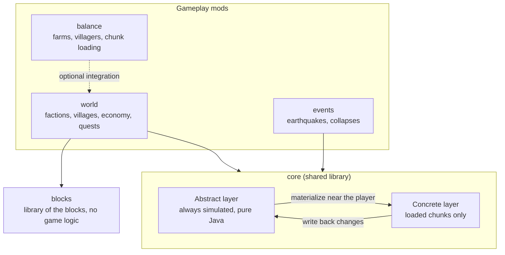
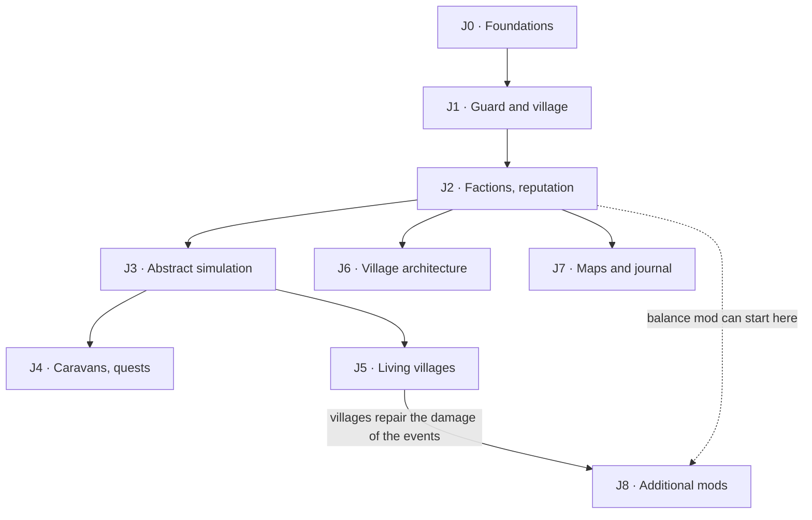

# Folkhold — Design document


## Vision and principles

Goal: a single-player Minecraft (NeoForge 1.21.1) where the world changes without the player. NPC factions trade, fight and take territory. Nature grows and ages. Natural events occur. There is less grind and fewer abusive automatic farms.

The project has a base modpack (existing mods) and three mods to develop:

- **World**: factions, villages, economy, quests.
- **Balance**: farms, villagers, chunk loading.
- **Events**: earthquakes, collapses.

Design principles:

- **The world lives without the player.** The mod simulates all important state (factions, stocks, territories) in an abstract form, also when the chunks are not loaded.
- **The player is one actor among others.** The player can influence the factions but cannot control them. No system needs the player to work.
- **Stable states, not infinite curves.** Prices, populations and budgets move toward an equilibrium. A disturbance creates a story. Then the system returns to equilibrium.
- **Less grind, not more farms.** Comfort comes from trade and NPCs, not from unlimited automation.
- **Everything is configurable.** Each rule has a setting (config or datapack). Balance changes do not need a new build.
- **Data-driven when stable.** Content (cultures, NPC recipes, structures, quests) starts in Java code. When a type of content is stable, it moves to JSON files in the mod jar, which a datapack can replace. Code and content stay separate.
- **Two languages.** All text that the player sees exists in English and French. Code uses translation keys only.

## Base modpack

The pack targets **NeoForge 1.21.1**. **packwiz** manages it: a versioned list in Git, updated with one command (`packwiz update --all`), exported as a `.mrpack` file. Prism Launcher and the Modrinth app import a `.mrpack` file in one click.

The pinned versions are in `modpack/mods/*.pw.toml`.

| Category | Mod | Modrinth slug | Pinned version | Note |
| --- | --- | --- | --- | --- |
| Performance | Sodium | `sodium` | 0.8.13 | Client only |
| Performance | Lithium | `lithium` | 0.15.4 | |
| Performance | ModernFix | `modernfix` | 5.27.26 | |
| Performance | FerriteCore | `ferrite-core` | 7.0.3 | |
| Performance | ImmediatelyFast | `immediatelyfast` | 1.6.14 | Client only |
| Performance | Entity Culling | `entityculling` | 1.11.3 | Client only |
| Performance | C2ME (NeoForge) | `c2me-neoforge` | 0.4.0-alpha.0.123 | Alpha; chunk generation, I/O and loading on more CPU cores |
| Performance | ScalableLux | `scalablelux` | 0.3.0-alpha.0.8 | Alpha; faster light engine |
| Performance | NoisiumForked | `noisiumforked` | 2.7.0 | Faster noise generation |
| Performance | Chunky | `chunky` | 1.4.23 | Pre-generation of the world before the play |
| Profiling | spark | `spark` | 1.10.124 | Measures the cost of each system for each tick |
| Nature | Dynamic Trees | `dynamictrees` | 1.7.2 | |
| Nature | Serene Seasons | `serene-seasons` | 10.1.0.9 | Requires GlitchCore |
| Nature | Smart Feeding Troughs | `smart-feeding-troughs` | 1.2.0 | Requires Dirigo |
| Terrain | The Roads More Travelled | `the-roads-more-travelled` | 0.5.1 | Beta |
| Aging | Immersive Weathering: Renewed | `immersive-weather-renewed` | 1.0.4 | Beta, unofficial port; requires Moonlight Lib |
| Navigation | Small Ships | `small-ships` | 2.0.0-b2.1 | Beta |
| Terrain | Tectonic | `tectonic` | 3.0.28 | Large continents, deep oceans, mountain ranges; requires Lithostitched |
| Light | LambDynamicLights | `lambdynamiclights` | 4.8.11 | Client only |
| Library | GeckoLib | `geckolib` | 4.9.3 | Required by `folkhold_world` |
| Comfort | JEI, Jade | `jei`, `jade` | 19.57.0.451, 15.10.6 | For development |

packwiz resolves most dependencies automatically (for example GlitchCore for Serene Seasons). Some mods do not declare a required library in their Modrinth metadata. Add these libraries explicitly:

- Immersive Weathering: Renewed requires Moonlight Lib.
- Smart Feeding Troughs requires Dirigo (1.3.0 or later, before 2.0.0).

Maintenance rules:

- Each update goes through a Git branch, a test launch and a test world before the merge.
- Pin the beta and unofficial mods (`packwiz pin`). This prevents a silent update that breaks the pack.
- During development, add our own mods to the pack as local files. If we publish them, add them through Modrinth.

## General architecture

The three mods use a shared library, `core`. The library separates two layers:

- The **abstract layer** always runs. It decides what happens (wars, stocks, travel).
- The **concrete layer** runs only in loaded chunks. It shows the result near the player. Then it writes the changes back to the abstract layer (deaths, raids, sales).



The balance mod has no dependency on `core` and stays usable alone. When the world mod is present, the balance mod uses it through an optional interface (for example to read village stocks).

The concrete layer reads the blocks only in chunks that are ready: loaded and complete (`ReadyChunks`). On the server, `Level.isLoaded` is also true for a chunk that has a ticket and a generation that is not complete. A read in such a chunk stops the server thread until the generation is complete. For example, the village heart does its work only when all the chunks of its scan area (24 blocks around the heart) are ready.

The blocks of all the mods are in the library `blocks` (mod `folkhold_blocks`). It has no dependency, except Minecraft and NeoForge. A block of the library has only its definition: shape, block states, placement of the parts, light, model, item, loot table, tags and names. The features of a block come from the other mods: block entity, click, scheduled tick, and actions when the block goes into the level or away. A mod registers one `BlockFeature` for a block (`BlockFeatures.register`). For example, the world mod gives the village heart its block entity, its screen and the destruction of the village. The ids `folkhold_world:<block>` of the blocks of the library resolve to the blocks of the library (registry aliases).

## World mod: factions, diplomacy, territories

When a new world starts, the mod creates 5 to 7 factions (`FactionGenerator.Settings.DEFAULT`):

- 1 or 2 factions that are allies of the player.
- 1 neutral faction.
- The other factions are hostile.

The villages come from the vanilla structure placement (random spread, spacing 40 chunks, separation 16). A village does not start when a possible vanilla village start is 8 chunks or nearer on the two axes (exclusion zone), so the two villages do not overlap. A village belongs to the faction with the nearest territory center, so the number of villages of a faction depends on the world.

### Glossary

| Term | Meaning |
| --- | --- |
| Territory | Disc of chunks around a village. The chunk is the unit of territory ownership (world mod). |
| Spawn cell | Square of 4×4 chunks. Unit of the spawn budget (balance mod). |
| Abstract tick | One step of the abstract simulation: every 2,400 game ticks (2 minutes). |
| Cycle | One game day (24,000 ticks = 10 abstract ticks). Production and consumption run once each cycle. |
| Level | Integer value (1 to 20) that measures the growth of a settlement. It sets the traits of the settlement. |
| Tier | Name for a range of levels: Hamlet, Village, Town, City, Capital. |
| Job | Economic activity of a settlement. A job has one recipe for each cycle. |
| Bank | Building of a village. Its chests contain the stocks of the village and a part of the treasury. |
| Mobile group | Group of NPCs that travels between villages: a caravan or a traveling merchant. |
| Route | List of points between two villages. A mobile group follows it. |
| Materialization | Creation of the entities of an abstract state near a player. The opposite operation removes the entities and writes their state back. |
| Quest board | Block in each faction village. It shows the quests of the village. |
| Ambush | Group of vanilla monsters that attacks an escorted caravan at a point of its route. |

### Data model

| Entity | Main fields |
| --- | --- |
| `Faction` | id, name, culture (village style, units), color and banner, treasury, military power, base attitude to the player, traits (expansionist, merchant, isolationist) |
| `Relation` | pair of factions, value from -100 to +100, state (alliance, peace, tension, war), date of the last change |
| `Territory` | claimed chunks (a disc around the village), owner village and faction, current contest |
| `Settlement` | id, faction, position, state (active or ruins), level, experience, tier (from the level), population, jobs, stocks, garrison |
| `MobileGroup` | id, kind (caravan, traveling merchant), faction, origin, destination, route, progress, cargo, members (stable UUID, role, health), state |
| `Quest` | id, kind (delivery, escort), giver, player, success condition, deadline, reward, state |

The mod stores all of this in `SavedData` of the Overworld level (settlements, mobile groups, quests, factions, reputations), written to NBT by hand with a version number.

### Simulation rules (abstract tick every 2,400 ticks = 2 minutes)

**Phase 1: living territories, no wars between NPCs.** Territories change mostly because of the player and because of the growth of the villages. The only military content is the defense of the villages. There are no patrols, no bandits and no armies.

**Implemented**:

- **Claim**: each village claims a disc of chunks around its position (its heart when the village exists). A chunk is in the disc when the distance from the position to the center of the chunk is not more than the claim radius. The claim radius comes from the level of the village (`claim_radius` in `levels.json`): 9 chunks (144 blocks) for a hamlet, 27 chunks for a city, 33 chunks for a capital. The radius is never smaller than the radius that contains all the blocks at 1.5 times the village radius (server configuration), so the territory contains all of the village and a margin. A chunk that two villages claim belongs to the nearest village. At equal distance, the village with the higher level gets the chunk.
- **Unclaimed land**: a chunk that no village claims.
- **Destruction of a village**: kill the captain and destroy the village heart (the central banner). The village becomes ruins. Its territory becomes unclaimed. The ruins stay in the world.

The faction of a new village is the faction with the nearest territory center.

- **Trade**: each trade between two villages creates a caravan. The goods arrive with the caravan (see "Trade between villages").
- **Relations**: each caravan that arrives raises the relation between the two factions a little.
- **Abstract caravans**: a caravan with no player near has no risk. It always arrives.

**Planned**:

- **Help a faction grow**: colonization quests (escort settlers, deliver materials) found a hamlet of this faction in unclaimed land.
- **Rally a village**: with sufficient reputation and a quest, a village can change its banner and join a different faction.
- **Natural growth**: a prosperous faction slowly founds a hamlet in unclaimed land near its territory (maximum one each game week).
- **Diplomacy**: relations change with trade and incidents. Relations decide which factions trade together.
- **Decline**: a faction with no village disappears. Its ruins stay in the world.

**Phase 2 (later)**: wars between factions, sieges, patrols, bandits, armies and NPC-against-NPC conquests, on the same simulation.

### Cultures

A culture is a template for factions: name, colors, banner, name syllables (for faction and village names), pitch of the voices of its units. **Implemented**: the cultures are Java definitions (`Cultures`). **Planned**: each culture moves to a JSON file in the mod (`data/folkhold_world/folkhold/cultures/<id>.json`), and a new culture then needs no code.

The factions of a world are not static content. The mod creates them when the world starts, from the cultures, and saves them in the world.

All cultures are human. **Planned**: non-human cultures (illagers, piglins).

## World mod: villages, NPCs, defense

Each faction village has fortifications and guards. A player in iron armor with no enchantments must lose a frontal attack. The player needs enchanted diamond gear, allies or a trick.

### Villages

- Generated as *jigsaw* structures, one set for each culture (building pools: center, houses, workshops, wall, towers, gates).
- The size follows the abstract state: a hamlet has a palisade, a city has a stone wall and archer towers.
- Settlement positions come from the seed. The village is a jigsaw structure with a vanilla placement (structure set, random spread). The game can calculate where a structure starts from the seed and the biomes, without the generation of chunks: the `/locate` command uses this method. The abstract simulation uses the same method to know the villages of a region before the player goes there, and it also applies the exclusion zone around the vanilla villages, as the chunk generation does. The discovery reads the placement from the structure sets of the chunk generator: in a world whose generator does not generate the faction villages, for example a vanilla Superflat world, it finds no village. The `/locate` command does not apply the exclusion zone: in chunks that the game did not generate, it can show a village that does not start. The discovery covers 1024 blocks around each player and the world spawn (`discoveryRadius`), and the simulation runs on all the discovered villages: the world around the player changes with no visit. The admin screen lists these villages, with the name in italics while the game did not generate them. Its discover action checks at once the regions up to 3000 blocks in each direction around the operator (`adminDiscoveryRadius`).
- Materialization: when the player comes near, the mod creates the garrison and the inhabitants from the `Settlement` state. When the player goes away, the mod removes them and writes their state back (health, deaths, equipment).
- Villagers: the villagers of a village are its population: the merchants, and the inhabitants for the rest of the population. The mod sets no maximum, so a city can have 100 villagers. The setting `inhabitantLimit` can set a maximum (0: no maximum), and the server and the other mods can limit the entities.
  - The first inhabitants are 2 builders and 1 handyman (settings `builders` and `handymen`), also in a small village. The builders build the construction sites of the village (see Construction). The handymen light the braziers in the evening and put them out in the morning (see Shelter at night). Then the workers show the jobs of the settlement: 2 inhabitants (`workersPerJob`) for each active job. The rest have no job: they give life to the village.
  - The builders and the handymen stay vanilla villagers (bed, bell, raids, zombies), with no trades. Only their model changes: a GeckoLib model with arms that move (place a block, use a brazier). It uses the vanilla textures of the villagers: the skin, the type and the profession. The other villagers keep the vanilla model.
  - The heart creates the villagers in groups of 4, one group every 2 seconds while a player is near.

### Vanilla villages in a territory

The Folkhold villages are the main settlements of a territory. A vanilla village inside the territory of a faction gets a small detachment of guards of this faction. It gets nothing more: no village heart, no garrison of a faction village, no quest board, no economy and no claim.

- A vanilla village is a bell with 2 beds or more in 32 blocks around it. A bell of a faction village does not count.
- Every 10 seconds, the mod checks the bells in 64 blocks around each player, in the loaded chunks.
- A vanilla village in a chunk that an active settlement claims gets 2 guards of the faction of this settlement. The setting `detachmentGuards` sets this number, and 0 turns off the detachments. The guards have the equipment of a hamlet. They spawn near the bell and patrol around it. They use the colors and the reputation of the faction: they defend the villagers against the monsters and against a hostile player.
- A dead guard comes back after the refill delay of the garrisons, when no guard of the detachment fights.
- When the territory changes owner, the guards change their faction. When no settlement claims the chunk, the guards go away. A vanilla village with no territory has no guards.
- When the bell is not there any more (a player broke or moved it), the detachment of this bell leaves. A bell at a new position is a new village for the scan.

### Village styles and terrain

- Each faction has an **architecture style**. There are 3 or 4 styles, and two factions can have the same style. Examples: Norse (long houses, steep roofs, axes), Medieval (cobblestone and timber frame, stone walls, swords and crossbows).
- A style sets the architecture of the buildings and some traits of the units and the village.
- Each style has **biome variants**: the buildings use the local materials (spruce in the taiga, sandstone in the desert).
- The village adapts to the terrain:
  - coast and river: docks, boats, fishing huts, bridges;
  - mountain and cliff: large houses against the cliff, terraces, walls that follow the terrain, or a village dug into the rock;
  - island: the wall follows the coast, piers are the access, stilt houses.
  - gates: the compound is flat. When the terrain outside a gate is higher or lower, the heart builds cobblestone stairs once (at most 6 steps): down with a support under each step, or up with the terrain above each step removed.
- A village is a group of pieces on the terrain (streets, houses, towers, walls), as the vanilla villages, not one large piece.

### Village growth

Growth is gradual. Each settlement has a **level** from 1 to 20. The tiers are names for ranges of levels. The level sets the traits of the settlement: claim radius, maximum population, job slots, stock capacity, number of trade offers, number of village cats, the units of the garrison and their equipment. A data file holds the level table, the tier table and the traits. More levels and tiers can exist later.

| Levels | Tier | Trades |
| --- | --- | --- |
| 1–4 | Hamlet | Basic offers |
| 5–8 | Village | More offers, better prices |
| 9–12 | Town | Specialized craftsmen |
| 13–16 | City | Rare offers, inn, advanced quests |
| 17–20 | Capital | All offers |

- **Start level**: when the mod creates a settlement, the settlement gets a random start level from 1 to 16 (configurable chances). Only growth makes a Capital. A settlement with a higher start level also starts with more stocks.
- **Experience**: at each cycle, the settlement gets experience from its prosperity: food need covered, inputs of the jobs available, treasury above a minimum. The experience for each level increases with the level.
- **Loss**: a shortage of food, a pillage of the bank or the death of the captain removes experience. A settlement can go down one level.
- **Level event**: the mod sends an event when the level changes. Other systems can use it, for example the physical growth.
- **Garrison**: the garrison follows the level of the village (see "Balancing"). When the level changes, the heart adds the missing units, and the units that are alive get the equipment of the new level.

**Implemented**: the level does not change the blocks of the village. The variants of the village are simple and do not change the structure.

**Physical growth (planned, J6 · Village architecture)**: the village grows in the world. New buildings, larger walls, farms, mills, fields, a forge. Each building, wall section and defense has a minimum level. The growth uses the construction system of J5 · Living villages.

### Construction

The construction system changes the blocks of the level into the blocks of a **target**. A target is a set of block states at positions, for example a building of the village. The repair of the village (J5) and the physical growth (J6) use it.

**Implemented**: the plan, the kinds of the blocks, the capture of a target and a run with no villager. Also the construction tool of the operators, the construction sites of the builders and the repairs of the villages.

- **Plan** (`folkhold_core`): from a target and the blocks of the level, the planner makes an ordered list of steps. A step removes a block, places a block, places or removes scaffolding, or adds a fluid. Each step has the full state of the block (facing, axis, half, shape) and the position where the builder stands.
- **Order**: the plan removes the obstacles first: the attached blocks first, then from the top to the bottom. A block that needs an obstacle as its support also goes, and comes back if the target has it. Then the placements go from the bottom to the top. A block comes after the block that holds it: a falling block after the block below it, an attached block after its support. A connected block comes after the solid blocks next to it. One step places the two parts of a door, a bed or a tall plant.
- **Fluids**: the sources of water and lava come at the end. A waterlogged block goes in place with no water, and gets its water at the end. A flowing fluid is not part of a target: it comes back from its source.
- **Reach**: a builder places and removes the blocks of a zone around its feet. The zone goes 2 blocks on the X axis and on the Z axis. On the Y axis, it goes from the layer of the floor of the builder to one block above its head (config `construction.reachHorizontal`, `reachBelow` and `reachAbove`).
- **Position to stand**: a builder stands in a free space of two blocks, on a block with a full top face. It does not climb on the top of a new wall, which is 1 block wide. The block below the builder is one of these blocks:
  - a block of the level, or the scaffolding of the plan
  - a block that the plan puts directly on a block of the level, for example the floor of a house on the ground
  - a block of the plan in a square of 2 × 2 floor blocks. Examples: the floor of a house on its foundation, the floor of an upper storey.
- **Scaffolding**: with no position to stand, the plan adds a column of vanilla scaffolding next to the block. The builder stands on the column, with the block at the height of its head. Under a roof, the block can be one block above the head. The plan selects a column on the ground before a column on a block of the plan, so the columns stand around a new house. Then it selects the column with the fewest new blocks: a column on top of an existing column makes it higher. The column stays out of the positions that the target fills, and it does not stand on a block that a later step removes. The plan removes the scaffolding at the end, from the top.
- **Warnings**: the plan reports these problems of a target: a falling block above air, an attached block with no support, a cycle of supports. It also reports a block with no position to stand.
- **Kinds of blocks** (`folkhold_world`): the class of a block gives its kind and the side of its support. The block state gives the side (`face`, `facing`, `hanging`, the half of a door). A trapdoor, a chain, a flower pot, a grindstone and a wall hanging sign stay in place alone. They come after the block on their side. A fence, a wall, a pane, stairs, a chest, a fence gate and a tripwire get their shape from their neighbors. Redstone wire is an attached block. The block tags `folkhold_world:construction/support_below` and `folkhold_world:construction/support_above` add the special cases, for example sugar cane and cave vines.
- **Block data**: the construction keeps the data of the blocks in the block tag `folkhold_world:construction/keep_data`. Examples: the text of a sign, the patterns of a banner, the profile of a head. The items of a container do not come with the block.
- **Capture**: a target comes from a box of the level, or from a structure template at a position, with its rotation and its mirror. A jigsaw block becomes its final state, as in a village.
- **Run**: a run applies the steps of a plan, with a number of steps for each tick. It puts the blocks directly, with no villager. It uses no items, and no block drops an item. The other part of a door or a bed goes first with no update, so that the primary part does not break.
- **Builders**: the builders of a village build a structure block by block, as players do. The village is the nearest village heart at the village radius from the center of the structure, or nearer.
  - The work zone is the box of the structure and a band of the horizontal reach around it. First, the builders put spruce fences on the ground at the edge of the zone. The ring of fences has an opening on the side of the village. Then they apply the steps of the plan in their order. At the end, they remove the scaffolding that stays and the fences.
  - Each builder claims the next free step. It walks to a position where the block is in its reach zone: the position to stand of the plan, or a free position near the block. It looks at the block and moves its arm. Then the block changes, with the sound of a placement or the particles of a break. One step takes 20 ticks (config `construction.builderTicksPerStep`), and a step of the scaffolding takes half this time. Thus a builder puts about 1 block each second, plus the time to walk. A builder that is in position for the next step takes it from a builder that walks to it.
  - For a position on a scaffolding column, the builder walks to the bottom of the column and climbs it. To go to another position, it goes down the column first. A builder adds and removes the blocks of a column from its bottom, as a player does.
  - A builder that cannot get to its position in 15 seconds goes there directly. With no free position, it works from where it is. A block does not go into an entity: after 2 seconds, the entity moves to a free position near it.
  - The builders work during the day, when the village is calm. At night and during an alert, they go down from the scaffolding and stop. When a player is in the work zone, the builders stop and look at the player. Every 5 seconds, the player gets a message above the hotbar: go out of the zone.
  - The builders never change a block that a player placed in the village (see Repairs). The step of this position goes with no change.
  - The sites of one village come one after the other. Each level keeps its sites (`folkhold_builder_sites.dat`): the template, the position, the phase, the fences and the scaffolding. After a load, a site makes a new plan from the blocks of the level.
  - Chunks not loaded: during the day, the builders of the oldest site of a village go on with the work in the abstract. Each builder of the village (`builders`) does 1 step each `construction.builderTicksPerStep` ticks. The site keeps the steps of this work. When the chunks load, the site applies these steps before the builders go on: 32 steps at most for each tick (`construction.catchUpStepsPerTick`). Thus a player who comes to the village sees the work of this time. No chunk stays loaded for a site.
  - A step that an entity blocks, or that waits for materials, stops this work: the builders go on from this step.
  - Materials: the builders take the materials of each block from the stock of the village. The cost of a block is in items of the economy. It comes from the recipes of the server: crafting, smelting, stonecutting, and the axe that strips a log. Example: 1 oak stairs costs 1.5 oak planks. The parts of items that the builders took and did not use stay in the site for the next blocks. They go back to the stock at the end.
  - A block waits when the stock does not have its materials. The steps after it wait too.
  - A rare block has no recipe from the items of the economy, for example calcite. A valuable block costs 1 emerald or more (`construction.valuableBlockPrice`), for example a gold block. The builders take a rare or a valuable block as it is from the stock. The village asks the players for it at once with a delivery quest, and the delivered blocks go into the stock.
  - The village also asks for a common material when the builders wait for it for 5 minutes (`construction.materialQuestMinutes`).
  - The fences of the work zone and the scaffolding use no materials. A removed block drops no item.
  - With the setting `construction.freeMaterials`, or in a village with no economy, the builders use no materials.
  - The blocks of the block tag `folkhold_world:construction/free_materials` use no materials: the blocks of the village library and the bell. The village makes them.
- **Repairs**: the builders of a village repair the damaged blocks of the village (config `construction.repairs`).
  - Reference: the structure pieces of the village at the generation: the center, the bank and the houses. The repairs change only the positions of the pieces inside the palisade. The gates give the size of the palisade. Thus the stairs of the gates stay.
  - Every 60 seconds (`construction.repairCheckSeconds`), a loaded village heart compares the blocks of the village with the reference. It does this when the village is calm, has builders and has no site.
  - The comparison ignores the changes that come with the life of a village. Examples: open doors and gates, lit braziers, the color of the banners, the age of the plants. It also ignores the connections of the fences and the walls, the shape of the stairs and the water in a block. Grass, dirt, podzol and paths are one soil (block tag `folkhold_world:construction/repair_soil`). Water and ice are equal, and a brazier can take the place of a campfire.
  - On an empty position, the repairs keep the blocks of the weather and of the plants: snow, grass, flowers, trees (block tag `folkhold_world:construction/repair_natural`). The jigsaw blocks and the structure blocks also stay.
  - The repairs never change the blocks that a player placed in a village. When the player breaks such a block, the repairs can change the position again. The repairs also keep the boxes of the construction sites of the village: the new buildings. Each level keeps these positions (`folkhold_village_repairs.dat`).
  - The damaged blocks make groups: two blocks at 3 blocks or less on each axis are in the same group. The builders repair the largest group first, with a repair site: fences, materials and quests, as for a construction site. A repair asks at once for the materials that the stock does not have, with delivery quests. The quests follow the stock: an offered quest changes to the new missing quantity, and goes away when the stock has the item. With the setting `construction.freeRepairs`, the repairs use no materials.
  - After a repair, its positions wait 20 minutes before a new repair. Thus a block that does not stay in place does not start a repair at each check. At the end of a repair, the heart gives the color of the faction to the banners again.
- **Commands** (operators): `/folkhold construction build <template> [stepsPerTick]` builds a structure template at the position of the player, and `/folkhold construction build <template> builders` gives it to the builders of the nearest village. `/folkhold construction capture <from> <to>` keeps the blocks of a box, and `/folkhold construction restore [stepsPerTick]` puts them back. `/folkhold construction sites` shows the sites of the builders: phase, steps, state, builders and missing materials. A repair site shows the number of its blocks. A site shows the steps of the work that wait for the load of its chunks. `/folkhold construction stop` stops the constructions and the sites of the level: the fences and the scaffolding of a site go away. Each command that builds with no villager shows the steps and the warnings of its plan.
- **Loaded chunks**: a construction starts only when its chunks are ready (loaded and complete). These chunks contain the box of the construction and a margin of the horizontal reach plus 1 block. The plan reads the blocks in this margin for the positions to stand and the scaffolding.
- **Construction tool** (operators): `/folkhold construction place` opens a menu with the structure templates of the server, a text filter and the speed of the construction. The speeds are slow, normal, fast and "builders": the builders of the nearest village build the structure. A key can also open the menu. After the selection, a ghost of the structure follows the block that the player looks at, 64 blocks away or nearer. The ghost stands on this block, with its center above it.
  - The ghost shows the blocks of the structure, translucent, and the box of the structure. A red outline shows each block of the level that the construction removes. Grass and flowers have no outline.
  - Keys: turn by 90 degrees (R), mirror (M), lock the position (G), build (Enter), remove the ghost (Backspace). The arrow keys, Page Up and Page Down move the ghost by one block, and lock it. The panel above the hotbar shows the keys.
  - The key "build" sends the template, the origin, the turn and the mirror to the server. The server checks the permission and the size of the structure: 32,768 blocks at most, air included. It also checks the distance (96 blocks at most) and the loaded chunks. Then it starts the construction as the command `build`. With the speed "builders", it starts a site of the builders of the nearest village.
  - During the construction, the ghost shows only the blocks that are not in place. It goes away when all its blocks are in place. It also goes away at the end of the construction, and when the command `stop` stops the construction.

**Planned**: new elements go into the **construction queue** of the settlement (growth, J6). The builders build them, also while the chunks are not loaded.

### Reputation and welcome

- The mod tracks reputation **for each player**, **for each village** and **for each faction**. The key is the UUID of the player, so multiplayer stays possible.
- Village reputation and faction reputation use the same range: -1000 to +1000.
- The behavior of a village uses the **effective reputation**: 70 % village reputation + 30 % faction reputation. The two weights are configurable.
- When the player enters a village:
  - Hostile: the guards attack.
  - Neutral: the guards watch and give a warning.
  - Friend: the guards greet the player and the gates stay open.
- Two villages of the same faction trade together first (see the economy section).
- **Pillage**: to open or to break a bank chest is a pillage. Before a player opens a bank chest, a screen asks for a confirmation. After a pillage, the village reputation and the faction reputation of the player go to a very negative value (default -800, sworn enemy). The village goes to the alert state. An explosion that a player caused is also a pillage.
- Information for the player:
  - When the player enters the territory of a faction, a small banner at the top of the screen shows the faction banner, "Lands of" and the faction in its color, and the reputation tier with its glyph and color, for some seconds. This is an early warning before the villages.
  - Near a village (50 blocks from the heart, configurable), the action bar shows the village name, the faction, the level, the tier and what the guards do ("✓ Friend: the guards greet you").
  - Important events show in a toast at the top right of the screen, not in the chat: the warning of a guard, the result of a quest, a pillage, and the warnings of a bank chest and a caravan mule. The same warning shows at most once in 10 seconds.
  - A HUD panel (client option, on by default) at the top right of the screen, below the vanilla effect icons: the banner and the name of the faction that owns the territory, the tier of the player with its glyph and color, and the nearest village of the territory (also a village that the game did not generate yet) with its distance and an arrow to it.
  - The village heart opens a screen with the village information.

### Shelter at night

- At night, the guards light torches and braziers, close the gates and patrol the walls. A brazier (block of the library) is 1.5 blocks high, so the mobs do not jump on it, and it does not burn the entities. A campfire of the village layout becomes a brazier.
- Braziers: the handymen of the village light the braziers in the evening and put them out in the morning. The times come from the schedule of the vanilla villagers.
  - Evening: from the day time 11000, when the villagers stop their work, to the rest time of the villagers (12000).
  - Morning: from the end of the rest time (day time 10) to the day time 2000, when the villagers start their work.
  - A handyman takes the nearest brazier that no other handyman took. It walks to a position next to the brazier, looks at the brazier and uses it: the brazier changes.
  - A handyman works when it is awake and calm: not in bed, not in the rest time, not in a panic or a raid.
  - The village heart lights the braziers that do not burn at the start of the night. In a village with no handymen, the heart puts out the braziers at the start of the day. In a village with handymen, the braziers burn until the handymen put them out. At the day time 2000, the heart puts out the braziers that burn.
  - A handyman that cannot go to a brazier stops. No handyman tries this brazier again in the same period, and the heart changes it at the end of the period.
- The village heart prevents monster spawns in its area.
- Village cats stay near the gates and the center. The creepers run away from them. The player cannot tame them.
- A neutral or friendly player can take shelter in the village. From the Town tier, the player can rent a bed at the inn for emeralds.

### Raids against the faction villages

The vanilla raid stays. Near a faction village, Folkhold changes where the raiders spawn and how they march on the village. A raid is at a faction village when a loaded village heart is 64 blocks or less from the center of the raid.

- Spawn: all the raiders of a wave spawn at one position, 40 to 56 blocks from the heart. The position is on natural ground (tag `folkhold_world:raid_spawn_ground`: dirt, sand, stone, terracotta, gravel, paths and snow), on land and under the open sky. It is not in a hole or a ravine, it has room for a ravager, and it has a path to the village. When no position is good, the raiders keep the vanilla position.
- March: a raider walks to the approach of the nearest gate, 8 blocks outside the gate. In water, the approach is at the surface. At an open gate, it goes through the gate to the heart, and it keeps this way while the gate stays open. At a closed gate, it waits outside. It swims across the rivers.
- When a raider has a target, it attacks. When it loses the target, it marches again. At 12 blocks from the heart, the raider arrives: the vanilla goals of the raid move it in the village. After its arrival, a raider marches again only when it is outside the palisade.
- The raiders target the faction units, as the other monsters do. A garrison can stop a wave outside the palisade.

### NPC types

| NPC | Role | Key behavior |
| --- | --- | --- |
| Inhabitant | Population, economic job | Day/night routine, runs away from fights, takes shelter in buildings |
| Builder | Constructions of the village | Inhabitant with no economic job, with an animated model. Puts fences around a site, builds it block by block, climbs the scaffolding. Stops at night, during an alert, and when a player is in the work zone |
| Handyman | Small work of the village | Inhabitant with no economic job, with an animated model. Lights the braziers of the village in the evening and puts them out in the morning |
| Merchant | Trade with the player | Sells the stocks of the village, buys the items of the player. Compatible with the vanilla villager systems (raids, Hero of the Village, zombie conversion, iron golems, gossip) |
| Guard | Basic defense | Fixed patrol, sword and shield, chases in a limited radius |
| Archer | Ranged defense | Takes position on towers and walls. Priority target: hostile players. A bow, or a crossbow in the larger villages: it charges the crossbow, aims and shoots a faster bolt |
| Rider | Interceptor | Rides a faction horse with a saddle and a leather horse armor in the color of the faction. Patrols on a ring outside the walls, and goes through the gates on its horse. Charges the threats near the village at a gallop, then goes back to its patrol. When its horse dies, fights on foot and gets a new horse after the refill delay. A player cannot ride the horse. A horse with no rider disappears after 30 seconds. From the Town tier |
| Faction golem | Heavy unit | Model and animations of the vanilla iron golem, with an armband in the color of the faction. Guards a post inside a gate, or the center when the village has more golems than gates. Very resistant and slow. Chases a target only near its post. Its attack throws the target up. In a village with faction golems, the villagers do not call vanilla iron golems. From the City tier |
| Captain | Garrison leader | Morale buff, general alarm. Its death lowers morale (some units run away) |
| Healer | Field medic | Heals a wounded unit of its village with a bandage. During an alert, stays near the captain, behind the fighting units, and gives a short buff (regeneration and resistance) to the units near it. Long cooldowns and a limited supply of bandages that refills while the village is calm. Does not attack, runs away from threats. Not in a hamlet |

### AI

- Based on the `Goal` system of `PathfinderMob` (simpler than the `Brain` system to start). Each village has a shared state: *calm*, *alert*, *assault*.
- An alert spreads. An attack on a guard starts the alert. Then:
  - the bell of the village rings;
  - all units of the village get the position of the threat;
  - the archers go to their positions;
  - the gates close;
  - the inhabitants hide.
- Archers: when the village is calm, each archer moves between the towers at random intervals. A tower with a large view to the outside has a higher chance. When the village is in alert, each archer goes to the nearest free tower: one archer on each tower, if possible. A tower with no view is not used.
- Aggression depends on reputation. Below the hostile threshold, the guards attack on sight. At neutral, they give a warning, then attack if the player breaks blocks or steals.

### Balancing

Difficulty target: a player in iron armor with no enchantments loses a frontal attack against the garrison of an average village in most cases. This is a design target, not an automatic test.

All values are configurable, with a global difficulty multiplier. This lets us adjust the difficulty without a new build:

- the health, the damage and the armor of each unit type: server config;
- the heal value, the cooldowns and the supply of the healer: server config;
- the chase radius and the knockback resistance of the faction golem: server config;
- the patrol radius of the riders, and the health and the speed of their horses: server config;
- the number of units of each role for each level: `garrison` in the level table (`levels.json`);
- the equipment of each role for each level: the equipment set of the level (`equipment` in `levels.json`), defined in `garrison_equipment.json`. A role can have variants: each unit takes one variant, from its id. The archers of the town, the city and the capital have a bow variant and a crossbow variant.

The garrison and its equipment grow with the tier. The units do not drop their equipment.

| Tier | Guards | Archers | Captain | Healers | Golems | Riders | Equipment |
| --- | --- | --- | --- | --- | --- | --- | --- |
| Hamlet | 2 | 2 | 1 | 0 | 0 | 0 | Iron (guards, captain) and chainmail (archers) |
| Village | 3 | 2 | 1 | 1 | 0 | 0 | Same, with Protection I and Power I |
| Town | 4 | 3 | 1 | 1 | 0 | 1 | Diamond swords, Protection I to II, a crossbow for some archers |
| City | 5 | 4 | 1 | 1 | 1 | 2 | Diamond (guards, captain), Protection II, Sharpness II, Power II, Quick Charge I |
| Capital | 6 | 5 | 1 | 2 | 2 | 3 | Diamond and netherite, Protection III, Sharpness III, Power III, Quick Charge I and Piercing I |

Most villages start as a hamlet. The garrison of a hamlet keeps the difficulty target.

## World mod: simulated economy

Each village has real stocks. It produces and consumes according to its jobs. It sets its prices from the difference between stock and need. Villages trade together. The player is one more customer.

### Jobs and recipes

Each job has one recipe for each cycle (1 game day = 24,000 ticks = 10 abstract ticks). Production and consumption run once each cycle, not on each abstract tick. The jobs and the recipes are data files (`data/folkhold_world/folkhold/jobs/<id>.json`). The culture and the biome select the jobs and the materials (spruce in the taiga, sandstone in the desert). The level of the settlement sets the number of job slots and the minimum level of some jobs.

The jobs cover most of the base items of the Overworld. The player crafts the other items. The jobs do not produce:

- rare items: netherite, elytra, totems, tridents, heads, enchanted books, enchanted golden apples;
- items of the Nether or the End;
- items of ancient cities, trial chambers, ocean monuments, strongholds or similar structures.

| Family | Job | Consumes | Produces |
| --- | --- | --- | --- |
| Food | Farmer | — | wheat, carrots, potatoes, beetroots, seeds |
| Food | Gardener | — | pumpkins, melons, sugar cane, sweet berries, cocoa beans |
| Food | Baker | wheat, sugar, eggs, milk | bread, cookies, cakes, pumpkin pies |
| Food | Rancher | wheat, seeds | eggs, milk, feathers, livestock |
| Food | Butcher | livestock, coal | raw and cooked meat, leather |
| Food | Fisher | string | cod, salmon, ink sacs |
| Food | Beekeeper | — | honey bottles, honeycombs |
| Raw materials | Lumberjack | — | logs, planks, sticks, saplings, apples |
| Raw materials | Miner | tools (wear) | cobblestone, raw iron, raw copper, coal, flint, redstone, lapis lazuli, raw gold (small), diamonds (very small) |
| Raw materials | Digger | tools (wear) | sand, gravel, clay, dirt |
| Raw materials | Shepherd | wheat | wool, mutton |
| Raw materials | Forager | — | mushrooms, flowers, bamboo, kelp, vines, cactus |
| Processing | Smelter | raw metal, sand, coal | ingots, glass, charcoal |
| Processing | Mason | cobblestone, clay, sand | stone, stone bricks, bricks, terracotta, sandstone, smooth stone |
| Processing | Dyer | flowers, ink sacs, cocoa beans | dyes, dyed wool |
| Processing | Papermaker | sugar cane, leather | paper, books |
| Crafted goods | Blacksmith | iron ingots, coal | iron tools, weapons, armor, shields |
| Crafted goods | Fletcher | sticks, flint, feathers, string | arrows, bows, crossbows |
| Crafted goods | Carpenter | planks | chests, barrels, doors, fences, boats, crafting tables |
| Crafted goods | Tanner | leather | leather armor, saddles, bundles |
| Crafted goods | Weaver | wool, planks | beds, carpets, banners |
| Crafted goods | Tinker | iron ingots, copper ingots, redstone | buckets, shears, rails, minecarts, lanterns, lightning rods |

A recipe with no inputs produces nothing. The job goes into "need" state and buys.

The population consumes food at each cycle.

### Price formula

```math
P = P_{base} \times \mathrm{clamp}\left( \left( \frac{S_{target}}{\max(S, 1)} \right)^{\varepsilon},\ 0.5,\ 3 \right)
```

- `S` = current stock.
- `S_target` = stock target of the village.
- `ε` = elasticity (default 0.5).

A surplus lowers the price down to ×0.5. A shortage raises the price up to ×3. The sell price to the player is `P × 1.15`. The buy price from the player is `P × 0.85`.

### Trade between villages

- On each abstract tick, each village makes a list of its surpluses (`S > 1.5 × S_target`) and its needs (`S < 0.5 × S_target`).
- A greedy match links one seller and one buyer from factions that are not hostile. Distance is a weight.
- Two villages with no route between them do not trade.
- Each trade creates a **caravan** (see "World mod: caravans, squads, traveling merchants"). The goods leave the stock of the seller when the caravan leaves.
- When the caravan arrives, the goods go into the stock of the buyer and the payment goes to the treasury of the seller. The time of travel comes from the length of the route.
- If the caravan is raided (by the player in phase 1, also by bandits in phase 2), the goods are lost.
- Expected result: prices converge between connected villages. A war that cuts a route makes prices go up on one side.

### Trade with the player

- The **merchant** of the village sells **only what the village has in stock**. There is no magic restock and no "fast reset". The number of offers comes from the level.
- No trade below the neutral tier. Friends and allies get a discount.
- The player can sell surplus items (ore, crops). This lowers their local price. To get the best price, the player must sell in different places.
- The currency stays the emerald. The treasury of each faction is finite. Its sales fill it.

### Bank

- Each village has a bank with bank chests. The bank chests show the stocks of the village and 40 % of the treasury that belongs to the village (configurable). When a player takes items, the mod removes them from the stocks and from the treasury.
- To open or break a bank chest is a pillage (see "Reputation and welcome").
- The bank chests and the walls of the bank resist explosions. A creeper or TNT does not break them by accident.

### Professions and offers

- Rails and minecarts (rail, powered rail, detector rail, activator rail, minecart variants), from the tinker.
- **Lumberjack**: logs and planks of different wood types.
- **Traveling merchant**: rare items, very expensive, small quantities, slow restock (as the wandering trader). See "Traveling merchant".
- No overpowered enchanted books (for example Mending) in the offers.

### Stability

To prevent runaway loops:

- The population sets a maximum production.
- The warehouse size sets a maximum stock.
- A small consumption (rot, wear) removes 2 % of the stocks on each cycle.

## World mod: caravans, squads, traveling merchants

Mobile groups travel in an abstract form along a route. They become entities only when their position comes near the player.

### Mobile groups

| Group | Phase | Origin | Content | Player interaction |
| --- | --- | --- | --- | --- |
| Merchant caravan | 1 | Trade between villages | Merchant, loaded mules, 2 to 4 guards | Trade on the road, escort (quest), raid (reputation) |
| Traveling merchant | 1 | Neutral faction | 1 merchant + pack animal | Rare stock, moves from village to village |
| Patrol | 2 | Faction, around its territory | 3 to 6 soldiers, sometimes one rider | Hostile, neutral or ally, as a function of reputation |
| Army | 2 | Faction at war | 10 to 30 units | The player can join (ally) or harass it |
| Bandits | 2 | Fallen faction or event | 3 to 8 outlaws | Hostile, raid caravans |

### Abstract movement

- A route is a list of points between two villages. The mod generates it once: an approximate line on the heightmap that avoids deep water.
- The group moves N blocks on each abstract tick. The mod interpolates its position on the route.
- When the position enters the simulation distance of a player, the mod materializes the group at the nearest point. The group then uses the vanilla pathfinding over short distances.
- When the group leaves the area, it becomes abstract again and keeps its state (losses, cargo).
- Encounters (phase 2): two hostile groups on near segments fight. A comparison of power with a random factor gives the result. If the player is present, the fight is real.

### Routes

- The mod calculates the route once, before the first caravan between two villages leaves. It keeps the route in the world data.
- The heights come from the chunk generator, as the settlement discovery does. The calculation does not generate chunks.
- Two levels of routes:
  - The **coarse route** uses a grid of 32 blocks. Slopes have a cost. A route has a maximum length. The trade uses the coarse routes to find the partners. When there is no route, the two villages do not trade. The mod keeps this result too.
  - The **detailed route** uses a grid of 4 blocks, in a corridor of 48 blocks around the coarse route. A height step of more than 3 blocks between two cells is a cliff: the route goes around it. If the corridor has no route, the search tries again with a corridor two times wider. If there is still no route, the group uses the coarse route.
- Each segment of a route has a surface: land, ford (water of 2 blocks or less), water or road. On water, the group crosses in boats. Getting into and out of the boats has a cost, so a route goes around a small lake.
- **Roads**: the routes use the roads of the world (`RoadNetwork`). The tag `folkhold_world:road` has the road blocks: paths, gravel, cobblestone, bricks, planks, slabs, the blocks of The Roads More Travelled. A column of blocks is a road when a road block has 2 blocks of free space above it. The highest such block counts, also under a roof. The mod reads the roads of a chunk when the chunk loads and unloads, and one column after a player changes a block in it.
  - A cell with a road has a second level at the height of the road, with no water. Thus a route takes a bridge instead of a ford or boats, and a tunnel or a covered bridge instead of a pass. A road far below the terrain (a mine) has no entrance within the height limit, so the route does not use it.
  - On a detailed route, a move on the roads costs 0.7 times its length. The heuristic uses the same factor, so the search finds a road near the direct line.
  - The merchant walks to the height of the road on a road segment: in a tunnel, not on the mountain above it.
  - When the roads near a route change, the mod forgets the route and calculates it again at the next need. It does this every 30 seconds for all the changed chunks.
- A new group waits at its village until its detailed route is ready, also after its departure time. The escort offer stays open. The mod keeps the detailed route for the next groups between the same villages.
- One column of the terrain noise gives the 2 heights of a cell (the surface, water included, and the floor). One column costs a calculation of the terrain noise, and a search reads thousands of columns. A worker thread calculates the routes. The simulation uses only the routes that are in the world data, and a group or a trade waits for its route. When an error stops a calculation, the world data gets no result, so the simulation can ask again, and a group that waits for its detailed route continues with its coarse route. The search uses a weighted heuristic: it examines fewer cells, and a route can be a little longer than the best route.

### Benchmarks

- Each system of the simulation records the time of its calls: number, average, maximum, last call, total. The coarse and the detailed routes record the time of their calculation on the worker thread.
- `/folkhold sim profile` shows the measurements and the routes on the way. `/folkhold sim profile reset` clears them.
- A system call that takes more than 50 ms writes a warning in the log.
- Spark gives the complete profile of the server.

### Materialization

- Each member of a group has a stable UUID. The entity of a member always has this UUID. This prevents duplicates.
- The mod materializes a group when its position enters the distance of a player. It dematerializes the group when no player is in this distance plus a margin, and before the chunk of an entity unloads.
- While the group is materialized, the position of its merchant sets its progress on the route.
- At the dematerialization, the mod writes back the health and the death of each member, and the cargo.
- The mod removes an entity of a group that loads from a chunk while its group is abstract.

### Caravans

- A caravan has a merchant (it looks like a wandering trader), loaded mules (vanilla mules with chests) and 2 to 4 guards. The level of the origin village sets the number of guards. The merchant walks on the route. The mules follow the merchant.
- The guards of a caravan have no village anchor. They follow the merchant and defend the members. The center of their chase radius is the merchant.
- **Convoy**: the merchant is a little slower than the mules and the guards. When a member is more than 10 blocks from the merchant, the merchant waits (20 seconds or less).
- **Departure**: at the start of the route, the merchant goes to a point of the route at 40 blocks or more from its start, out of the walls of the origin village. Its path goes through a gate.
- **Arrival**: near the end of the route, the merchant goes to the heart of the destination. Its path goes around the walls and through a gate. The caravan arrives when the merchant is at 8 blocks or less from the heart. If the heart is not known, the caravan arrives at the end of the route.
- **Gates**: the merchant opens a closed gate (all its fence gates, so a mule can go through) and closes it again after the members of the caravan.
- **Boats**: at the start of a water segment, the merchant and the guards get into vanilla boats, two in each boat. The first boat follows the route, and the other boats follow it in a line. The mules swim behind the boats. At the end of the segment, the members get out on the shore and the boats disappear. A player cannot break or use these boats.
- After the arrival, the members stay in the village for some time. The mule chests are empty, because the goods are in the stock of the destination. The members disappear after 30 seconds when no player is near, or after 3 minutes.
- **Trade on the road**: the caravan merchant sells the items of the cargo, with the prices of the origin village. The reputation rules of the village merchant apply.
- **Cargo**: while the caravan has entities, its cargo is in the chests of its mules. A dead mule drops its chest. When the cargo gets smaller (sale, theft, dead mule), the payment at the arrival gets smaller in proportion.
- **Raid**: an attack on a member of the caravan or the opening of a mule chest is a raid. A raid lowers the reputation with the faction of the caravan (once in each offense window), and the guards attack the player. A caravan mule does not carry a player.
- When the merchant dies, the caravan is lost. The goods do not arrive.

### Traveling merchant

- The neutral faction has traveling merchants: 1 merchant and 1 pack animal. A traveling merchant goes from village to village and stays near each village for some time.
- It sells rare items: very expensive, small quantities, slow restock, as the wandering trader. No overpowered enchanted books, and no item from the Nether: the caravans and the traveling merchants carry only items of the Overworld.
- Each traveling merchant sells 6 items of this list. At each cycle, it gets back one item of one offer.

| Item | Price (emeralds) | Maximum |
| --- | --- | --- |
| Name tag | 12 | 2 |
| Saddle | 10 | 1 |
| Ender pearl | 6 | 4 |
| Nautilus shell | 16 | 1 |
| Golden apple | 14 | 1 |
| Diamond | 12 | 2 |
| Slime ball | 4 | 4 |
| Glow ink sac | 4 | 4 |
| Amethyst shard | 3 | 8 |
| Spyglass | 12 | 1 |
| Music disc "cat" | 20 | 1 |
| Cherry sapling | 5 | 2 |
| Mangrove propagule | 5 | 2 |
| Sea pickle | 3 | 4 |
| Pointed dripstone | 3 | 4 |

- At the end of its route, a traveling merchant stays near the village (10 minutes by default). Then it goes to one of the 5 villages nearest to it.
- The world has 2 traveling merchants by default. With no neutral faction, it has none.

### Commands and admin screen

- `/folkhold caravan list|info|spawn|tp|remove`: follow, make, find and remove the mobile groups.
- `/folkhold quest list|give|complete|fail`: the quests of a player. `give` makes a delivery or an escort of the village nearest to the player.
- `/folkhold settlement route <from> <to>`: calculates a route again and shows its time.
- `/folkhold construction build|place|capture|restore|sites|stop`: builds a structure template, places it with a ghost, or puts back the blocks of a captured box. The builders of a village can also build a template (see Construction).
- `/folkhold admin` opens the admin screen (operators only). Left: all settlements of the world, with a text filter and chips for the state, the level range and the sort order. Right: the selected settlement, with its badges (level, state, alert), its rows and its largest stocks.
- The actions of the admin screen are in menus: Village (teleport, set the level, add experience, restore, ruin), Economy (one cycle, reset), Garrison (alert state, bells, if the heart is loaded) and World (copy the position, the id or a `/tp` command). The header has Refresh, Simulation (one tick or one cycle for all settlements, and the discovery of the villages up to 3000 blocks around the operator now) and "Caravans and quests": three tabs with the caravans, the traveling merchants and the quests of the world.
- The result of an action shows in the status line of the screen. To ruin a settlement, the operator types its name. To reset an economy, the operator confirms.

### Synergy with the pack mods

With The Roads More Travelled, the materialized caravans that walk on their route create real paths over time. This gives visible trade routes. The eroded blocks of TRMT are in the tag `folkhold_world:road`, so the next routes follow these paths. An in-game check with the modpack shows that TRMT reacts to the caravans, not only to the players.

## World mod: reputation and quests

The reputation of the player is one value for each faction (-1000 to +1000). It spreads to the allies and enemies of that faction. The mod generates quests from the real state of the world.

### Reputation tiers

| Tier | Range | Effect |
| --- | --- | --- |
| Sworn enemy | -1000 to -600 | Attacked on sight, bounties on the player, raids on the player base |
| Hostile | -600 to -200 | Attacked on sight in the territory |
| Neutral | -200 to +200 | Tolerated, warning before attack, basic trade |
| Friend | +200 to +600 | Better prices, advanced quests, lodging |
| Ally | +600 to +1000 | Recruit escorts, access to elite units, support in war |

Spread: an action toward faction A changes the reputation with the allies of A (50 %) and with the enemies of A (-30 %). Both values are configurable.

### Quests from the state of the world

| Quest | State | Description |
| --- | --- | --- |
| Delivery | Implemented | A village with a shortage asks for an item. Linked to the economy. The reward follows the local price. |
| Escort | Implemented | A real caravan leaves. The player protects it to its destination (against monsters in phase 1). |
| Hunt | Planned | Monsters attack a trade route. In phase 2, also bandits. |
| Diplomacy | Planned | Carry a message to improve the relation between two factions. |
| Defense | Planned (phase 2) | An army on the road threatens an allied village. |

A quest has a giver, a success condition that the mod checks on the state of the world, a deadline and a reward (emeralds, items, reputation).

- **Givers**: each faction village has a quest board. The captain of the village gives the same quests. The quest board is at the west end of the east-west path of the village, and faces the plaza. It is a large notice board (3 blocks wide, about 2.5 blocks high) with two posts and a gable roof. The board shows one paper or map for each offer of the village, up to 7, so a player sees from a distance if the village has work. A click on any part opens the quests. A captain does not give quests to a hostile player.
- **Screen**: the offers are papers pinned on a wood board (item, what to do, kind, time, reward, the items of the player, the departure of an escort caravan). Each offer shows why the player cannot accept it: tier too low, or too many active quests. A column shows the active quests of the player: time left, progress, deliver button, abandon button (with a confirmation). The result of an action shows in the screen.
- **HUD**: a panel (client option, on by default) at the top left of the screen shows the active quests: the item, the items of the player for a delivery, the arrow and the distance to the village of the delivery, and the time (on a red badge under 2 minutes). An escort has a tracker: the progress of the caravan, the arrow and the distance to the merchant, the hearts of the merchant, and a warning with the time to come back when the player is too far. The times go down with the game time: they stop while the game is paused.
- **Reward**: the emeralds come from the treasury of the faction of the village. An abandoned quest fails.

### Delivery

- A delivery asks for an item that the village needs (stock below half of its target), at most 32 items. The needs with the most value come first. A village does not offer two deliveries of the same item.
- The reward is the local price of the items × 1.5 in emeralds, and +20 reputation.
- The player gives all the items with the "Deliver" button of the quest screen of the village. The items go into the stock of the village.
- **Offers**: at each cycle, a village makes new offers. The number of offers comes from its level. An offer expires after a delay.
- **Reputation**: no quest below the neutral tier. Some quests are only for the friend tier and the ally tier.
- **Quest log**: the mod keeps the quests of each player (UUID). A player has a maximum number of active quests.

### Escort

- When a caravan is ready to leave, its village offers an escort quest. The caravan waits until a player accepts or until a delay ends. Then it leaves.
- The escorted caravan stays materialized while the player is in the escort distance.
- When the player is farther than the escort distance, the caravan stops. When the player stays away longer than a delay, the quest fails and the caravan continues as an abstract group.
- **Ambushes**: each escort contains 1 to 3 ambushes of vanilla monsters at random points of the route. The length of the route and the level of the origin village set the size of an ambush.
- **Success**: the caravan arrives and its merchant is alive. The reward comes from the value of the cargo.
- **Failure**: the merchant dies, the player stays away too long, or the deadline ends.
- **Guidance**: a gold marker above the merchant shows the caravan to protect, also through the blocks.

- Defaults: the caravan waits 6 minutes for an escort, the escort distance is 48 blocks, the player can stay away 2 minutes, the deadline is the length of the route at 60 blocks per minute plus 10 minutes (at least 40 minutes), the reward is 50 % of the value of the cargo and +30 reputation.
- An ambush has 2 monsters, plus 1 for each 500 blocks of route and for each 5 levels of the origin village, up to 8. The monsters (zombies, skeletons and spiders, with a helmet against the sun) appear 16 blocks in front of the merchant and attack it.

All distances, delays and rewards are configurable.

### Lore

Each culture has a short history. Players find it in books in villages and ruins. The text is in the language files (`en_us.json`, `fr_fr.json`), like all other text that the player sees. Past wars leave real ruins in the world, so each game gets its own lore.

## Balance mod: farms, villagers, chunk loading

This mod does not need the world mod. It limits infinite farms with regional budgets, not with the detection of farm designs. It also gives expensive chunk loading or an offline catch-up.

### Regional spawn saturation

- The mod divides the world into spawn cells of 4×4 chunks. Each spawn cell counts the recent deaths of hostile mobs.
- The natural spawn rate is multiplied by `max(0.1, 1 - deaths / threshold)`. The counter decreases by 5 % each game minute.
- Result: a small farm stays useful, an industrial farm reaches its limit quickly, and no design is "forbidden".
- Option: deaths in flowing water or from falls count double (simple detection from the damage source).

### Budget of vanilla villages

- **Golems**: each village has a golem budget (default 4). The budget recovers one unit each game day.
- **Breeding**: the number of villagers in a village has a maximum from the beds and a minimum delay between births.
- **Cure of zombie villagers**: the price reduction from a cure does not stack and expires after 7 game days.

### Fairer trades

- The mod replaces the vanilla restock with a stock for each offer that refills slowly. If the world mod is present, the village stock is used.
- **Clean reroll** of a master villager: an item or a paid village service gives a new list of offers. Cooldown: 5 game days.
- Offers with too much value (rare enchanted books, valuable items) have a maximum number of purchases each week.

### Anvil

- No level cap and no "Too Expensive!" limit. An enchantment level such as Efficiency 20 is possible, but very expensive.
- The **enchantment cost** increases quadratically with the levels of the result.
- The **repair cost** is separate. It depends on the item and on its current enchantments, and it stays the same for each repair (no prior work penalty for a repair).
- Mending is not in the villager offers. The repair cost is then an important choice.

### Chunk loading

| Option | Principle | Cost | Use |
| --- | --- | --- | --- |
| World anchor | A block that keeps 3×3 chunks loaded | Fuel (for example 1 coal block each hour), maximum 2 anchors for each player | Critical machines |
| Offline catch-up | When the chunk loads again, compatible blocks calculate the missed production | 50 % yield, maximum 3 game days | Crops, furnaces, beehives, machines of the mod |

The catch-up is reliable only for our own blocks and some simple vanilla blocks (crops, furnaces). It does not cover redstone contraptions.

All thresholds are in `balance-common.toml`, with a "soft" preset and a "strict" preset.

## Maps and journal

- A map mod (for example JourneyMap, with its overlay API) shows the territories and the known villages. It is an optional dependency.
- The vanilla maps also show the territory borders and the known villages.
- The player can update a map at a distance: a cartographer block, or a surveyor map that updates itself (for example each 10 minutes).
- A **faction journal** shows the discovered factions and villages: reputation, relations, position, distance.
  - **Implemented** (`Journals`, `JournalScreen`, key J): a player discovers a village when the player enters its territory. The player visits the village when the player comes near its heart (the village message). The server keeps the journal of each player.
  - Tab "Villages": a text filter, a filter on the visits, a sort by distance, name or reputation. The details show the faction, the reputation in the village, the position and the direction, the day of the discovery and of the last visit.
  - Tab "Factions": the factions of the discovered villages, with the culture, the attitude, the reputation of the player and the discovered villages.
  - Tab "Routes" (`RouteViews`, `ClientRouteView`): the player selects two discovered villages. The map shows the route of the caravans between them, with a color for each surface: road, land, ford, boats. The server shows only the routes between two villages of the journal of the player.
  - The route is the route of the next caravan: the detailed route, or the coarse route when the corridor has no detailed route. The server does not calculate a route on the server thread: the worker thread calculates a missing route, and the journal asks again until the route is ready. The data keeps the route for the caravans.
  - A button shows the route in the world (`ClientRouteOverlay`): a yellow line above the blocks that the caravans walk on, near the player, also after the player closes the journal. On a road segment, the line is on the road floor, on a bridge or in a tunnel. The player sees where to build roads, bridges and defenses.
  - The journal keeps the last route and the relief of each pair of villages (`RouteViewData`). It shows them again with no new search, also after a change of the roads near the route. Only the button "Recalculate" starts a new search. The button "✕" clears the two selected villages.
  - The line in the world follows a walk on the blocks (`RouteWalker`), as the path finder of the mobs: one block at a time, up by one block or down by three blocks at most, through the fence gates and the doors, never through a wall, a ceiling or the ground, on the surface of deep water. The search stays in a corridor of 8 blocks around the route, in parts of 24 blocks. When a part has no walk, the line follows the floors of the columns, paler. Two modes: approximate (a point every 3 blocks of the walk) and precise (a point on each block). A change of height is a vertical step at the edge of the higher block, above the lower block.
  - The button "Recalculate" asks the server to calculate the route and its relief again, for example after the player builds a road. The caravans also take the new route. A player can ask once each 20 seconds.
  - The routes go through the gates of the palisades (`RouteGates`): from the heart to a gate, through the gate, then to the route outside the village. The heart records the gates of its village in the settlement when a player is near. The selected gate gives the shortest route.
  - Above the map, a line gives the state of the calculation: the number of calculations before it, or the part of the distance that the search covered and the number of examined cells. A coarse route with no detailed route in the corridor is final.
  - The map has a white background with the relief in a light grey gradient (darker for a higher floor) and the water in light blue (`RouteReliefs`). The worker thread of the routes calculates the relief from the chunk generator.

## Events mod

This mod adds ground events and rare disasters. Players can protect their buildings.

| Event | Trigger | Effect | Technical cost |
| --- | --- | --- | --- |
| Earthquake | Random, more frequent near mountains | Camera shake, unstable blocks fall (sand, gravel, cracked stone), cracks in the surface | Medium |
| Collapse | Cavity below the surface + earthquake or rain | An area of 5 to 15 blocks collapses into falling blocks | Medium |
| Storm | Random and rare: one storm every 15 to 30 game days on average | A strong wind tears up the fragile blocks, lightning, the wind throws and hurts the entities | Medium |
| Landslide | Steep slope + long rain | Dirt and gravel slide down | Medium |
| Wildfire | Summer (Serene Seasons, optional dependency) + lightning | Faster spread, ash, regrowth with Dynamic Trees | Low |
| Flood | Heavy rain near rivers | Temporary rise of the water on the banks | Difficult |

### Rules

- An event occurs only in loaded chunks (technical limit). But the mod announces it: rumble sounds, animals run away, NPCs give an alert.
- A **stabilizer** block (reinforced foundations) protects a radius of 16 blocks.
- Batch updates: maximum N changed blocks for each tick, to keep the TPS stable.
- Link with the world mod: a village that an event hits produces less and starts reconstruction quests.

The milestone J8 · Additional mods contains the earthquake with local collapses and the storm. The other events come later.

## Assets and content for a non-artist

The strategy:

- Use vanilla content as much as possible.
- Generate buildings with code, not by hand.
- Import external work only with a compatible license.

### Characters and units

- Start from the existing vanilla models (villager, illager, player). Change only the texture. A new color or a uniform is enough to identify a faction.
- Banners and faction colors come from code (vanilla banner patterns). No drawing is necessary.
- Use Blockbench (free) for the few new models. It exports directly to the Minecraft format.
- Animations of the faction units use GeckoLib (MIT license): a humanoid model and animation files made with Blockbench (attack wind-up and swing, shield block, bow draw, hit reaction). GeckoLib is a dependency of the world mod and is in the modpack.

### Buildings and villages

- **Generation with code**: walls, towers, gates and palisades are parametric shapes (length, height, culture material). A script makes the `.nbt` structure files. This is the most efficient method for this project. The script of the first culture is `tools/structures/village.py`.
- **Construction in the game**: for unique buildings, build in creative mode, save with a structure block, then assemble with *jigsaw*.
- **Palettes for each culture**: one building in several materials (oak/stone, birch/sandstone, spruce/slate) by block substitution. This multiplies the content with no drawing.

### Work found on the internet

- Sources: Planet Minecraft, GrabCraft, minecraft-schematics.com.
- Always check the license. Much work is "all rights reserved". The register `docs/ASSETS_LICENSES.md` (source, author, license, file) gets a row for each import. The assets of the project are under CC BY 4.0: an import must permit this distribution.
- Prefer Creative Commons work (CC0, CC-BY), or get the permission of the author, especially if we publish the mod.
- During the shared work sessions, Claude can search for work, check its license and convert a schematic into a structure.

### Textures

The blocks of the library `folkhold_blocks` are volumes of voxels in Python, in `tools/pixvox`. PixVox (MIT license) reads the texture of each face on the volume: the voxel of an edge has one color on its two faces. PixVox renders each block as the game does, checks the export, and makes a review board. The colors come from the materials of the villages: spruce, stone, deepslate, iron and gold. A new block gets a description in `tools/pixvox`.

**Implemented**: all the blocks of the library. These are the village heart, the watch post, the bank chest, the bank wall, the brazier, the building signs and the quest board. The embers and the flames of the brazier move and glow. The plaque of a building sign has a raised frame and a raised icon. The papers of the quest board show notices, maps and a sea chart.

## Technical stack and tools

Java 21, NeoForge 1.21.1, Gradle with ModDevGradle. One repository contains the three mods, the two libraries and the modpack.

| Need | Tool | Note |
| --- | --- | --- |
| Project base | NeoForge MDK (ModDevGradle) | Official generator on the NeoForge site |
| Readable names | Mojang mappings + Parchment | Named parameters and Javadoc |
| IDE | VS Code or IntelliJ IDEA, in a dev container | See `docs/getting-started.md` |
| Tests | GameTest (built in) + JUnit for pure simulation | The abstract simulation is testable without the game |
| Profiling | Spark | Measures the cost of each system for each tick |
| Config | `ModConfigSpec` (TOML) | One file for each mod |
| Modpack | packwiz | Versioned list, `.mrpack` export |
| CI | GitHub Actions | Build, tests, `.jar` artifacts, release to GitHub Packages |
| Languages | `en_us.json`, `fr_fr.json` | A Gradle check fails when a key is missing in one language |

### Repository layout

```
Folkhold/
  core/          shared library: abstract simulation, territories, scheduler
  blocks/        library of the blocks, with no game logic
  world/         factions, villages, economy, caravans, quests
  balance/       farms, villagers, chunk loading
  events/        earthquakes, collapses
  dev/           development runtime that loads all mods together
  modpack/       packwiz (pack.toml, index.toml, mods/)
  tools/         scripts that generate structures (.nbt)
  docs/          this document, getting started, the UI framework, the asset licenses
```

### Advice for a Java/C# developer who is new to modding

- The code runs on the **logical server**, also in single-player. All simulation state lives on the server. The client receives only what it shows, through network packets.
- Write the abstract simulation in **pure Java with no Minecraft classes** (data in, data out). You can test it with JUnit and debug it without the game.
- Do not use mixins when a NeoForge event is sufficient (spawns, interactions, ticks). Mixins are mostly for the balance mod (villager offers, golems).

## Roadmap and milestones

The project moves forward in milestones. Each milestone gives a playable world. This keeps the motivation and lets us test the balance early. Each milestone is a GitHub milestone: the state of each one (open, closed) is on GitHub, not in this document. The sections above say what is implemented and what is planned.

| Milestone | Scope | Playable result |
| --- | --- | --- |
| J0 · Foundations | Mono-repo, NeoForge 1.21.1 project, CI, packwiz modpack | The pack starts with the empty mods |
| J1 · Guard and village | One NPC guard with AI, one jigsaw village and its garrison | An attack on a village in iron armor fails |
| J2 · Factions, reputation | Faction definitions, relations, player reputation | Allies, neutral factions and hostile factions behave differently |
| J3 · Abstract simulation | `SavedData`, abstract tick, village level, territory claims, economy, bank, merchant | Villages grow, territories change owner |
| J4 · Caravans, quests | Trade between villages, caravans, traveling merchants, materialization, delivery and escort quests | The player meets convoys and can escort them |
| J5 · Living villages | Vanilla villages with a garrison, construction system, repair by the villagers, equipment and garrison size from the village level, healer, rider, faction golem, raids against the villages | Villages repair themselves, their garrison grows with the level, a large village resists a raid |
| J6 · Village architecture | Styles for each faction with biome variants, villages of several pieces, coast, mountain and island villages, growth with new buildings, walls and paths | Each faction has its own look, villages fit the terrain and grow with their level |
| J7 · Maps and journal | Territories on the maps, map updates at a distance, faction journal | The player plans a trip with the map and the journal |
| J8 · Additional mods | Balance mod: farms, trades, anvil. Events mod: earthquakes, collapses and storms | Farms have limits, the anvil has no cap, first earthquakes and storms |



Notes:

- The guard, the village, the factions and the reputation (the first milestones) give a mod that is interesting to play.
- The abstract simulation is the core of the project and the part with the highest risk: it is pure Java with JUnit tests.
- Wars between factions come in phase 2, after the caravans and the quests.
- Version 1 contains the milestones of the table. The living villages, the architecture and the maps depend on the factions and the abstract simulation, not on each other: their order can change.
- The additional mods come last. The balance mod removes comfort that comes from the farms and the vanilla trades. The villages, the trade and the NPCs give this comfort first. The natural events damage the villages, and the villages repair this damage (J5).

## Risks and open questions

| Risk | Impact | Mitigation |
| --- | --- | --- |
| Size of the project (world mod) | Abandon before there is something playable | Playable milestones from the first guard; the abstract simulation comes after the village |
| CPU cost of the simulation | TPS loss | Abstract tick every 2 minutes, time budget in ms for each tick, Spark profiling |
| Inconsistent materialization | NPCs that disappear or duplicate | Stable identifier for each unit, GameTest tests for entry and exit of the area |
| Beta mods in the pack (TRMT, Immersive Weathering: Renewed, Small Ships) | Crash or world corruption | Pinned versions, backups before each update |
| Long-distance pathfinding | Blocked caravans | Abstract movement, vanilla pathfinding only over short distances |
| Visual content (buildings) | Production time | Generation with code, palettes, licensed imports |

### Open questions

- [x] Are hostile factions only human, or also non-human cultures (illagers, piglins)? Human only. Non-human cultures are planned.
- [ ] Can the player found a faction, or join an existing faction?
- [ ] Is a multiplayer mode necessary, or is single-player sufficient? (The data already uses the player UUID.)
- [ ] Publish the mods on Modrinth later, or personal use only?
- [x] Select a license for the code and the assets: MIT for the code, CC BY 4.0 for the assets (see `docs/ASSETS_LICENSES.md`).
- [x] Does Lithium have a reliable NeoForge 1.21.1 version? Yes: `mc1.21.1-0.15.4-neoforge` (June 2026).
