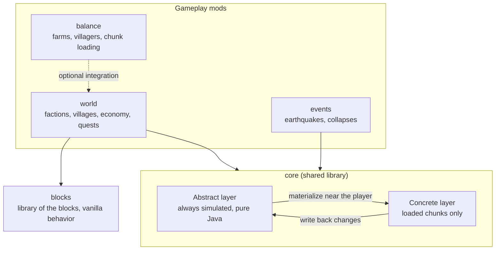
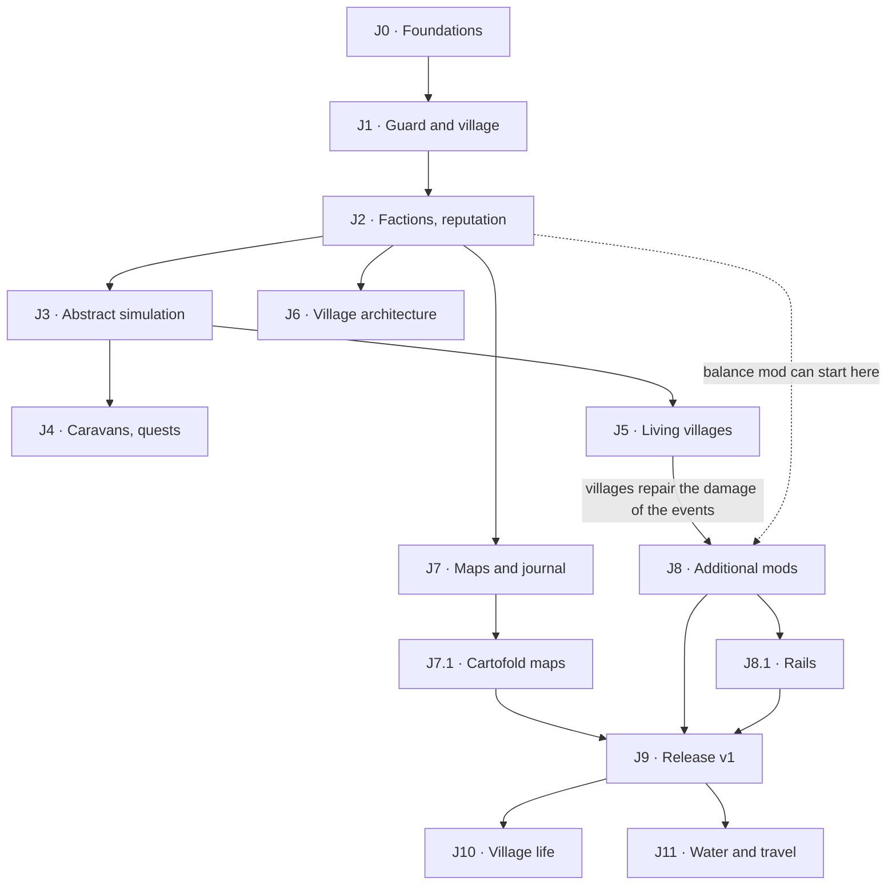

# Folkhold — Design document


## Vision and principles

Goal: a single-player Minecraft (NeoForge 1.21.1) where the world changes without the player. NPC factions trade, fight and take territory. Nature grows and ages. Natural events occur. There is less grind and fewer abusive automatic farms.

The project has a base modpack (existing mods) and three mods to develop:

- **World**: factions, villages, economy, quests.
- **Balance**: farms, villagers, chunk loading, trains.
- **Events**: earthquakes, collapses.

Design principles:

- **The world lives without the player.** The mod simulates all important state (factions, stocks, territories) in an abstract form, also when the chunks are not loaded.
- **The player is one actor among others.** The player can influence the factions but cannot control them. No system needs the player to work.
- **Stable states, not infinite curves.** Prices, populations and budgets move toward an equilibrium. A disturbance creates a story. Then the system returns to equilibrium.
- **Less grind, not more farms.** Comfort comes from trade and NPCs, not from unlimited automation.
- **Everything is configurable.** Each rule has a setting (config or datapack). Balance changes do not need a new build.
- **Data-driven when stable.** Content (cultures, NPC recipes, structures, quests) starts in Java code. When a type of content is stable, it moves to JSON files in the mod jar, which a datapack can replace. Code and content stay separate.
- **Two languages.** All text that the player sees exists in English and French. Code uses translation keys only.

## Base modpack

The pack targets **NeoForge 1.21.1**. **packwiz** manages it: a versioned list in Git, updated with one command (`packwiz update --all`), exported as a `.mrpack` file. Prism Launcher and the Modrinth app import a `.mrpack` file in one click.

The pinned versions are in `modpack/mods/*.pw.toml`.

| Category | Mod | Modrinth slug | Pinned version | Note |
| --- | --- | --- | --- | --- |
| Performance | Sodium | `sodium` | 0.8.13 | Client only |
| Performance | Lithium | `lithium` | 0.15.4 | |
| Performance | ModernFix | `modernfix` | 5.27.26 | |
| Performance | FerriteCore | `ferrite-core` | 7.0.3 | |
| Performance | ImmediatelyFast | `immediatelyfast` | 1.6.14 | Client only |
| Performance | Entity Culling | `entityculling` | 1.11.3 | Client only |
| Performance | C2ME (NeoForge) | `c2me-neoforge` | 0.4.0-alpha.0.123 | Alpha; chunk generation, I/O and loading on more CPU cores |
| Performance | ScalableLux | `scalablelux` | 0.3.0-alpha.0.8 | Alpha; faster light engine |
| Performance | NoisiumForked | `noisiumforked` | 2.7.0 | Faster noise generation |
| Performance | Chunky | `chunky` | 1.4.23 | Pre-generation of the world before the play |
| Profiling | spark | `spark` | 1.10.124 | Measures the cost of each system for each tick |
| Nature | Dynamic Trees | `dynamictrees` | 1.7.2 | |
| Nature | Serene Seasons | `serene-seasons` | 10.1.0.9 | Requires GlitchCore |
| Nature | Smart Feeding Troughs | `smart-feeding-troughs` | 1.2.0 | Requires Dirigo |
| Terrain | The Roads More Travelled | `the-roads-more-travelled` | 0.5.1 | Beta |
| Aging | Immersive Weathering: Renewed | `immersive-weather-renewed` | 1.0.4 | Beta, unofficial port; requires Moonlight Lib |
| Navigation | Small Ships | `small-ships` | 2.0.0-b2.1 | Beta |
| Navigation | Cartofold | `cartofold` | 0.23.4 | Required by `folkhold_world`. Minimap (the key Y shows or hides it), map of the explored world (key M), survey maps. The jar of its GitHub Release |
| Terrain | Tectonic | `tectonic` | 3.0.28 | Large continents, deep oceans, mountain ranges; requires Lithostitched |
| Light | LambDynamicLights | `lambdynamiclights` | 4.8.11 | Client only |
| Library | GeckoLib | `geckolib` | 4.9.3 | Required by `folkhold_world` |
| Comfort | JEI, Jade | `jei`, `jade` | 19.57.0.451, 15.10.6 | For development |
| Comfort | Inventory Tweaks: ReFoxed | `inventory-tweaks-refoxed` | 1.2.0 | Client only. The key R sorts the inventory under the cursor (default key of the pack). Refills a stack that runs out, and replaces a tool that breaks |
| Comfort | Default Options | `default-options` | 21.1.8 | Client only. Sets the default keys of the pack (`config/defaultoptions/keybindings.txt`), and keeps the keys that the player set. Requires Balm |

packwiz resolves most dependencies automatically (for example GlitchCore for Serene Seasons). Some mods do not declare a required library in their Modrinth metadata. Add these libraries explicitly:

- Immersive Weathering: Renewed requires Moonlight Lib.
- Smart Feeding Troughs requires Dirigo (1.3.0 or later, before 2.0.0).

Maintenance rules:

- Each update goes through a Git branch, a test launch and a test world before the merge.
- Pin the beta and unofficial mods (`packwiz pin`). This prevents a silent update that breaks the pack.
- During development, add our own mods to the pack as local files. If we publish them, add them through Modrinth.

## General architecture

The three mods use a shared library, `core`. The library separates two layers:

- The **abstract layer** always runs. It decides what happens (wars, stocks, travel).
- The **concrete layer** runs only in loaded chunks. It shows the result near the player. Then it writes the changes back to the abstract layer (deaths, raids, sales).



The balance mod has no dependency on `core` and stays usable alone. When the world mod is present, the balance mod uses it through an optional interface (for example to read village stocks).

The concrete layer reads the blocks only in chunks that are ready: loaded and complete (`ReadyChunks`). On the server, `Level.isLoaded` is also true for a chunk that has a ticket and a generation that is not complete. A read in such a chunk stops the server thread until the generation is complete. For example, the village heart does its work only when all the chunks of its scan area (the area of the village structure) are ready.

The blocks of all the mods are in the library `blocks` (mod `folkhold_blocks`). It has no dependency, except Minecraft and NeoForge. A block of the library has its definition: shape, block states, placement of the parts, light, model, item, loot table, tags and names. It also has the behavior that a player expects from a similar vanilla block, with no other Folkhold mod. For example, a player lights and puts out a brazier as a campfire. The library has no game logic. The other mods add the features of a block: block entity, click, scheduled tick, and actions when the block goes into the level or away. A mod registers one `BlockFeature` for a block (`BlockFeatures.register`). For example, the world mod gives the village heart its block entity, its screen and the destruction of the village. The ids `folkhold_world:<block>` of the blocks of the library resolve to the blocks of the library (registry aliases).

## World mod: factions, diplomacy, territories

When a new world starts, the mod creates 5 to 7 factions (`FactionGenerator.Settings.DEFAULT`):

- 1 or 2 factions that are allies of the player.
- 1 neutral faction.
- The other factions are hostile.

The villages come from the vanilla structure placement (random spread, spacing 40 chunks, separation 16). A village does not start when a possible vanilla village start is 8 chunks or nearer on the two axes (exclusion zone), so the two villages do not overlap. A village belongs to the faction with the nearest territory center, so the number of villages of a faction depends on the world.

### Glossary

| Term | Meaning |
| --- | --- |
| Territory | Disc of chunks around a village. The chunk is the unit of territory ownership (world mod). |
| Spawn cell | Square of 4×4 chunks. Unit of the spawn budget (balance mod). |
| Abstract tick | One step of the abstract simulation: every 2,400 game ticks (2 minutes). |
| Cycle | One game day (24,000 ticks = 10 abstract ticks). Production and consumption run once each cycle. |
| Level | Integer value (1 to 20) that measures the growth of a settlement. It sets the traits of the settlement. |
| Tier | Name for a range of levels: Hamlet, Village, Town, City, Capital. |
| Job | Economic activity of a settlement. A job has one recipe for each cycle. |
| Bank | Building of a village. Its chests contain the stocks of the village and a part of the treasury. |
| Mobile group | Group of NPCs that travels between villages: a caravan or a traveling merchant. |
| Route | List of points between two villages. A mobile group follows it. |
| Materialization | Creation of the entities of an abstract state near a player. The opposite operation removes the entities and writes their state back. |
| Quest board | Block in each faction village. It shows the quests of the village. |
| Ambush | Group of vanilla monsters that attacks an escorted caravan at a point of its route. |

### Data model

| Entity | Main fields |
| --- | --- |
| `Faction` | id, name, culture (village style, units), color and banner, treasury, military power, base attitude to the player, traits (expansionist, merchant, isolationist) |
| `Relation` | pair of factions, value from -100 to +100, state (alliance, peace, tension, war), date of the last change |
| `Territory` | claimed chunks (a disc around the village), owner village and faction, current contest |
| `Settlement` | id, faction, position, state (active or ruins), level, experience, tier (from the level), population, jobs, stocks, garrison |
| `MobileGroup` | id, kind (caravan, traveling merchant), faction, origin, destination, route, progress, cargo, members (stable UUID, role, health), state |
| `Quest` | id, kind (delivery, escort), giver, player, success condition, deadline, reward, state |

The mod stores all of this in `SavedData` of the Overworld level (settlements, mobile groups, quests, factions, reputations), written to NBT by hand with a version number.

### Simulation rules (abstract tick every 2,400 ticks = 2 minutes)

**Phase 1: living territories, no wars between NPCs.** Territories change mostly because of the player and because of the growth of the villages. The only military content is the defense of the villages. There are no patrols, no bandits and no armies.

**Implemented**:

- **Claim**: each village claims a disc of chunks around its position (its heart when the village exists). A chunk is in the disc when the distance from the position to the center of the chunk is not more than the claim radius. The claim radius comes from the level of the village (`claim_radius` in `levels.json`): 9 chunks (144 blocks) for a hamlet, 27 chunks for a city, 33 chunks for a capital. The radius is never smaller than the radius that contains all the blocks at 1.5 times the village radius (server configuration), so the territory contains all of the village and a margin. A chunk that two villages claim belongs to the nearest village. At equal distance, the village with the higher level gets the chunk.
- **Unclaimed land**: a chunk that no village claims.
- **Destruction of a village**: kill the captain and destroy the village heart (the central banner). The village becomes ruins. Its territory becomes unclaimed. The ruins stay in the world.

The faction of a new village comes from the regions of the cultures (`CultureRegions`, `CultureMap`). The world has a grid of square regions of 2048 blocks. The seed and the biome at the middle of a region select the culture of the region: a culture has a weight of 8 in its biomes of affinity (the tag `#folkhold_world:culture/<id>`) and a weight of 1 in the other biomes. Valeholm is frequent in the cold and frozen biomes, Ashmark in the temperate biomes, and Sunreach in the hot biomes. A village belongs to the nearest faction of the culture of its region: the faction with the nearest territory center.

- **Trade**: each trade between two villages creates a caravan. The goods arrive with the caravan (see "Trade between villages").
- **Relations**: each caravan that arrives raises the relation between the two factions a little.
- **Abstract caravans**: a caravan with no player near has no risk. It always arrives.

**Planned**:

- **Help a faction grow**: colonization quests (escort settlers, deliver materials) found a hamlet of this faction in unclaimed land.
- **Rally a village**: with sufficient reputation and a quest, a village can change its banner and join a different faction.
- **Natural growth**: a prosperous faction slowly founds a hamlet in unclaimed land near its territory (maximum one each game week).
- **Diplomacy**: relations change with trade and incidents. Relations decide which factions trade together.
- **Decline**: a faction with no village disappears. Its ruins stay in the world.

**Phase 2 (later)**: wars between factions, sieges, patrols, bandits, armies and NPC-against-NPC conquests, on the same simulation.

### Cultures

A culture is a template for factions: name, colors, banner, name syllables (for faction and village names), pitch of the voices of its units, biomes of affinity. The style of the villages is the visual aspect of the culture. A culture has several factions, and the factions of a culture can be allies or enemies. **Implemented**: the cultures are Java definitions (`Cultures`). **Planned**: each culture moves to a JSON file in the mod (`data/folkhold_world/folkhold/cultures/<id>.json`), and a new culture then needs no code.

The factions of a world are not static content. The mod creates them when the world starts, from the cultures, and saves them in the world.

All cultures are human. **Planned**: non-human cultures (illagers, piglins).

## World mod: villages, NPCs, defense

Each faction village has fortifications and guards. A player in iron armor with no enchantments must lose a frontal attack. The player needs enchanted diamond gear, allies or a trick.

### Villages

- Generated as structures of the type `folkhold_world:fortified_village` (`FortifiedVillageStructure`), one set of pools for each culture:
  - The pieces of the jigsaw pools go on the terrain, as in a vanilla village. The plaza is the start piece: the village heart, the braziers, the alarm bell, the quest board and the sign of the hall. A street goes out of each side of the plaza. Each street has a plot for a house on each side and a short end. The streets go on the terrain, and the arms of the wall (below) give them their levels. On water, the blocks of a path change to planks (processor list `village/street`): spruce planks, or the planks of the biome variant. The street to the north of the template has the plot of the bank. The builders build homes on the free plots (see "Village growth").
  - The first house-workshops (see Job posts): the street to the south of the template (piece `street_jobs`, pool `streets_jobs`) has the plots of the first job posts of the village. Its west plot uses the pool `jobs_food`, and its east plot uses the pool `jobs_start`. A Valeholm street has 2 plots on each side: near the plaza, the pool `jobs_food` on the west side and the pool `jobs_start` on the east side; far from the plaza, the pool `jobs_start` on the west side. Thus a new village has a food job and a trader before its first growth: 2 house-workshops, 3 in a Valeholm village.
    - The jigsaw does not know the level of the settlement: the pools have only the jobs with a minimum level of 1. Each job of the pools has a profession (its workers trade), and its biomes have all the biomes of the variant: the job is valid in each village of the variant. Thus the taiga variants have no job of the spruce (the snowy plains are not in `#minecraft:is_taiga`), and the swamp variants have the fisher.
    - `jobs_food`: the jobs of the food family (`FOOD_JOBS` in the structure script). `jobs_start`: all the jobs. The weight of a job is the weight of its job file times the multiplier of the culture of the style (Ashmark for the pieces of all the cultures, no multiplier for the maritime pieces).
    - The fallback of `jobs_food` is `jobs_start`, and the fallback of `jobs_start` is `houses`. The jigsaw uses the fallback of the pool of a plot, not the fallback of this fallback: a `jobs_food` plot gets a house-workshop of `jobs_food` or `jobs_start`, or stays free; a `jobs_start` plot gets a house-workshop or a house, or stays free. The wall keeps the space of a free plot, and the growth can build on it.
    - The connector of the street to the south of the plaza has a placement priority of 1 (the other connectors 0): the jigsaw places the plots of this street before the plots of the other streets. Thus a large house of a next street (13 × 13 in Sunreach, a side long house in Valeholm) does not take the space of a house-workshop: it goes to its next house. On the Valeholm street, the plot connectors of the house-workshops have a selection priority of 1: the jigsaw fills them before the plot of the pool `houses` of the same street, so a side long house on this plot does not take their space.
    - A house-workshop has 2 beds and a cottage 3 beds. The barracks, the storehouses and the forge give no places, thus a house-workshop gives more places than the mean plot of the pool `houses` (about 1 place).
    - The houses of the pool `houses` have no job sign, except the fishing hut of the maritime villages (a home with the job sign of the fisher).
    - In each home of the pools `homes` and `houses`, a villager can walk from the front of the house to each work block and to each bed: each work block and the head of each bed have a free floor block next to them.
  - Then the structure adds a closed wall around all the pieces (`WallLayout`, `VillageWall`). The outline is the rectangle around the pieces, with a margin of 4 blocks (`wall.margin`): the palisade has no gap. A tower is at each corner. More towers go on a side when the middles of 2 towers are more than 40 blocks apart (`wall.tower_spacing`). A gate is on each side, on the axis of the plaza. Each arm of the village, from a gate to the plaza through the streets on its axis, is a ramp that goes up or down by 1 block at most from a row to the next one (`PathRamp`), from the level of the gate to the level of the plaza. The rows on the flat terrain behind the gate stay at the level of the gate, and between the gate and the plaza the ramp stays near the terrain. A gate higher or lower than the range of its arm goes down or up to the nearest level in this range, and its flat terrain clears the terrain above it. The ramp has the width of a street: 3 blocks of path in the middle, and an edge of terrain on each side with the surface block of the terrain (grass, sand). It cuts through the high terrain (the ores and the lights of the old street included) up to the surface, and dirt fills the holes under it and shallow water (less than 3 blocks deep). A house on a plot of an arm moves up or down to the level of the ramp at its plot: its door stays at the level of the street.
  - The palisade follows the terrain (`PalisadeHeights`). The structure reads the height of the terrain on the line of the palisade, and at 2 blocks inside and outside the line. It reads the heights at the corners of a grid of 4 blocks and interpolates between them: the calculation of a height takes time. A column is not lower than the terrain of its block. It is at most 1 block lower than the near terrain, thus a mob on this terrain cannot jump onto the palisade. 2 columns side by side have a difference of 1 block at most: a column goes up for this rule, never down. A foundation fills the space under a column. When the ground at the generation is higher than the base of a column, the column gets more logs.
  - A tower or a gate is a template on the highest base under it.
  - Before the start, the structure checks the terrain around the middle of the plaza, on a grid of 3 x 3 points, 32 blocks apart (`VillageSite`). These conditions stop the village: water at the middle of the plaza, a mean slope of more than 40 % between the neighbor points. Deep water on more than 45 % of the points (the sea, a deep lake: the surface is at the sea level or lower, and the water is deeper than 5 blocks) gives a maritime village (see below). Thus the steepest slopes stop a village, and the streets follow the other slopes. Shallow water does not stop a village: an island or a lake shore with shallow water gets a village, with its buildings on stilts and its streets on planks over the water. The discovery of the settlements uses the same check.
  - The terrain near the village changes before the generation of the blocks. The terrain adaptation of the structure (`beard_thin`, as in a vanilla village) puts the terrain under the templates and removes it from them. Pieces with no blocks (`TerrainPiece`) make the terrain flat along the palisade and in front of each gate. Along the palisade, the flat terrain goes 2 blocks inside and outside the line. On a slope, the terrain adaptation does not remove all the terrain above this level: the flat terrain of a gate also removes the terrain and the plants in the 3 blocks above its level, so that the gate is open to the walk. The adaptation adds the boxes of the pieces together, and near a tower or a gate these boxes are at different levels: the terrain can get a gap of air under its top block. A piece with no blocks (`GroundFillPiece`) on each tower and each gate fills these gaps in the box of the template, in a band of 4 blocks around it and down to 16 blocks below it: air under the surface, closed within 8 blocks by a solid block or by water under the terrain, gets the ground block of the surface (dirt under grass and snow, else the surface block; dirt for sand and gravel over water). A deeper space is a cave and stays. The fill does not close the space that the flat terrain of a gate clears, and it has no terrain adaptation. Only the villages in new chunks get the fill: the chunks of the world that exist do not change.
  - A foundation of stone (cobblestone, or the stone of the biome variant) fills the space under the lowest layer of the templates, down to the ground (processor `folkhold_world:foundation`, list `village/foundation`). A building on a hole, on water or on a slope does not float. Over water, the building stands on stilts (`stilt`): at the corners of its lowest layer and every 3 blocks along its edges. The stilts are spruce logs, or the blocks that replace them in the biome variant (cut sandstone in the desert).
  - Maritime villages: the check of the site gives a maritime village when the middle of the plaza is on land and the deep water covers more than 45 % of the points (an island, a peninsula, a coast). The water is the wall (`SeaWall`): the palisade stands on the land side of the ring only, and goes 4 columns into the water at each end of the land side, on its foundation from the floor of the water. The towers and the gates on the other columns go away. A village that fills its island has no palisade, no towers and no gates.
  - The pieces of a maritime village: a fishing port, in all the cultures (`MARITIME` in the structure script, variants with `maritime` in the structure). Fishing huts (2 beds, the barrels of the catch, a smoker, the nets, and the job sign of the fisher), a fish market (`market` sign: the stalls of the catch) and a smokehouse (`storehouse` sign: the smokers and their racks), with cottages, barracks and storehouses. The buildings have a lower wall of mossy cobblestone and stone, iron bars in the windows and a stone quay at the porch. A maritime site selects the maritime variant of the biome, else the maritime base variant (spruce). The piers of the water gates go from the village to the sea.
  - With Immersive Weathering, the processor `folkhold_world:optional_replace` changes the stone of the maritime pieces to mossy stone and the iron bars to rusted iron bars. A replacement names its output block by its id: with no block of this id (the mod is not present), the block of the template stays.
  - The water side: the top block of the terrain is water at the sea level or lower. On water, the palisade stands on its foundation of stone from the floor of the water, with no flat terrain along it. A gate opens on water when 2 of the 3 points in front of it (at 2, 4 and 6 blocks) are on water. Such a gate gets a pier (`PierPiece`, `wall.pier`) and no flat terrain in front of it. The pier is 3 blocks wide and at the level of the gate. It goes over the water to the first position on land: 4 blocks at least and 12 blocks at most. On a shore, the deck goes through the ground. It has posts down to the floor of the water every 3 rows, and rails on its two sides.
  - The game places the trees of the biome after the structures. Before the first activation of a village, its heart removes these trees (`VillageClearing`). The clearing covers the area of the village and a band of 6 blocks around it. It removes the logs, the leaves, the vines, the cocoa pods, the bee nests, the roots and the propagules of the mangroves, and the cacti. A waterlogged block leaves its water. It keeps the blocks of the structure pieces, the columns of the palisade, the blocks under the buildings (the foundations and the stilts), the posts of the piers, and the blocks of the players and of the construction sites.
  - In the grove and the snowy slopes, the surface of the terrain has powder snow. Under the buildings and the palisade, the foundations replace it. Once, after the clearing of the trees and in a different tick, the heart replaces the other powder snow with snow blocks (`VillageClearing.replacePowderSnow`): in the area of the village and in a band of 8 blocks around it (the streets, the terrain between the buildings, the flat terrain, the stairs and the approaches of the gates). The layers of snow stay. The heart keeps the blocks of the structure pieces (a position where a piece has air changes), and the blocks of the players and of the construction sites. Thus the villagers and the units do not sink in the village. A heart of an earlier save does this replacement once.
  - The first garrison of a village waits for the clearing of the trees and of the powder snow: the heart waits while a chunk of the clearing or of the band of the powder snow is not ready.
  - Limit: the heart knows only the blocks that a player places in the radius of a village (`villageRadius`, 48 blocks). The powder snow that a dispenser places, or that a player places farther from the heart (a corner of the band of a large village), changes to snow blocks.
  - The structure files (`structure/village.json`) give the pools, the settings of the wall and the blocks of the palisade.
- The size follows the abstract state: a hamlet has a palisade, a city has a stone wall and archer towers.
- Settlement positions come from the seed. The village is a jigsaw structure with a vanilla placement (structure set, random spread). The game can calculate where a structure starts from the seed and the biomes, without the generation of chunks: the `/locate` command uses this method. The abstract simulation uses the same method to know the villages of a region before the player goes there, and it also applies the exclusion zone around the vanilla villages, as the chunk generation does. The discovery reads the placement from the structure sets of the chunk generator: in a world whose generator does not generate the faction villages, for example a vanilla Superflat world, it finds no village. The `/locate` command does not apply the exclusion zone: in chunks that the game did not generate, it can show a village that does not start. The discovery covers 1024 blocks around each player and the world spawn (`discoveryRadius`), and the simulation runs on all the discovered villages: the world around the player changes with no visit. The admin screen lists these villages, with the name in italics while the game did not generate them. Its discover action checks at once the regions up to 3000 blocks in each direction around the operator (`adminDiscoveryRadius`).
- Materialization: when the player comes near, the mod creates the garrison and the inhabitants from the `Settlement` state. When the player goes away, the mod removes them and writes their state back (health, deaths, equipment).
- Villagers: the villagers of a village are its population: the inhabitants. The setting `inhabitantLimit` can set a maximum (0: no maximum), and the server and the other mods can limit the entities.
  - Places (`VillagePlaces`, `VillageBeds`): the places of a village are the maximum of its inhabitants, as the buildings in a real-time strategy game. Each bed of the homes of the village gives one place: the beds of the structure and the beds that a player places. The beds of a garrison building (a template with a name that ends with `barracks`) are for the garrison: they give no place. The hall gives one place to each builder and each handyman, thus a village with no bed keeps its workers. A village with fewer places than inhabitants keeps its inhabitants, and gets no new inhabitant. Each cottage of the village structure has 3 beds, and each job building 2 beds.
  - The heart counts the beds with each scan of the village. It scans the village again after a finished construction site, and when a player places or breaks a bed in the village. The settlement keeps the number of beds (`Beds`). The heart screen and the journal show the inhabitants and the places ("Housing").
  - The order of the places: first one worker of an active job that trades (see "Trade with the player"), so that each village with an active job has a trader, also a small or starving village. Then 2 builders and 1 handyman (settings `builders` and `handymen`), also in a small village. The builders build the construction sites of the village (see Construction). The handymen light the braziers in the evening and put them out in the morning (see Shelter at night). Then the workers show the active jobs of the settlement (see Job posts): in a village with a list of posts, the household of the home of each active post; in a village with no list of posts, 2 inhabitants (`workersPerJob`) for each active job. The rest have no job: they give life to the village.
  - The builders and the handymen stay vanilla villagers (bed, bell, raids, zombies), with no trades. Only their model changes: a GeckoLib model with arms that move (place a block, use a brazier). It uses the vanilla textures of the villagers: the skin, the type and the profession. The other villagers keep the vanilla model.
  - The heart creates the villagers in groups of 4, one group every 2 seconds while a player is near.

### Vanilla villages in a territory

The Folkhold villages are the main settlements of a territory. A vanilla village inside the territory of a faction gets a small detachment of guards of this faction. It gets nothing more: no village heart, no garrison of a faction village, no quest board, no economy and no claim.

- A vanilla village is a bell with 2 beds or more in 32 blocks around it. A bell of a faction village does not count.
- Every 10 seconds, the mod checks the bells in 64 blocks around each player, in the loaded chunks.
- A vanilla village in a chunk that an active settlement claims gets 2 guards of the faction of this settlement. The setting `detachmentGuards` sets this number, and 0 turns off the detachments. The guards have the equipment of a hamlet. They spawn near the bell and patrol around it. They use the colors and the reputation of the faction: they defend the villagers against the monsters and against a hostile player.
- A dead guard comes back after the refill delay of the garrisons, when no guard of the detachment fights.
- When the territory changes owner, the guards change their faction. When no settlement claims the chunk, the guards go away. A vanilla village with no territory has no guards.
- When the bell is not there any more (a player broke or moved it), the detachment of this bell leaves. A bell at a new position is a new village for the scan.

### Village styles and terrain

- Each faction has an **architecture style**. There are 3 or 4 styles, and two factions can have the same style. Examples: Norse (long houses, steep roofs, axes), Medieval (cobblestone and timber frame, stone walls, swords and crossbows).
- A style sets the architecture of the buildings and some traits of the units and the village.
- Each style has **biome variants**: the buildings use the local materials (spruce in the taiga, sandstone in the desert).
  - **Implemented**: the variants of the village pieces for the biomes of the villages:
    - oak in the plains, the sunflower plains, the meadow, the cherry grove and the forest;
    - birch in the birch forest;
    - acacia in the savanna;
    - sandstone in the desert, with doors and fence gates of jungle wood;
    - mangrove and mud bricks in the swamp and the mangrove swamp;
    - spruce in the taiga, the snowy taiga, the snowy plains, the grove, the snowy slopes and the windswept hills (the windswept hills, the windswept forest and the windswept gravelly hills): the base variant. In the snowy biomes, the generation of the world adds the snow on the village.
  - **Implemented**: the styles of the cultures. A style changes some pieces of the village; the other pieces are the pieces of all the cultures. Each style has the biome variants of the materials.
    - Ashmark: the pieces of all the cultures (timber frame houses with a gable roof).
    - Valeholm (Norse): long houses in 2 orientations. A deep long house has the gable end and the door on the street, and the body goes 17 blocks deep into the plot. A side long house (cottage, storehouse) has the long side and the door on the street, and goes 17 blocks along the street. Walls of horizontal spruce logs between posts, a base of stones, a steep roof of dark oak (2 blocks up for each block to the ridge) with carved horns at the ends of the ridge, and a long hearth in the middle. The ridge is a row of planks with no slab on it, and the middle horn stands on these planks: a builder stands on a scaffolding in the house to place the ridge. The cottage has 3 beds, the barracks 4 beds. A Norse street has a segment of 21 blocks with 2 plots on each side. The jigsaw tries the houses of the pool in a random order: a house that touches another piece goes to the next house, and a plot with no house that fits stays free. The wall goes around all the pieces: the long houses make the palisade larger.
    - Sunreach (desert and Mediterranean): flat houses with a parapet on the roof. Walls of smooth sandstone with pillars of cut sandstone at the corners, a band of terracotta, small windows with iron bars, and a striped awning of wool over the door. Courtyard houses (13 x 13: a cottage, the barracks, the storehouse) have the rooms around a courtyard open to the sky, with a basin in the middle. The cottage has 3 beds, the barracks 4 beds. The streets are the streets of all the cultures.
  - A variant replaces the wood of the walls, the floors, the frames, the doors and the fences. The desert and the swamp also replace the stones. The roofs stay of dark oak in all the variants.
  - The structure script (`tools/structures/village.py`) writes the pieces, the template pools and the processor lists of each variant, in a folder with the name of the variant. The jigsaw connectors of a piece use the pools of its variant. The script also writes the biomes of the village (the tag `#folkhold_world:has_village`): the biomes of all the variants.
  - The culture of the region (see "World mod: factions, diplomacy, territories") and the biome at the middle of the start piece select the variant of a village (`variants` in the structure). A variant can have a culture (`culture`): its pieces are the style of the culture. The order of the search: a variant of the culture with the biome, the base variant of the culture (a variant of the culture with no biome), a variant of all the cultures with the biome, the base variant of the structure. At a given place, a village has the same layout in the variants of the same pieces. The village gets the palisade, the piers and the stilts of its variant. The repairs use the pieces of the village, and the growth uses the homes of its variant.
- The village adapts to the terrain:
  - coast and river: docks, boats, fishing huts, bridges;
  - mountain and cliff: large houses against the cliff, terraces, walls that follow the terrain, or a village dug into the rock. **Implemented**: the villages of the meadow, the cherry grove, the windswept hills, the grove and the snowy slopes, with the arms of the village as ramps (see "Villages"). In the grove and the snowy slopes, the heart replaces the powder snow of the village with snow blocks;
  - island: the wall follows the coast, piers are the access, stilt houses.
  - gates: the terrain outside a gate can be higher or lower than the gate. Then the heart builds cobblestone stairs once (at most 6 steps). Stairs that go down have a support under each step. For stairs that go up, the heart removes the terrain above each step. A player can stack fence gates in the opening of a gate: the stacked fence gates on the axis of the fence gate below them and this fence gate are one gate. The lowest fence gate gives the floor of the gate, and the stacked fence gates get no stairs. The heart, the units and the raiders open, close and force all the fence gates of a gate together. A generated gate has one row of fence gates.
- A village is a group of pieces on the terrain (streets, houses, towers, walls), as the vanilla villages, not one large piece.

### Village growth

Growth is gradual. Each settlement has a **level** from 1 to 20. The tiers are names for ranges of levels. The level sets the traits of the settlement: claim radius, maximum population, job slots, stock capacity, number of trade offers, number of village cats, the units of the garrison and their equipment. A data file holds the level table, the tier table and the traits. More levels and tiers can exist later.

| Levels | Tier | Trades |
| --- | --- | --- |
| 1–4 | Hamlet | Basic offers |
| 5–8 | Village | More offers, better prices |
| 9–12 | Town | Specialized craftsmen |
| 13–16 | City | Rare offers, inn, advanced quests |
| 17–20 | Capital | All offers |

- **Start level**: when the mod creates a settlement, the settlement gets a random start level from 1 to 16 (configurable chances). Only growth makes a Capital. A settlement with a higher start level also starts with more stocks.
- **Experience**: at each cycle, the settlement gets experience from its prosperity: food need covered, inputs of the jobs available, treasury above a minimum. The experience for each level increases with the level.
- **Loss**: a shortage of food, a pillage of the bank or the death of the captain removes experience. A settlement can go down one level.
- **Level event**: the mod sends an event when the level changes. Other systems can use it, for example the physical growth.
- **Garrison**: the garrison follows the level of the village (see "Balancing"). When the level changes, the heart adds the missing units, and the units that are alive get the equipment of the new level.

**Physical growth**: the village grows in the world. The growth uses the construction system of J5 · Living villages.

- **First posts** (`VillageGrowth`, `VillageBuildings.steps`): a scanned village with no valid food post or no valid post that trades builds a house-workshop first, before the market and before the other buildings, also when it does not need places. Its job comes from `JobAssignment.next` with the eligible jobs (minimum level and biome), so it is a food job that trades, else a job that trades. The inhabitants of the homes fill the first valid post first (see Job posts): the food post that trades is active with 1 inhabitant of the homes. The generation gives each new village a food post that trades: this step is for a legacy village, a village with no valid food post (for example a level loss) and a village that lost its house-workshops.
- **New homes** (`VillageGrowth`, `VillagePlots`, setting `construction.growth`): the streets of the village structure have plots (the jigsaw connectors with the name `folkhold_world:plot`). The generation puts a house on a plot, or leaves it free. The wall keeps the space of a new home on each free plot (`VillagePlots.reserved`): the box around all the pieces of the pool `homes` and of the pool `jobs` of the variant on the plot (`VillagePlots.homePools`). The sizes come from the templates of the pools, thus the space holds each house-workshop of the culture: 9 × 9 blocks in the base and maritime styles, 9 × 13 blocks in the Sunreach style (the Sunreach cottage is 9 × 11 blocks) and 9 × 17 blocks in the Valeholm style. The palisade is 5 blocks (the margin of 4 blocks and 1 block) from the spaces, and a tower or its stair goes 4 blocks inside the palisade: no part of the wall is in the space of a free plot. The village needs places when its population is more than its places (see "Villages"). Then its builders build a home on the nearest free plot. Each new home is a house-workshop: the job of its post comes from `JobAssignment.next` with the valid posts of the village, and the piece is `job_<id>` of the pool `jobs` of the variant of the village. When the variant has no piece for the job, or no free plot holds it, the growth tries the next job of the eligible jobs (minimum level and biome) with the same rule, 3 jobs at most. Then the growth builds no home in this check. The growth starts no site while the village has a site, and the heart checks the growth only after a scan: the post of the last house-workshop counts before the next choice, so 2 sites do not take the same need. When no house-workshop of the tried jobs has a piece and a free plot, the heart records that the village has no place for a new home (`VillageHeartBlockEntity.isHomeNoSpace`, not saved: the next check sets it). The value is also true when the variant has no piece for the tried jobs. A check that starts the market site tries no home: the value stays the value of the last check that tried a home. The heart screen shows the row "No place for a new home" in its Jobs tab. The heart looks for a free plot after the check of the repairs, when the village is calm, has builders and has no site. A free plot has no building of the generation. The space of the home has no piece of the structure, no palisade, no earlier construction site and no block of a player. The site uses the stock and the delivery quests of the village. At the end, the heart scans the village again: the new beds give places, and the job sign gives a new post. In a legacy village, each new active post takes one legacy job slot. A level that goes down does not remove a home.
- **Plots**: the plaza has no plot. A village of the base, Sunreach or maritime style has 7 house plots (2 on each of the 4 streets, one plot is the bank), with 0.64 to 0.78 free plots on average, and no free plot in 44 to 51 % of the villages. A Valeholm village has 15 house plots, with about 1.5 free plots on average. The rings of the town and the city (#656) give more plots, thus more homes and posts.
- **Buildings of the level** (`VillageGrowth`, `VillageBuildings`, data file `folkhold/village_buildings.json`): a village with enough places builds the missing buildings of its level on the free plots, with the same rules as the homes. A requirement gives a kind of building and a minimum level: a storehouse from the level 3, a barracks and a second storehouse from the level 9, a second barracks from the level 17. The forge is not a building of a level: the blacksmith works in its house-workshop (see Job posts). The scan of the heart counts the building signs of each kind: a building of the generation counts. The building is the piece `house_<kind>` of the pool `houses` of the variant of the village, in the style of its culture. The first requirement with a missing building comes first. A level that goes down does not remove a building.
- **Market** (`VillageBuildings.steps`, `VillageMarket`): the data file gives one market from the level 5. A village of the level 5 or more with no market builds its market after its first posts, before a new home and before the other buildings of the level. The market takes one plot, and the plots are few: if the homes come first, they can take all the plots, and the village never gets its market. A home that waits for the market waits for one construction only. The market is the piece of the pool `market` of the variant of the village. If no free plot can hold the market, the growth goes on with the home or the building of the level, and the village has no market until a plot is free again (or until the town ring adds plots, #656). The heart keeps the plot of its market (`VillageMarket.Plot`: the template, the origin and the turn of the piece, saved in the heart).
  - **Broken or stopped market**: the repairs keep the blocks of the box of a construction site and do not repair them. Thus the growth builds the market again: when the market sign or the market post is broken (by a player, a raid or an explosion), or when the market site stops before its end, the next check of the growth starts a new site on the plot of the market, with the same piece. The builders build only the missing blocks. The village takes no other plot for its market. No block event tells the heart about all these changes: before its steps, the growth scans the village again when a market sign of the scan is not a market any more (`VillageHeartBlockEntity.checkMarkets`). A site that is not finished at a stop of the server stays in the saved sites and goes on after the load. The plot of a market of the village structure comes from its piece (the market piece that holds the first market sign) at the first scan of the heart.
  - **Block of a player**: the builders never change a block of a player. While a block of a player stands at the position of the market sign or of the market post of the plot, the growth does not build the market again (state `BLOCKED`) and goes on with the next step. The market comes when the player removes the block.
  - See "Market square" for the trade place.
- **Planned**: larger walls and new streets when no plot is free, farms, mills, fields. Each building, wall section and defense has a minimum level.

### Construction

The construction system changes the blocks of the level into the blocks of a **target**. A target is a set of block states at positions, for example a building of the village. The repair of the village (J5) and the physical growth (J6) use it.

**Implemented**: the plan, the kinds of the blocks, the capture of a target and a run with no villager. Also the construction tool of the operators, the construction sites of the builders and the repairs of the villages.

- **Plan** (`folkhold_core`): from a target and the blocks of the level, the planner makes an ordered list of steps. A step removes a block, places a block, places or removes scaffolding, or adds a fluid. Each step has the full state of the block (facing, axis, half, shape) and the position where the builder stands.
- **Order**: the plan removes the obstacles first: the attached blocks first, then from the top to the bottom. A block that needs an obstacle as its support also goes, and comes back if the target has it. Then the placements go from the bottom to the top. A block comes after the block that holds it: a falling block after the block below it, an attached block after its support. A connected block comes after the solid blocks next to it. One step places the two parts of a door, a bed or a tall plant.
- **Fluids**: the sources of water and lava come at the end. A waterlogged block goes in place with no water, and gets its water at the end. A flowing fluid is not part of a target: it comes back from its source.
- **Reach**: a builder places and removes the blocks of a zone around its feet. The zone goes 2 blocks on the X axis and on the Z axis. On the Y axis, it goes from the layer of the floor of the builder to one block above its head (config `construction.reachHorizontal`, `reachBelow` and `reachAbove`).
- **Position to stand**: a builder stands in a free space of two blocks, on a block with a full top face. It does not climb on the top of a new wall, which is 1 block wide. The block below the builder is one of these blocks:
  - a block of the level, or the scaffolding of the plan
  - a block that the plan puts directly on a block of the level, for example the floor of a house on the ground
  - a block of the plan in a square of 2 × 2 floor blocks. Examples: the floor of a house on its foundation, the floor of an upper storey.
  - The other floor blocks of the plan are the tops of new walls. The blocks of the plan are the blocks that the steps place, and the blocks that the site placed before the plan, for example before a load of the level. The plan and the site use one function for this rule (`ConstructionPlanner.isWallTop`).
- **Way to the position**: a villager can walk from the ground to the position to stand of the plan. Else the position is on a scaffolding column of the plan: the builder climbs the column from its bottom. The way follows the path finder of the villagers: the builder walks through a door, a carpet or water. It jumps 1 block up and goes down 3 blocks at most. A fence, a wall and lava stop it. The ground is around the box of the target and the reach, at most 1 block above the bottom of the box.
  - The search first looks for a clear way: a way with no step on the top of a new wall. It uses a way over a wall only when it finds no clear way. A position to stand with a clear way comes before a position with a way over a wall, also when it is farther from the block. With no clear way, the plan keeps the nearest position with a way over a wall.
- **Scaffolding**: with no position to stand with a way from the ground, the plan adds a column of vanilla scaffolding next to the block. A way goes from the ground to the bottom of the column. A column with a clear way to its bottom comes before a column with a way over a wall. With no such column, the builder goes directly to the nearest position to stand. With no position to stand, the plan adds a column with no way to it. The builder stands on the column, with the block at the height of its head. Under a roof, the block can be one block above the head. The plan selects a column on the ground before a column on a block of the plan, so the columns stand around a new house. Then it selects the column with the fewest new blocks: a column on top of an existing column makes it higher. The column stays out of the positions that the target fills, and it does not stand on a block that a later step removes. The plan removes each column after the last step that uses it, from the top. Thus a column does not close a way for the next steps, for example the way from a door to the rest of a room.
- **Warnings**: the plan reports these problems of a target: a falling block above air, an attached block with no support, a cycle of supports. It also reports a block with no position to stand.
- **Kinds of blocks** (`folkhold_world`): the class of a block gives its kind and the side of its support. The block state gives the side (`face`, `facing`, `hanging`, the half of a door). A trapdoor, a chain, a flower pot, a grindstone and a wall hanging sign stay in place alone. They come after the block on their side. A fence, a wall, a pane, stairs, a chest, a fence gate and a tripwire get their shape from their neighbors. Redstone wire is an attached block. The block tags `folkhold_world:construction/support_below` and `folkhold_world:construction/support_above` add the special cases, for example sugar cane and cave vines. The path finder of the villagers and the collision box give the walk of a block (see "Way to the position").
- **Block data**: the construction keeps the data of the blocks in the block tag `folkhold_world:construction/keep_data`. Examples: the text of a sign, the patterns of a banner, the profile of a head, the job and the icon of a job sign. The items of a container do not come with the block.
- **Capture**: a target comes from a box of the level, or from a structure template at a position, with its rotation and its mirror. A jigsaw block becomes its final state, as in a village.
- **Run**: a run applies the steps of a plan, with a number of steps for each tick. It puts the blocks directly, with no villager. It uses no items, and no block drops an item. The other part of a door or a bed goes first with no update, so that the primary part does not break.
- **Builders**: the builders of a village build a structure block by block, as players do. The village is the nearest village heart at the village radius from the center of the structure, or nearer.
  - The work zone is the box of the structure and a band of the horizontal reach around it. First, the builders put spruce fences on the ground at the edge of the zone. The ring of fences has an opening on the side of the village. Then they apply the steps of the plan in their order. At the end, they remove the scaffolding that stays and the fences.
  - Each builder claims the next free step. It walks to a position where the block is in its reach zone: the position to stand of the plan, or a free position near the block with a way from the ground (see "Way to the position"). With no such position, the builder waits near the bottom of the column of the position of the plan, or near the block. At the position, it looks at the block and moves its arm. Then the block changes, with the sound of a placement or the particles of a break. One step takes 20 ticks (config `construction.builderTicksPerStep`), and a step of the scaffolding takes half this time. Thus a builder puts about 1 block each second, plus the time to walk. A builder that is in position for the next step takes it from a builder that walks to it.
  - A builder does not walk through the scaffolding: a scaffolding block stops the path finder of a builder, except the column that the builder climbs. Thus the builders take the ways of the plan. For a position on a scaffolding column, the builder walks to the bottom of the column and climbs it. To go to another position, it goes down the column first. A builder adds and removes the blocks of a column from its bottom, as a player does. The removal of a block waits while an entity is on the column above the floor of this block: else the entity falls. A builder there goes down the column first.
  - A builder does not stand on the top of a new wall, and walks on it only when no other way is near. The top of a wall is a block that a step of the plan places, with a sturdy top face, that is not a floor for a builder (see "Position to stand"): it is not on a floor that the plan did not place, and it is not in a square of 2 × 2 floor blocks. The site and the plan use the same rule. The path finder of the villagers jumps 1 block up on the top of a wall, walks on it and goes down on the other side. For the path finder of a builder, a position above the top of a new wall costs 64 blocks of walk more. Thus the builders leave a building through the door or the open side of the site. A way over a wall stays possible when there is no other way near. A free position near a block is not on the top of a new wall. Of the free positions near a block, a position with a clear way comes before a position with a way over a wall (see "Way to the position").
  - A builder that does not get nearer to its position on its path for 15 seconds, or that has no path to it for 5 seconds, goes there directly. Thus a long walk around a building is not a cause. A builder that is not in position after 30 seconds, or that has no free position, works from where it is. A block does not go into an entity: after 2 seconds, the entity moves to a free position near it. An entity that goes to a position directly stops there: it keeps no speed, and a builder keeps no walk input and no jump. A builder that climbs a column, goes down a column, works or waits also has no walk input and no jump. Thus a builder does not walk on in the air above a column, and does not move off the top of a column.
  - The builders work during the day, when the village is calm. At night and during an alert, they go down from the scaffolding and stop. When a player is in the work zone, the builders stop and look at the player. Every 5 seconds, the player gets a message above the hotbar: go out of the zone.
  - The builders never change a block that a player placed in the village (see Repairs). The step of this position goes with no change.
  - The sites of one village come one after the other. Each level keeps its sites (`folkhold_builder_sites.dat`): the template, the position, the phase, the fences, the scaffolding and the positions of the blocks of its plans. After a load, a site makes a new plan from the blocks of the level. The blocks of the plans before the load stay blocks of the plan for the top of a new wall: for the site and for the new plan.
  - Chunks not loaded: during the day, the builders of the oldest site of a village go on with the work in the abstract. Each builder of the village (`builders`) does 1 step each `construction.builderTicksPerStep` ticks. The site keeps the steps of this work. When the chunks load, the site applies these steps before the builders go on: 32 steps at most for each tick (`construction.catchUpStepsPerTick`). Thus a player who comes to the village sees the work of this time. No chunk stays loaded for a site.
  - A step that an entity blocks, or that waits for materials, stops this work: the builders go on from this step.
  - Materials: the builders take the materials of each block from the stock of the village. The cost of a block is in items of the economy. It comes from the recipes of the server: crafting, smelting, stonecutting, and the axe that strips a log. Example: 1 oak stairs costs 1.5 oak planks. The parts of items that the builders took and did not use stay in the site for the next blocks. They go back to the stock at the end.
  - A block waits when the stock does not have its materials. The steps after it wait too.
  - A rare block has no recipe from the items of the economy, for example calcite. A valuable block costs 1 emerald or more (`construction.valuableBlockPrice`), for example a gold block. The builders take a rare or a valuable block as it is from the stock. The village asks the players for it at once with a delivery quest, and the delivered blocks go into the stock.
  - The village also asks for a common material when the builders wait for it for 5 minutes (`construction.materialQuestMinutes`).
  - The fences of the work zone and the scaffolding use no materials. A removed block drops no item.
  - With the setting `construction.freeMaterials`, or in a village with no economy, the builders use no materials.
  - The blocks of the block tag `folkhold_world:construction/free_materials` use no materials: the blocks of the village library and the bell. The village makes them.
- **Repairs**: the builders of a village repair the damaged blocks of the village (config `construction.repairs`).
  - Reference: the structure pieces of the village at the generation: the plaza, the houses, the bank, the towers and the gates. The palisade is also a part of the reference: the base block and the 4 logs of each column. The streets and the paths are not template pieces: the repairs keep only the surface of the streets (below). The repairs change only the positions inside the palisade, the palisade included. Thus the stairs of the gates stay.
  - Streets (`StreetBlocks`): at its first check, the heart records the top block of each column of the streets in the area, and keeps it (`folkhold_village_repairs.dat`). A street light, a plant or a fluid is not a surface block. A hole in a street (air, a fluid or a replaceable block) is a damaged block. A changed block that is not a hole is not damaged: a player can pave a street. A block that falls (gravel, sand) becomes a bridge block: the planks of the wood of the palisade, else the base block of the palisade. Thus the repair of a deep hole, for example after an explosion, gives a bridge over the hole.
  - Every 60 seconds (`construction.repairCheckSeconds`), a loaded village heart compares the blocks of the village with the reference. It does this when the village is calm, has builders and has no site.
  - A damaged block is a missing block or another block. A state that the normal use, the weather or the growth changes is not damage. Thus the comparison ignores the changes that come with the life of a village. Examples: open doors and gates, lit braziers, the color of the banners, the age of the plants, the bites of a cake, the papers of the quest board (the offered quests of the village). It also ignores the connections of the fences and the walls, the shape of the stairs and of the rails, and the water in a block. An empty cauldron, a water cauldron and a powder snow cauldron are one family: the rain or the snow fills an empty cauldron, and a player takes the water. A lava cauldron is not in the family, because no weather gives lava. A melon stem or a pumpkin stem with its fruit and the same stem with no fruit are one family. Grass, dirt, podzol and paths are one soil (block tag `folkhold_world:construction/repair_soil`). Water and ice are equal, and a brazier can take the place of a campfire.
  - A player action that gives another block is damage: a candle cake that becomes a cake, a chipped anvil, a flower pot with a plant. The repair gives back the block of the template.
  - When the block of the level is the block of the reference with only other properties, the repair gives it the reference state with no removal, and with no drops. Thus a block of more than one part (for example the quest board) keeps its other parts, and the block entity stays. The properties that show the contents of the block entity keep the value of the level: `has_book` (lectern), `has_record` (jukebox), the 6 `slot_N_occupied` properties (chiseled bookshelf), `has_bottle_0` to `has_bottle_2` (brewing stand). The connection of a chest (`type`) also keeps the value of the level. The other properties get the reference value. This rule applies to all the construction sites. Another block goes first, then the repair places the reference block.
  - On an empty position, the repairs keep the blocks of the weather and of the plants: snow, grass, flowers, trees (block tag `folkhold_world:construction/repair_natural`). The jigsaw blocks and the structure blocks also stay.
  - The repairs never change the blocks that a player placed in a village. When the player breaks such a block, the repairs can change the position again. The repairs also keep the boxes of the construction sites of the village: the new buildings. Each level keeps these positions (`folkhold_village_repairs.dat`).
  - The damaged blocks make groups: two blocks at 3 blocks or less on each axis are in the same group. The builders repair the largest group first, with a repair site: fences, materials and quests, as for a construction site. A repair asks at once for the materials that the stock does not have, with delivery quests. The quests follow the stock: an offered quest changes to the new missing quantity, and goes away when the stock has the item. With the setting `construction.freeRepairs`, the repairs use no materials.
  - After a repair, its positions wait 20 minutes before a new repair. Thus a block that does not stay in place does not start a repair at each check. At the end of a repair, the heart gives the color of the faction to the banners again.
- **Commands** (operators): `/folkhold construction build <template> [stepsPerTick]` builds a structure template at the position of the player, and `/folkhold construction build <template> builders` gives it to the builders of the nearest village. `/folkhold construction capture <from> <to>` keeps the blocks of a box, and `/folkhold construction restore [stepsPerTick]` puts them back. `/folkhold construction sites` shows the sites of the builders: phase, steps, state, builders and missing materials. A repair site shows the number of its blocks. A site shows the steps of the work that wait for the load of its chunks. `/folkhold construction stop` stops the constructions and the sites of the level: the fences and the scaffolding of a site go away. Each command that builds with no villager shows the steps and the warnings of its plan.
- **Loaded chunks**: a construction starts only when its chunks are ready (loaded and complete). These chunks contain the box of the construction and a margin of the horizontal reach plus 1 block. The plan reads the blocks in this margin for the positions to stand and the scaffolding.
- **Construction tool** (operators): `/folkhold construction place` opens a menu with the structure templates of the server, a text filter and the speed of the construction. The speeds are slow, normal, fast and "builders": the builders of the nearest village build the structure. A key can also open the menu. After the selection, a ghost of the structure follows the block that the player looks at, 64 blocks away or nearer. The ghost stands on this block, with its center above it.
  - The ghost shows the blocks of the structure, translucent, and the box of the structure. A red outline shows each block of the level that the construction removes. Grass and flowers have no outline.
  - Keys: turn by 90 degrees (R), mirror (N), lock the position (G), build (Enter), remove the ghost (Backspace). The arrow keys, Page Up and Page Down move the ghost by one block, and lock it. The panel above the hotbar shows the keys.
  - The key "build" sends the template, the origin, the turn and the mirror to the server. The server checks the permission and the size of the structure: 32,768 blocks at most, air included. It also checks the distance (96 blocks at most) and the loaded chunks. Then it starts the construction as the command `build`. With the speed "builders", it starts a site of the builders of the nearest village.
  - During the construction, the ghost shows only the blocks that are not in place. It goes away when all its blocks are in place. It also goes away at the end of the construction, and when the command `stop` stops the construction.

The growth of the village starts the sites of its new homes (see "Village growth"). The builders build them as the other sites, also while the chunks are not loaded.

### Reputation and welcome

- The mod tracks reputation **for each player**, **for each village** and **for each faction**. The key is the UUID of the player, so multiplayer stays possible.
- Village reputation and faction reputation use the same range: -1000 to +1000.
- The behavior of a village uses the **effective reputation**: 70 % village reputation + 30 % faction reputation. The two weights are configurable.
- When the player enters a village:
  - Hostile: the guards attack.
  - Neutral: the guards watch and give a warning.
  - Friend: the guards greet the player and the gates stay open.
- Two villages of the same faction trade together first (see the economy section).
- **Pillage**: to open or to break a bank chest is a pillage. Before a player opens a bank chest, a screen asks for a confirmation. After a pillage, the village reputation and the faction reputation of the player go to a very negative value (default -800, sworn enemy). The village goes to the alert state. An explosion that a player caused is also a pillage.
- Information for the player:
  - When the player enters the territory of a faction, a small banner at the top of the screen shows the faction banner, "Lands of" and the faction in its color, and the reputation tier with its glyph and color, for some seconds. This is an early warning before the villages.
  - Near a village (50 blocks from the heart, configurable), the action bar shows the village name, the faction, the level, the tier and what the guards do ("✓ Friend: the guards greet you").
  - Important events show in a toast at the top right of the screen, not in the chat: the warning of a guard, the result of a quest, a pillage, and the warnings of a bank chest and a caravan mule. The same warning shows at most once in 10 seconds.
  - A HUD panel (client option, on by default) at the top right of the screen, below the vanilla effect icons: the banner and the name of the faction that owns the territory, the tier of the player with its glyph and color, and the nearest village of the territory (also a village that the game did not generate yet) with its distance and an arrow to it.
  - The village heart opens a screen with the village information.

### Shelter at night

- At night, the guards light torches and braziers, close the gates and patrol the walls. A brazier (block of the library) is 1.5 blocks high, so the mobs do not jump on it, and it does not burn the entities. A campfire of the village layout becomes a brazier.
- A player lights and puts out a brazier as a vanilla campfire. Flint and steel, a fire charge or a burning projectile lights it. A shovel, a water potion or water puts it out. A brazier in water does not burn. A brazier that a player places is lit, except in water.
- Braziers: the handymen of the village light the braziers in the evening and put them out in the morning. The times come from the schedule of the vanilla villagers.
  - Evening: from the day time 11000, when the villagers stop their work, to the rest time of the villagers (12000).
  - Morning: from the end of the rest time (day time 10) to the day time 2000, when the villagers start their work.
  - A handyman takes the nearest brazier that no other handyman took. It walks to a position next to the brazier, looks at the brazier and uses it: the brazier changes.
  - A handyman works when it is awake and calm: not in bed, not in the rest time, not in a panic or a raid.
  - The village heart lights the braziers that do not burn at the start of the night. The heart and the handymen do not light a brazier in water. In a village with no handymen, the heart puts out the braziers at the start of the day. In a village with handymen, the braziers burn until the handymen put them out. At the day time 2000, the heart puts out the braziers that burn.
  - A handyman that cannot go to a brazier stops. No handyman tries this brazier again in the same period, and the heart changes it at the end of the period.
- The village heart prevents monster spawns in its area.
- Village cats stay near the gates and the center. The creepers run away from them. The player cannot tame them.
- A neutral or friendly player can take shelter in the village. From the Town tier, the player can rent a bed at the inn for emeralds.

### Raids against the faction villages

The vanilla raid stays. Near a faction village, Folkhold changes where the raiders spawn and how they march on the village. A raid is at a faction village when a loaded village heart is 64 blocks or less from the center of the raid (`heartRadius`). The numbers of the spawn, the gates and the waves are in the section `raid` of the server config (`folkhold_world-server.toml`), with these values as defaults.

- Spawn: all the raiders of a wave spawn at one position, 40 to 56 blocks from the heart (`spawnMinDistance`, `spawnMaxDistance`). The position is on natural ground (tag `folkhold_world:raid_spawn_ground`: dirt, sand, stone, terracotta, gravel, paths and snow), on land and under the open sky. It is not in a hole or a ravine, it has room for a ravager, and it has a path to the village. When no position is good, the raiders keep the vanilla position.
- March: a raider walks to the approach of the nearest gate that fits it, 8 blocks outside the gate. A gate fits a raider when the gate is wide and high enough for the raider (or its vehicle) with all its fence gates open. A block that is not a fence gate and has a collision in the opening of a gate (for example a block that a player put in a broken gate) stays closed: the gate does not fit. When no gate fits, the raider walks to the nearest gate. In water, the approach is at the surface. At an open gate, it goes through the gate to the heart, and it keeps this gate until it is inside the palisade. It swims across the rivers.
- Closed gate: a raider at a closed gate walks to the front of the gate and forces it. After 10 seconds in front of the gate (`gateForceSeconds`), all the fence gates of the gate open, also the fence gates stacked in its opening. A raider that a knockback moves away from the gate keeps its time when it comes back to the same gate in 5 seconds or less (`gateForceMemorySeconds`). The raiders force the gates also when the game rule `mobGriefing` is false: a forced gate opens, and no block breaks.
- Gates during a raid: a gate closes at night, and a unit closes a gate after it goes through, also during a raid. This is a part of the defense: the palisade sends the raiders to the gates and holds them there, and the archers shoot at them. The palisade does not stop a raid.
- Break of a gate: a raider is blocked at a gate from its first hit on it. When the gate was open while the raider was in front of it (for example the raider forced it, and a unit closed it again), and the raider is in front of the same closed gate 20 seconds after its first hit (`gateBreakAfterSeconds`), the raider breaks the gate, as a zombie breaks a door. The raider breaks the gate one column after the other: the middle column first, then the nearest columns to the middle. A column is the fence gate at the floor and the fence gates stacked on it. The blocks of a column show the cracks of the break progress, and the raider hits them with the sound of a zombie at a door. After 10 seconds (`gateBreakSeconds`), the blocks of the column break. The raider stops when the opening is as wide and as high as the raider or as its vehicle: one column of 2 blocks for a pillager, two columns of 3 blocks for a ravager or a pillager on a ravager. A column that is open for the raider does not break. A raider that a knockback moves away from the gate keeps its break progress when it comes back in 5 seconds or less (`gateForceMemorySeconds`), as the force time. A raider that is away from the gate for `gateBreakAfterSeconds` is not blocked any more, and the time starts again at its next hit. Thus the force always comes first.
  - A gate is open for a raider when its open or broken columns side by side are as wide as the raider (or its vehicle), and have no block with a collision from the floor to the height of the raider. A gate with a broken middle column and closed side columns is open for a pillager and closed for a ravager: the ravager forces it, then breaks the next column. A gate with 2 blocks of free height is closed for a ravager (2.2 blocks high).
  - A gate that is too narrow or too low for a raider with all its fence gates open (for example a gate of one column for a ravager): the raider goes to another gate that fits it. When no gate fits, the raider breaks the palisade at the gate: the positions of the palisade next to the gate, on its line (as many as the width of the raider less one, on each side), and the blocks above the gate up to the height of the raider. It breaks them column by column, with the cracks and the time of the break of a gate (`gateBreakSeconds`), until the opening fits it. The raider breaks only the blocks in the scan area of the heart with no block entity and with a hardness from 0 to less than 50: obsidian, crying obsidian, reinforced deepslate and the blocks that a player cannot break stay. At the end of the break of a column, the raider checks each block again: when a block changed (for example a player put a chest there), no block of the column breaks, and the raider looks for a column again. When no column can break, the raider looks again after 2 seconds. The limit is the line of the gate in the scan area, not the palisade blocks only: a wall or a house of a player on the line of a gate, next to it, can break. A broken part of the palisade is an open column of the gate. The builders repair the palisade of a generated village after the raid (see "Repairs").
  - The break follows the game rule `mobGriefing`: when it is false, a raider does not break a gate or the palisade. It forces the gate each time that the gate closes. When no gate fits the raider, it stays at the nearest gate, and the raid can stall as a vanilla raid.
  - A broken fence gate drops no item, as a door that a zombie breaks: a raid does not give fence gates to the players, and the builders of the village repair the gate.
  - Only the raiders of a raid at a faction village break gates, and only the gates of the layout of the heart (the fence gates that the heart scanned).
  - After the break, the heart keeps the positions of the broken fence gates in its layout. A position of the layout with no fence gate and no collision is a broken fence gate: the opening is an exit with no gate, always open. The raiders and the routes go through it, and the day and night state does not change it. The heart does not rebuild the gate. When the village is calm after the raid, the repairs of the builders give back the fence gates of a generated gate (see "Repairs"). A fence gate that a player placed is not a part of the reference: the player replaces it. A new scan of the layout (for example after a construction) removes the empty positions from the gates of the layout. The fence gates that stay in the opening are still exits. A gate of one column that is broken is then not an exit: the raiders and the routes do not use the opening until a fence gate is in it again.
- When a raider has a target, it attacks. When it loses the target, it marches again. A raider outside the palisade with a target inside the palisade (for example a villager) marches to a gate, forces it when it is closed, and attacks the target when it is inside the palisade. At 12 blocks from the heart, the raider arrives: the vanilla goals of the raid move it in the village. After its arrival, a raider marches again only when it is outside the palisade.
- The raiders target the faction units, as the other monsters do. A garrison can stop a wave outside the palisade.
- Waves: at the difficulty Normal, a vanilla raid has 5 waves, and a 6th wave when its level is 2 or more. The waves of the levels 2 to 5 are the same: only the chance of enchanted weapons changes (10 % to 75 % of the raiders). At a faction village, each wave of a raid of level 4 gets 1 extra ravager, and each wave of a raid of level 5 gets 2 extra ravagers (`extraRavagersLevel4`, `extraRavagersLevel5`). A faction village is a village with a loaded village heart at 64 blocks or less from the center of the raid. The first raider of a new wave adds them at the spawn position of the wave. The wave ends when they are dead, as the vanilla raiders. The raids at the vanilla villages do not change. The extra ravagers apply at each difficulty and in each wave, also in the bonus wave: at Easy, a raid has 3 waves (4 with the bonus wave); at Hard, a raid has 7 waves (8 with the bonus wave). Thus at Hard, a raid of level 4 gets 8 extra ravagers, and a raid of level 5 gets 16 extra ravagers. The balance targets are for the difficulty Normal only.

- Rewards: a player helps a faction village when, during the raid (before its victory or its loss), the player is in the raid area (96 blocks or less from the center of the raid, as vanilla) and kills `minKills` raiders or more (default 1), or gives `minDamage` damage or more to the raiders (default 40, 0: the damage alone does not count). The server config has the two values in the section `raidRewards`. A hit or a kill from outside the raid area does not count. As in vanilla, only a damage source of the player counts: its arrows, its potions and the TNT that it lights count; its tamed wolves, the iron golems, the fire and the poison do not count. A fake player of another mod (for example a machine that attacks) is a player, thus it can help.
- Fall during a raid: the village of a raid falls when the raid has started and its loaded heart has no living unit in its garrison (also a garrison with no unit at the start of the raid), when its settlement is ruins, or when its heart is broken (a loaded position with no heart block; a heart in a chunk that loads again is not broken, also before it registers again). The raid keeps the heart that its first check finds until its end: a heart of an other village near the raid does not become the heart of the raid, and a heart that a player moves during the raid is a broken heart (the village falls). After a restart of the server, the raid finds its heart again. The check stops at the end of the raid (victory or loss). The fall stays until the raid stops, also when the garrison refills. The village holds when the raid ends in a victory and the village did not fall (`VillageRaids.holds`).
- Reward: when the village holds, each helper gets the vanilla effect Hero of the Village, with the level of the raid (amplifier: raid level - 1) and the vanilla duration (48000 ticks, 40 minutes). A player who does not help gets no reward, also in the raid area. When the village falls, no player gets a reward. Vanilla gives the effect, the statistic `raid_win` and the advancement "Hero of the Village" to each player who kills a raider: at a faction village, the heroes of the vanilla raid are the helpers only (no player after a fall), thus a player gets the reward one time. There are no other raid rewards.
- Effects on the simulation (`RaidEffects`, section `raidEffects` of the server config): at the first server tick after the end of the raid (victory or loss), the settlement and the reputation change one time.
  - The village holds: the settlement keeps its experience and its stocks. Each helper gets +50 reputation with the faction and the village (`holdReputation`).
  - The village falls: each helper gets +15 reputation (`fallReputation`). The helper took the risk: a hamlet falls to each raid by design, and help with no gain has no value for the player. The settlement loses 50 % of the experience of its current level (`fallExperiencePercent`) and 25 % of each item of its stocks, rounded down (`fallStockPercent`). The experience loss follows the rules of the other losses: when the settlement has less experience, it goes down one level, never more for each raid, and the level 1 stops at 0 experience.
  - Repeated raids: a player with a Raid Omen can start raids on one village again and again. Two rules keep the village alive:
    - Cooldown: after a fall penalty (the loss of experience and stocks), the same settlement pays no new fall penalty for 24000 ticks, one game day (`fallCooldownTicks`, 0: no cooldown). The helpers still get the reputation. The settlement data keeps the game time of the last penalty, thus the cooldown continues after a server restart. Clock: the game time of the level, not the time of the day. A sleep, `/time set` or `/time add` does not end the cooldown, and the other dimensions use the game time of the overworld.
    - Food floor: the stock loss does not take the food of the settlement below the food need of its population for 3 economy cycles (`fallFoodFloorDays`, 0: no floor). One cycle is one game day with the default simulation interval. The food need is `population × foodPerInhabitant` food points for each cycle, and the food points of an item come from the item values (`food` in `items.json`). When the full loss of the food items takes the food points below the floor, each food item loses a smaller part, in the same proportion (rounded down), thus the loss can be smaller than the food points above the floor. The other items lose the full part. The default of 3 cycles is the start food of a hamlet (the start stock has food for 2 + level cycles): a village that falls keeps the food of a new hamlet. The population then has food until the jobs make food again, and a food shortage does not remove experience or inhabitants immediately after the raid.
  - Saved village: a village that falls and wins the raid, with a heart that is not broken and one helper or more, keeps its experience and its stocks. This occurs when the garrison dies during the raid, also when the garrison has no living unit at the start of the raid, and the players kill the last raiders: the players saved the village. A victory with no helper (for example the iron golems kill the last raiders) pays the fall penalty. The village still falls for the rewards (no Hero of the Village, the fall reputation) and for the balance tests (`RaidEffects.paysFallPenalty`).
  - The players who do not help get no change. A settlement in ruins gets no change of experience or stocks.
  - The effects apply one time for each raid: a record of a raid that starts after the end of the raid (for example a raider that loads after a server restart in the 30 seconds after the end) applies no effect.
- `RaidHelpers` keeps the helpers of each raid in memory until the raid stops (30 seconds after its end). A server restart during a raid loses the helpers: after the restart, the count starts again. It keeps 64 raids at most: when the map is full of active raids, a new raid gets no record (a warning in the log), and the vanilla rule gives its reward (each player who kills a raider).

**Balance targets** (targets of version 1, not a description of the current balance). The raid level is the level of the Raid Omen (1 to 5), at the difficulty Normal. The village holds when the raid ends in a victory and the village did not fall (see "Fall during a raid"). The village falls when all the units of its garrison die, or when the raid ends in a loss.

| Raid level | Hamlet | Village | Town | City | Capital |
| --- | --- | --- | --- | --- | --- |
| 1 | Falls | Holds | Holds | Holds | Holds |
| 2 to 3 | Falls | Falls | Holds | Holds | Holds |
| 4 to 5 | Falls | Falls | Falls | Holds | Holds |

- The exit criterion of version 1 ("a large village resists a raid, a small village falls") is the GameTests of `RaidBalanceGameTests` for the decisive cells of the targets: a hamlet (level 1) falls to a raid of level 1, a village (level 5) holds against a raid of level 1, a town (level 9) holds against a raid of level 3, and a city (level 13) holds against a raid of level 5. The units and the raiders use random sources with no fixed seed: each of these tests runs up to 5 trials and checks the result of 3 trials. A test is required when the probability of a wrong majority is below 1 %, also at the low end of the 95 % interval of the measured rate: the hamlet only. The village, the town and the city tests are optional. For the town (33 / 33), a wrong majority occurs in about 1.0 % of the runs at the low end of the interval (0.89). For the city (32 / 45), a wrong majority occurs in about 15 % of the runs at the measured rate. For the village (14 / 16), a wrong majority occurs in about 1.6 % of the runs at the measured rate.
- The harness of these tests measures the garrison against the raiders: a heart, the full garrison of the level, 4 villagers with a bed, no palisade, and no refill of the garrison. A Holds result with no walls is also a Holds result with the palisade. The chunks in the gate radius of the heart (village radius and chase radius) plus one chunk have a ticket of the trial: they stay loaded and ticking. When the test ends, also after a failure, the trial removes its tickets, its raiders and its units. The arena is a cell of the GameTest grid: the barrier cages of the tests that ran before stay near the spawn positions of the raiders. A trial stalls when no raider and no unit dies, the raiders lose no health and no wave spawns during 2 minutes of game time (one game day with a palisade). The environment variable `FOLKHOLD_RAID_MATRIX=<runs>` adds the optional trials of the raid levels 1, 3, 4 and 5 against the first level of each tier, and the trials of the Falls cells with a palisade. With `FOLKHOLD_RAID_MATRIX=<runs>`, the environment variable `FOLKHOLD_RAID_CELLS` (for example `3:9,5:13,5:9:p`) replaces these cells with a list of `raid:level` pairs (suffix `:p`: with a palisade). The palisade of a trial is a square of 4 logs, 20 blocks from the heart, with a gate on each side. A gate is 3 closed fence gates with 3 blocks of free height, as the gate of a generated village. The gates are closed at the start, as at night: the raiders must force them. Each trial writes a line `Raid trial:` in the log of the GameTest server. The worst time of an exit test is 5 × (60 s + 600 s) = 3300 s. The usual time is 15 to 50 s.

**Measured balance** (difficulty Normal, no palisade): the trials of 2 runs of the GameTest server with the current values: one run of all the cells, and one run of 24 more trials of the cells "raid level 4, town" and "raid level 5, city". Each cell: results / trials. **Bold**: not the target.

| Raid level | Hamlet (1) | Village (5) | Town (9) | City (13) | Capital (17) |
| --- | --- | --- | --- | --- | --- |
| 1 | falls 14 / 14 | holds 14, **falls 2** / 16 | holds 2 / 2 | holds 2 / 2 | holds 2 / 2 |
| 3 | falls 2 / 2 | falls 2 / 2 | holds 33 / 33 | holds 2 / 2 | holds 2 / 2 |
| 4 | falls 2 / 2 | falls 2 / 2 | falls 16, **holds 28** / 44 | holds 13, **falls 1** / 14 | holds 8 / 8 |
| 5 | falls 2 / 2 | falls 2 / 2 | falls 14 / 14 | holds 32, **falls 13** / 45 | holds 10 / 10 |

- The city has 6 guards, 5 archers, 2 healers and 2 golems, thus 5 units more than the town. With a difference of one unit, the measured values of extra ravagers (1 / 1 and 1 / 2 at the levels 4 / 5) do not make the town fall and the city hold with a good probability.
- Gaps: the town holds against a raid of level 4 in 64 % of the trials: this cell misses its target (Falls). The city holds against a raid of level 5 in 71 % of the trials, and the village holds against a raid of level 1 in 88 % of the trials.
- The hold rates change much from one run of the GameTest server to the next (issue #760): for example, one run gives 0 holds in 24 trials for the town against a raid of level 4, and 1 hold in 24 trials for the city against a raid of level 5. The table does not include this run.

**Measured with a palisade** (the Falls cells, difficulty Normal, closed gates at the start). Each cell: results / trials.

| Raid level | Hamlet (1) | Village (5) | Town (9) |
| --- | --- | --- | --- |
| 1 | falls 2 / 2 | | |
| 3 | falls 2 / 2 | falls 2 / 2 | |
| 4 | | | **holds 2** / 2 |
| 5 | falls 2 / 2 | falls 2 / 2 | falls 7, **holds 3** / 10 |

### NPC types

| NPC | Role | Key behavior |
| --- | --- | --- |
| Inhabitant | Population, economic job | Day/night routine, runs away from fights, takes shelter in buildings |
| Builder | Constructions of the village | Inhabitant with no economic job, with an animated model. Puts fences around a site, builds it block by block, climbs the scaffolding. Stops at night, during an alert, and when a player is in the work zone |
| Handyman | Small work of the village | Inhabitant with no economic job, with an animated model. Lights the braziers of the village in the evening and puts them out in the morning |
| Worker | Economic job, trade with the player | Inhabitant with the profession of an active job. Sells the goods of its job from the stock of the village, buys the inputs of its job. Compatible with the vanilla villager systems (raids, Hero of the Village, zombie conversion, iron golems, gossip) |
| Guard | Basic defense | Fixed patrol, sword and shield, chases in a limited radius |
| Archer | Ranged defense | Takes position on towers and walls. Priority target: hostile players. A bow, or a crossbow in the larger villages: it charges the crossbow, aims and shoots a faster bolt |
| Rider | Interceptor | Rides a faction horse with a saddle and a leather horse armor in the color of the faction. Patrols on a ring outside the walls, and goes through the gates on its horse. Charges the threats near the village at a gallop, then goes back to its patrol. When its horse dies, fights on foot and gets a new horse after the refill delay. A player cannot ride the horse. A horse with no rider disappears after 30 seconds. From the Town tier |
| Faction golem | Heavy unit | Model and animations of the vanilla iron golem, with an armband in the color of the faction. Guards a post inside a gate, or the center when the village has more golems than gates. Very resistant and slow. Chases a target only near its post. Its attack throws the target up. In a village with faction golems, the villagers do not call vanilla iron golems. From the City tier |
| Captain | Garrison leader | Morale buff, general alarm. Its death lowers morale (some units run away) |
| Healer | Field medic | Heals a wounded unit of its village with a bandage. During an alert, stays near the captain, behind the fighting units, and gives a short buff (regeneration and resistance) to the units near it. Long cooldowns and a limited supply of bandages that refills while the village is calm. Does not attack, runs away from threats. Not in a hamlet |

### AI

- Based on the `Goal` system of `PathfinderMob` (simpler than the `Brain` system to start). Each village has a shared state: *calm*, *alert*, *assault*.
- An alert spreads. An attack on a guard starts the alert. Then:
  - the bell of the village rings;
  - all units of the village get the position of the threat;
  - the archers go to their positions;
  - the gates close;
  - the inhabitants hide.
- Archers: when the village is calm, each archer moves between the towers at random intervals. A tower with a large view to the outside has a higher chance. When the village is in alert, each archer goes to the nearest free tower: one archer on each tower, if possible. A tower with no view is not used.
- Chase area: a unit chases a target only near its village (the chase radius around the heart), in the territory of its faction, and out of deep water (3 blocks or more). A target that swims away from an island or a coast is safe, and the guards stay on land. When a unit stops a chase (the unit or its target leaves the chase area, or the unit cannot reach the target for 10 seconds), the unit ignores all targets for 5 seconds. An attack stops this time when the unit and the attacker are both in the chase area: the unit then targets the attacker. An attack from outside the chase area does not stop this time, so the unit stays near its post. Only the unit that takes the hit answers the attacker: the alert of this unit does not stop the give-up time of the other units.
- Friendly fire: the damage of a unit to another unit of its village (or to the horse of a rider of its village) does not apply. The damage of a unit to a villager or a trader (a wandering trader or a caravan merchant) also does not apply: a unit never targets them, thus an arrow that misses a raider and hits a villager behind the raider does not hurt the villager. A zombie villager is a monster, not a villager: the units hurt it.
- Aggression depends on reputation. Below the hostile threshold, the guards attack on sight. At neutral, they give a warning, then attack if the player breaks blocks or steals.

### Daily schedule

The workers of a village follow one schedule each day. The core class `DaySchedule` (no Minecraft classes) has the time logic. The world class `VillageSchedule` reads it from the section `schedule` of the server config, and gives the phase and the market day for a level, a worker and a settlement.

| Day time (ticks) | Phase | Config key |
| --- | --- | --- |
| 0 to 2000 | Home | (end of `sleepStart`) |
| 2000 to 5000 | Work at the building of the job | `workStart` |
| 5000 to 8000 | Market: the players trade with the workers | `marketStart`, `marketEnd` |
| 8000 to 11000 | Work | `marketEnd` |
| 11000 to 12000 | Home | `homeStart` |
| 12000 to 24000 | Sleep | `sleepStart` |

- The phase comes only from the time of the day (day time modulo 24000). The schedule keeps no state, so `/time set` and `/time add` change the phase at once. With the game rule `doDaylightCycle` false, the day time does not change: the phase and the day number stay the same, so the market stays open or closed, and a village keeps the same days to its next market day.
- The markets have the same hours each day. An invalid order of the bounds gives the default schedule and a warning in the log.
- **Market day**: one day in `marketDayPeriod` (default 7). The day number is the day time divided by 24000. On a market day, each worker has `marketDayOffers` more offers (default 2). The extra offers do not take a worker above 24 offers (`JobTrades.MAX_OFFERS`: the offer count of the level 20 and the default extra offers). A share of the level above this cap stays the same.
- **Market day for each village** (`marketDayForEachVillage`, default true): each village has a shift of 0 to `marketDayPeriod` - 1 days (0 to 6 with the default) from the chunk of its structure start. Thus each day of the period is the market day of some villages, and a player has a reason to travel. False: the days 0, `marketDayPeriod`, 2 × `marketDayPeriod`… are the market days of all the villages. `/time set <value>` sets the day number to `value` / 24000: `/time set day` or `/time set noon` sets it to 0, so it also moves the market days.
- **Heart screen**: the Economy tab of the village heart starts with the state of the market, the market hours (open or closed at this time) and the days to the next market day (today, tomorrow, or in N days) with the extra offers of each worker on this day ("+N offers", "+1 offer", no count with `marketDayOffers` 0). Before the first scan of the heart after a load, the state of the market is "Not checked yet". The server makes these rows when the player opens the screen (`VillageLife`).
- **Spread of the workers** (`workerSpreadTicks`, default 400): each worker changes its phase 0 to `workerSpreadTicks` ticks after the bound. The UUID of the worker gives one of 4 steps (`DaySchedule.WORKER_STEPS`) with equal delays, so the workers of a village need at most 4 brain schedules (`DaySchedule.bounds(step)` gives the moved bounds, wrapped at 24000). The path calculations of the workers of a village do not all occur in the same tick. The market hours of the village (the rule of the trade) do not have this delay. `DaySchedule.clock` gives the clock time of a day time (0 is 06:00).

#### Workers in the village

A worker is an adult villager of a faction village with the profession of a job. The vanilla villager brain does the walks, the work, the meeting and the sleep. Folkhold gives the brain a schedule and two memories (`WorkerBrains`, `VillageWorkers`).

| Phase | Vanilla activity | Place |
| --- | --- | --- |
| Work | `WORK` | The job sign of the home of the worker (memory `JOB_SITE`) |
| Market | `MEET` | The market sign, or the plaza bell for a village with no market (memory `MEETING_POINT`) |
| Home | `IDLE` | Near the home |
| Sleep | `REST` | A bed of the home of the worker (memory `HOME`, see Households) |

- **Schedule**: `DaySchedule.transitions(step)` gives the phase changes of a delay step, sorted by time. Two bounds at the same time make an empty phase: only the later phase of the day stays. Each delay step has one vanilla `Schedule`. The vanilla villager sets its default schedule each time that it builds its brain goals (creation, load, `refreshBrain` after a change of profession or at the adult age). The mixin `VillagerMixin` gives the worker schedule at the end of `registerBrainGoals`, so all these paths keep it. A change of profession at night wakes the worker, and the activity `REST` puts it in its bed again.
- **Job model**: each home with a job sign is one post, and the whole household of the home does its job. The job site of a worker is the job sign of the home of its bed. A worker with no bed in the home of a post (a worker of a legacy job slot) has no job sign, thus no activity `WORK`: it goes to the market and to its bed.
- **Other inhabitants**: the inhabitants with no job, the builders and the handymen keep the vanilla schedule. The builders and the handymen keep their work.
- **Points of interest**: `folkhold_world:job_sign` and `folkhold_world:market_sign` (`ModPoiTypes`) have 0 tickets, so no vanilla villager claims a sign. Near a memory of a place, the vanilla brain erases the memory if the place is not a point of interest of the expected type. The mixin `VillagerGoalPackagesMixin` also accepts a job sign for `JOB_SITE` (core package) and a market sign for `MEETING_POINT` (meeting package). A job sign is not the job site of its profession, so the vanilla rules that share or release a job site ignore it. A sign in a point of interest section with no record for the sign gets its record from the heart. A villager that is not a worker loses a job sign as its job site, and a worker keeps only the job sign of its home: the build of the brain goals and each check of the heart erase an other job sign. A cached place with no sign or bell block (a broken sign before the next scan) does not go to the workers.
- **Vanilla workstations**: a villager of a faction village does not claim a vanilla workstation, for example a composter. The mixin `VillagerGoalPackagesMixin` wraps the vanilla behavior of the core package that claims a workstation (`AcquirePoi` with the memories `JOB_SITE` and `POTENTIAL_JOB_SITE`). The wrapped behavior does not start for a villager with the village tag. Thus a worker of a legacy job slot keeps its job and its profession with no job sign. The vanilla behavior `YieldJobSite` can give the potential job site of a vanilla villager with no job to a worker near it with the profession of this workstation. Each check of the heart (every 2 seconds, with a player near the heart) erases the memories `JOB_SITE` and `POTENTIAL_JOB_SITE` of an inhabitant when they point to a vanilla workstation, and releases the ticket of the workstation. Thus the worker releases this workstation within about 2 seconds, and keeps its profession. The villagers outside the faction villages keep the vanilla rules.
- **Places with no player near**: the heart checks the villagers only with a player near it (see "Villages"), and the brains of the villagers tick up to the simulation distance. Thus the workers keep their places with no check of the heart. The vanilla behavior `SetWalkTargetFromBlockMemory` sets a walk target to a place: `JOB_SITE` in the work package (limit 1200 ticks), `MEETING_POINT` in the meeting package (limit 200 ticks). It erases the place when the memory `CANT_REACH_WALK_TARGET_SINCE` is older than the limit and the villager has no walk target. A villager cannot stand on a sign, so a walk to a sign often ends with no path to the sign, and this memory stays. The mixin `VillagerGoalPackagesMixin` wraps this behavior in the 2 packages (`WorkerBrains.keepPlace`). For a worker, the wrapper sets the current time in `CANT_REACH_WALK_TARGET_SINCE` before the vanilla behavior, when the memory is older than the limit and the worker has no walk target. Then the vanilla behavior sets a new walk target to the place, and does not erase it. When the vanilla behavior erases the place for an other cause, the wrapper gives the place back at once. The other causes are a place in an other dimension, and a place more than 100 blocks away (Manhattan distance) with no position toward it after 1000 tries. Then the worker does not try the walk to this place again before the limit. A different place in the memory (for example a new sign from the heart) has no wait. The villagers that are not workers keep the vanilla behavior.
- **Profession**: the vanilla behavior `ResetProfession` (core package) removes the profession of a villager with no job site, no experience and the level 1. The mixin `VillagerGoalPackagesMixin` wraps it (`WorkerBrains.keepProfession`): the wrapped behavior does not start for a villager with the village tag. The village gives the professions to its villagers (`VillageFolk.assign`). The villagers outside the faction villages keep the vanilla rule.
- **Alert, raid, panic**: the vanilla activities `HIDE`, `PRE_RAID`, `RAID` and `PANIC` have priority over the schedule. A new schedule (a refresh of the brain, a change of the config) does not stop these activities. In an alert, the heart rings the bells of the village every 5 seconds, and the loaded workers of the village hear them also far from a bell: they hide.
- **Cost**: the heart calculates the places (the job sign of each home bed, the meeting point, the missing points of interest) only when the phase of the village, the posts, the places of the inhabitants or the scan change. At each check of the villagers (every 2 seconds, with a player near the heart), the loaded workers get the places from this cache. No code of Folkhold searches the village on each tick. The wrappers of the vanilla behaviors (`keepPlace`, `keepProfession`, the workstation wrapper) read only the data and the memories of the villager: a tag lookup and some memory lookups on each tick of the brain, with no search of blocks, entities or points of interest. The walks are the vanilla cost: a vanilla villager also walks to the bell each day.

### Balancing

Difficulty target: a player in iron armor with no enchantments loses a frontal attack against the garrison of an average village in most cases. This is a design target, not an automatic test.

All values are configurable, with a global difficulty multiplier. This lets us adjust the difficulty without a new build:

- the health, the damage and the armor of each unit type: server config;
- the interval and the range of the shots of the archers, and the speed of the crossbow bolts: server config;
- the aura of the captain (radius, interval, duration and Strength level), and the rout after its death (share, duration, speed and Weakness level): server config;
- the heal value, the cooldowns, the supply, the buff radius and the buff levels of the healer: server config;
- the chase radius, the knockback resistance and the upward speed of a hit target of the faction golem: server config;
- the patrol radius and the charge speed of the riders, and the health and the speed of their horses: server config;
- the refill delay of the garrison: server config;
- the numbers of the raids against the faction villages (the extra ravagers of the waves, the time to force and to break a gate, the spawn distance of the waves): section `raid` of the server config;
- the effects of a raid on the settlement and on the reputation of the helpers (experience and stocks after a fall, cooldown of the fall penalty, food floor, reputation): section `raidEffects` of the server config;
- the number of units of each role for each level: `garrison` in the level table (`levels.json`). A data pack can replace this table. The server config does not have these numbers;
- the equipment of each role for each level: the equipment set of the level (`equipment` in `levels.json`), defined in `garrison_equipment.json`. A role can have variants: each unit takes one variant, from its id. The archers of the town, the city and the capital have a bow variant and a crossbow variant.
- the equipment of each culture: the set `<culture>/<set>` (for example `valeholm/hamlet`) changes some roles for the units of the factions of the culture. The other roles come from the set with no culture. A stronger weapon goes with a lighter armor:
  - Valeholm: axes and shields for the guards, the captain and the riders, with chainmail at the small levels; bows for the archers.
  - Ashmark: the swords and the shields of the sets with no culture; crossbows for the archers.
  - Sunreach: spears (tridents) with no shield for the guards and the riders, light armor with gold; bows for the archers. The captain keeps a shield.

The garrison and its equipment grow with the tier. The units do not drop their equipment.

| Tier | Guards | Archers | Captain | Healers | Golems | Riders | Equipment |
| --- | --- | --- | --- | --- | --- | --- | --- |
| Hamlet | 2 | 2 | 1 | 0 | 0 | 0 | Iron (guards, captain) and chainmail (archers) |
| Village | 5 | 3 | 1 | 1 | 0 | 0 | Set `town`: diamond swords, Protection I to II, a crossbow for some archers |
| Town | 5 | 4 | 1 | 1 | 1 | 1 | Set `city`: diamond (guards, captain), Protection II, Sharpness II, Power II, Quick Charge I |
| City | 6 | 5 | 1 | 2 | 2 | 2 | Set `city` |
| Capital | 6 | 5 | 1 | 2 | 2 | 3 | Diamond and netherite, Protection III, Sharpness III, Power III, Quick Charge I and Piercing I |

The balance of the raids (see "Raids against the faction villages") sets the garrison and the equipment of the village, the town and the city: a village has the set `town`, and a town the set `city`. The default level table does not use the set `village` (with Protection I and Power I). A data pack can select it.

Most villages start as a hamlet. The garrison of a hamlet keeps the difficulty target.

## World mod: simulated economy

Each village has real stocks. It produces and consumes according to its jobs. It sets its prices from the difference between stock and need. Villages trade together. The player is one more customer.

### Jobs and recipes

Each job has one recipe for each cycle (1 game day = 24,000 ticks = 10 abstract ticks). Production and consumption run once each cycle, not on each abstract tick. The jobs and the recipes are data files (`data/folkhold_world/folkhold/jobs/<id>.json`). The culture and the biome select the jobs and the materials (spruce in the taiga, sandstone in the desert). The biome limits the jobs (`biomes` in the job file). A culture makes its specialties more frequent: the line `cultures` of a job file multiplies the weight of the job in the settlements of a culture (3 for the specialties). The workers sell the goods of their jobs from the stocks of the village: the specialties of the culture are the most frequent goods. The level of the settlement sets the number of job slots and the minimum level of some jobs.

The jobs cover most of the base items of the Overworld. The player crafts the other items. The jobs do not produce:

- rare items: netherite, elytra, totems, tridents, heads, enchanted books, enchanted golden apples;
- items of the Nether or the End;
- items of ancient cities, trial chambers, ocean monuments, strongholds or similar structures.

| Family | Job | Consumes | Produces |
| --- | --- | --- | --- |
| Food | Farmer | — | wheat, carrots, potatoes, beetroots, seeds |
| Food | Gardener | — | pumpkins, melons, sugar cane, sweet berries, cocoa beans |
| Food | Baker | wheat, sugar, eggs, milk | bread, cookies, cakes, pumpkin pies |
| Food | Rancher | wheat, seeds | eggs, milk, feathers, livestock |
| Food | Butcher | livestock, coal | raw and cooked meat, leather |
| Food | Fisher | string | cod, salmon, ink sacs |
| Food | Beekeeper | — | honey bottles, honeycombs |
| Raw materials | Lumberjack | — | logs, planks, sticks, saplings, apples |
| Raw materials | Miner | tools (wear) | cobblestone, raw iron, raw copper, coal, flint, redstone, lapis lazuli, raw gold (small), diamonds (very small) |
| Raw materials | Digger | tools (wear) | sand, gravel, clay, dirt |
| Raw materials | Shepherd | wheat | wool, mutton |
| Raw materials | Forager | — | mushrooms, flowers, bamboo, kelp, vines, cactus |
| Processing | Smelter | raw metal, sand, coal | ingots, glass, charcoal |
| Processing | Mason | cobblestone, clay, sand | stone, stone bricks, bricks, terracotta, sandstone, smooth stone |
| Processing | Dyer | flowers, ink sacs, cocoa beans | dyes, dyed wool |
| Processing | Papermaker | sugar cane, leather | paper, books |
| Crafted goods | Blacksmith | iron ingots, coal | iron tools, weapons, armor, shields |
| Crafted goods | Fletcher | sticks, flint, feathers, string | arrows, bows, crossbows |
| Crafted goods | Carpenter | planks | chests, barrels, doors, fences, boats, crafting tables |
| Crafted goods | Tanner | leather | leather armor, saddles, bundles |
| Crafted goods | Weaver | wool, planks | beds, carpets, banners |
| Crafted goods | Tinker | iron ingots, copper ingots, redstone | buckets, shears, rails, minecarts, lanterns, lightning rods |

The specialties of the cultures:

| Culture | Jobs (weight × 3) | Goods |
| --- | --- | --- |
| Valeholm | fisher, butcher, tanner, miner, smelter, lumberjack and sawyer of spruce, shepherd | fish, meat, leather and furs, iron, spruce wood, wool |
| Ashmark | farmer, baker, blacksmith, carpenter, fletcher, mason, weaver | crops, bread, tools and armor, wood goods, crossbows, stone, beds |
| Sunreach | dyer, gold smelter, gardener, gardener of the jungle, papermaker, beekeeper, pastry cook | dyes, gold, sugar cane and cocoa, paper, honey, pastries |

A recipe with no inputs produces nothing. The job goes into "need" state and buys.

**Job posts.** A village has one job post for each home with a job sign, as a vanilla workstation (`JobPosts`). A job sign (`folkhold_blocks:job_sign`) names its job: the sign value `blacksmith` is the job `folkhold_world:blacksmith`. The rules:

- A home is a building with 1 home bed or more (see Villages): a template piece of the village structure (not a garrison building), or the box of a construction site of the builders. A post is a job sign in a home. A home has 1 post at most: the first job sign of the scan with a job, else the first blank job sign (a job sign with no job). A job sign in a building with no home bed is not a post: a forge with no beds is not a post. A cottage has no job sign: it has no post. A blank job sign in a home (a sign of the creative tab that a player places in a cottage) is a post with no job: the heart chooses its job (see below). The item of a broken job sign keeps its job and its icon: a player that moves a job sign does not get a blank sign.
- There is no maximum of posts: the posts are the homes.
- **Households** (`JobPosts.households`, `VillageFolk.seats`, `VillageHomes`): the household of a home lives in it and does the job of its post. The inhabitants of the homes fill the homes of the valid posts in the order of the posts, one inhabitant for each home bed: all the inhabitants of the home of a valid post have the profession of its job. The other inhabitants of the homes live in the other homes (the cottages, the homes of the posts that are not valid, the beds that are not in a building) and have no job. The builders and the handymen live in the hall: they have no post.
  - All the inhabitants of a household show the job of its post. The economy runs one job slot for each active post, at most `population / workersPerJob` job slots in each cycle (the job slots work in turn): the size of the household does not change the production. A cottage with a job sign (3 beds) shows 3 workers and produces as a house-workshop with 2 beds.
  - At each check, the heart gives a home bed to each loaded inhabitant of the homes: its vanilla memory `HOME` is this bed, and the villager sleeps in it at night. The villager keeps its bed while its place does not change. A villager with no bed gets first a bed with a free ticket, then a bed that a villager holds (for example a villager that is not loaded). The memory stays in the save of the villager.
  - More inhabitants than beds: the inhabitants with no free bed get no bed from the heart, and the vanilla rules apply to them. The heart does not give a bed to the builders and the handymen.
  - A villager that holds the bed of an inhabitant (a builder, an inhabitant with no place, a vanilla villager that claims a free bed) loses this bed when the inhabitant of this bed is loaded.
  - A legacy village: the households of its posts do the jobs of the posts, and its legacy job slots go to the inhabitants with no post (2 inhabitants for each job slot, `workersPerJob`). With few inhabitants with no post, some legacy job slots produce with no visible worker. A village with no list of posts keeps the workers of its job slots (see "Villages") and the vanilla rules for the beds.
- The scan of the heart finds the job signs (`VillageLayout`, scan version 14), and the heart finds the home of each sign (`VillageBeds.posts`). The settlement keeps the list of the posts: job id, sign position and number of home beds (`JobPosts` in the saved settlements, format version 3).
- The posts have an order, in 3 groups: first the posts with a food job that trades, then the posts with an other job that trades, then the other posts. In a group, the known posts keep their order, and the new posts come after them in the scan order. Each scan of the heart applies this order (`JobPosts.order`).
- A post is valid when its job is valid (job file, minimum level, biome). The inhabitants of the homes fill the homes of the valid posts in the order of the posts: a post with a job that is not valid (for example a fishing hut in a biome that is not a fisher biome) takes no inhabitant, and the inhabitants go to the next valid post. A post is active when it is valid and its home has 1 inhabitant or more. The builders and the handymen live in the hall, and the first inhabitant of the homes is the trader (see "Villages"): the first valid post always has an inhabitant. The economy runs one job slot for each active post. Example: a new village of level 1 has a population of 5 and 3 members of the staff, thus 2 inhabitants of the homes: its first post (the food post of the generation, 2 beds) is active.
- **Food and trader**: the first valid post is a post with a food job that trades when the village has a valid one, else a post with a job that trades. Its home always has the first inhabitant. `VillageFolk.professions` gives the first place to one worker of an active job that trades. Thus a village with a valid post that trades has a trader and, when it has a valid food post that trades, a food job, also a small or starving village. The generation gives each new village a food post that trades (see Villages).
- A village with no list of posts (the heart did not scan it, for example a village in a part of the world that no player visited, or a heart with no village structure) has the job slots of its level (`job_slots`, `JobAssignment`).
- **Legacy villages**: a settlement of format version 2 or lower with an initialized economy and no list of posts gets the mark `LegacyJobs`. A legacy village has its active posts and also `max(0, job_slots - active posts)` legacy job slots from `JobAssignment`. Each active post takes one legacy job slot, thus a legacy village never has fewer jobs than `job_slots`. The heart does not change the blocks of a legacy village for its jobs.
- A job with no active post is inactive: it does not produce and does not consume, and its workers are inhabitants with no job.
- The caravans and the delivery quests bring only the inputs of the active jobs and the food (`VillageTrade.usedItems`).
- A settlement with job slots and no active job gets no prosperity share for the jobs (30 %).
- A player that places or breaks a bed or a job sign in a village makes the heart scan again.
- **Heart screen** (`VillageLife`, tab Jobs): the number of active jobs (with the legacy job slots of a legacy village), one row for each post in the order of the posts (the job, the state: active, no inhabitant or job not valid, and the workers and the beds of its home), the number of homes with no post (`VillageBeds.Homes.cottages`: each building with home beds and no post, also a piece that is not a house), the legacy job slots of a legacy village with their jobs, and the row "No place for a new home" (see "Village growth"). The job names come from the keys `job.<namespace>.<path>`, with the path of the job id for a job with no key. A post with a blank job sign shows "No job". The server makes the rows when the player opens the screen: the client gets only these rows.
- **Job of a new post** (`JobAssignment.next`): the job comes from the jobs that are valid in the village (minimum level, biome). The first step with a candidate job gives the job: (1) no food post: a food job that trades; (2) no post that trades: a job that trades; (3) fewer food posts than 40 % of the posts (`FOOD_SHARE`): a food job; (4) else a job of all the valid jobs. The chance of a candidate job is its weight (with the multiplier of the culture) divided by (1 + the number of posts with this job): the village gets different jobs. The seed is the seed of the settlement and the index of the post: the same village gets the same jobs.
- **A job does not change**, except a blank job sign and a job that is not valid in the biome (the biome of a settlement does not change). At each check of the heart, such a post gets a new job with the same rule (`JobAssignment.renew`, `Economies.needsNewJob`, `VillageHeartBlockEntity.renewJobPosts`). The heart writes the new job and its icon (the first output item of the job) on the job sign, and logs the change. The blocks of the building do not change. The heart does not change the job signs of a legacy village. Other jobs that are not valid keep their job sign and are inactive (no inhabitant):
  - a minimum level above the level of the village: the level can go down (food shortage, raid) and come back. The post is active again at the minimum level of its job.
  - a job id with no job file: a data pack can remove the file, or the file can have an error. The post is active again when the job file comes back. To change the job, a player places a blank job sign.
- The growth builds the house-workshops with the job of a new post (see "Village growth").
- The building of a job is the piece `village/job_<id>` of the village structure (`<id>` is the name of the job file), in the pool `village/jobs` of each variant. The structure script writes the pieces of all the variants. Each piece fits one plot of a street. Each piece is a house-workshop: the home of a household that does the job. The job sign stands on the porch next to the west porch post, and the house sign next to the east porch post. Each piece has 2 beds (`HOME_BEDS` in the structure script): the beds give places, as the beds of a cottage (see Villages). Each bed stands next to a free floor block, and the beds do not close the way to a work block. The scan of the heart finds the job post of each piece: the job sign, the house sign and the beds.
  - Fields and gardens: a timber frame shed on the street (door on the street, back door, composter and barrel, 2 beds side by side in the east half of the shed) and a fenced garden behind it. The fences connect to the fences and to the shed, not to the plants. The water of a field is a waterlogged slab: the slab holds the water on uneven ground. The farmer has a field of wheat, carrots, potatoes and beetroots around the water, with a path of coarse dirt from the back door to the water. The gardener has pumpkins and melons on their stems, sugar cane next to the water and sweet berry bushes on the side edges, out of the path. The gardener of the jungle has cocoa pods on posts of jungle logs, melons and ferns. The forager has mushrooms on podzol and wild flowers. The beekeeper has 2 beehives among flowers, each on a lit campfire: the smoke calms the bees.
  - Food: a timber frame house with the job sign on the porch. The baker has a brick oven with a chimney, a crafting table, barrels of flour, hay bales and a cake on a counter. The pastry cook has an open shop front with a counter of candle cakes, a brick oven, pumpkins and barrels of sugar. The butcher has 2 smokers, a block of coal, a chopping block and a rack of chains on a beam.
  - Animals and fish: the shed of the fields and the gardens, with the work block of the vanilla profession. The rancher has a smoker in the shed and a pen behind it, with hay and a water trough. The doors and the fence keep the animals in the pen. The fisher has barrels, nets and a tub in the shed, and a yard with a pond of waterlogged slabs. The fishing hut of the maritime villages is a home and the building of the fisher: its job sign stands next to the west porch post.
  - Wood: the shapes do not change with the wood of the job. Only the logs, the planks, the slabs and the potted sapling of the job wood change, and the biome variants keep this wood (the lumberjack of spruce has spruce logs in the plains). The lumberjack has the shed of the fields and the gardens, with a grindstone for the axes and a potted sapling, and a yard with piles of logs, a chopping block and split wood (stripped logs). The yard has no sapling in the ground: a sapling grows into a tree. The sawyer has a timber frame house with a saw bench (a stonecutter between the logs and the slabs), a pile of logs, a stack of planks, a crafting table and a barrel.
  - Stone, earth and metal: the miner and the digger have the shed of the fields and the gardens with the work block of the vanilla profession, and a yard behind it. The miner has a smithing table in the shed, and a yard with a rock face of stone, andesite and ores at the back. A timber frame in the rock face makes the mouth of the mine, with a lantern under the beam, and a rail goes from the back door to the mouth. A pile of cobblestone stands next to the rail. The digger has a stonecutter in the shed, and heaps of sand, gravel, clay and dirt along the fence of the yard. The mason has a house of stone bricks with a stonecutter, a block of stone to cut, a brick kiln, and stacks of stone bricks, bricks, smooth stone and terracotta. The 2 smelters have the same brick house with 2 blast furnaces, a furnace in a brick oven, the raw ore, a block of coal, a water cauldron and the ingots on a counter (weighted pressure plates). Only the ore and the ingots change: iron and copper for the smelter, gold for the smelter of gold. The smelter also makes glass, and has a barrel of sand. The biome variants keep the cobblestone of the miner and the stone bricks of the mason.
  - Crafts: the forge (`house_forge`, in the style of each culture, pool `houses`) is a building of the village with the building sign of the forge next to the east porch post. It has no beds and no job sign: it is not a home and not a job post. The piece `job_blacksmith` is the forge of the base style as the house-workshop of the blacksmith: the house sign in place of the forge sign, the job sign next to the west porch post, and 2 beds on the side walls. The forge has an open front, an anvil, a blast furnace, a furnace, a smithing table, a grindstone and a water cauldron. The tinker has a timber frame house with a smithing table, blocks of iron and copper, a crafting table, a short track of rails, and a counter with lanterns and a lightning rod. The fletcher has the shed of the fields and the gardens with a fletching table, and a yard with 2 targets on hay bales and a heap of gravel. The carpenter has a timber frame house with 2 crafting tables, a bench of oak slabs, a stack of oak planks, chests and barrels: the biome variants keep the oak. The tanner has the shed with a cauldron, and a yard with 2 vats of water (water cauldrons) and a rack of fences with hides (brown carpets).
  - Cloth and paper: the shepherd, the weaver and the dyer have the loom of the vanilla shepherd. The shepherd has the shed of the fields and the gardens with bales of white wool, and a pen behind it with hay, a water trough and a salt lick (a block of calcite). The template has no sheep, as the pen of the rancher. The weaver has a timber frame house with 2 looms, stacks of white wool, a crafting table for the beds, and a counter with rolls of cloth (white carpets). The dyer has the shed with bales of dyed wool, and a yard with beds of dandelions, poppies and cornflowers and 2 dye vats (water cauldrons). The papermaker has a timber frame house with a lectern (the work block of the vanilla librarian), 2 vats of pulp (water cauldrons), barrels of sugar cane, a crafting table, bookshelves and a counter with sheets of paper (white carpets).
  - Valeholm style (`NORSE_JOBS` in the structure script): the house-workshops of all the jobs are Norse long houses of 9 × 17 blocks, as the deep long houses of the style. They fit each plot of a Norse street. The job sign, the house sign and the 2 beds follow the rules of all the house-workshops. The ridge has the shape of the ridge of the long houses of the homes.
    - The farmer, the gardeners, the forager, the beekeeper, the rancher, the fisher, the lumberjacks, the miner and the digger have a short long house on the street (the body is 8 blocks deep, with no hearth) and a fenced yard of 7 × 7 blocks behind it. The house has a door on the street, a back door to the yard, the work block of the job in the west back corner, a barrel next to the door, and the 2 beds side by side in the east half. The farmer has a field with one water block in the middle, which gives water to all the farmland. The gardener has 2 rows of pumpkins and melons on their stems, and sugar cane next to the water. The gardener of the jungle has cocoa pods on 2 posts of jungle logs. The forager has mushrooms on podzol and wild flowers. The beekeeper has 2 beehives on stands of stripped logs among the flowers, with no campfire. The rancher has a pen with hay and a water trough. The fisher has a pond of waterlogged slabs. The lumberjacks have a grindstone in the house, and a yard with a pile of logs of the wood of the job, a chopping block and the split wood. The miner has a smithing table in the house, and a yard with a rock face of stone, andesite and ores, the mouth of the mine in a timber frame, a rail from the back door to the mouth and a pile of cobblestone. The digger has a stonecutter in the house, and heaps of sand, gravel, clay and dirt along the fence of the yard. The fletcher, the tanner, the shepherd and the dyer also have this shape. The fletcher has a fletching table in the house, and a yard with 2 targets on hay bales at the back and a heap of gravel. The tanner has a cauldron in the house, and a yard with 2 vats of water and a rack of fences with hides (brown carpets). The shepherd has a loom and bales of wool in the house, and a pen with 2 hay bales, a water trough and a salt lick (a block of calcite). The dyer has a loom and bales of dyed wool in the house, and a yard with beds of dandelions, poppies and cornflowers along the side fences and 2 dye vats.
    - The baker, the pastry cook and the butcher have a full long house with the long hearth in the middle and the 2 beds on the side walls behind the hearth. The baker and the pastry cook have a brick oven on the back wall, with a chimney through the steep roof. The pastry cook has an open shop front with a counter of candle cakes. The butcher has 2 smokers and a rack of chains on a beam across the room.
    - The sawyers, the mason and the smelters also have a full long house with the long hearth. The sawyers have a saw bench across the room behind the beds (a stonecutter between the logs and the slabs), and the logs and the planks of the wood of the job on the back wall. The mason has a base of stone bricks, a stonecutter, a brick kiln with a chimney, and stacks of stone bricks, bricks, smooth stone and terracotta. The smelters have a base of bricks, 2 blast furnaces next to a brick oven with a chimney, the raw ore, a block of coal, a water cauldron and the ingots on a counter. The materials of the job do not change in the biome variants, as in the pieces of all the cultures.
    - The blacksmith, the tinker, the carpenter, the weaver and the papermaker also have a full long house with the long hearth. The blacksmith has the Norse forge (`house_forge` of the style) with an open front, the house sign and the 2 beds. The tinker has a smithing table, blocks of iron and copper, a crafting table and a barrel on the back wall, a short track of rails, and a counter with a lantern and a lightning rod near the door. The carpenter has 2 crafting tables and a bench of oak slabs near the door, and a stack of oak planks, 2 chests and a barrel on the back wall: the biome variants keep the oak. The weaver has 2 looms, stacks of white wool and a crafting table on the back wall, a barrel, and a counter with rolls of cloth near the door. The papermaker has a lectern between 2 vats of pulp, a crafting table, barrels of sugar cane and bookshelves on the back wall, and a counter with sheets of paper near the door. A free floor block that a walk from the door reaches is next to each work block.
    - The fences of these pieces connect to their neighbors. In the desert, a fence of the pieces becomes a sandstone wall, and the structure script gives each wall the shape of its neighbors after the block replacement (`connect_walls`). Thus the walls of a pen have no gaps.
  - Sunreach style (`SUNREACH_JOBS` in the structure script): the house-workshops of all the jobs are Sunreach flat houses in a piece of 9 × 13 blocks: as wide as the flat houses and as deep as the courtyard houses of the style. The generation places them on the plots of a street of the style when the jigsaw finds the space. The growth builds one only on a free plot with the space of the piece. The wall keeps a space of 9 × 13 blocks on each free plot (see "Village growth"), thus no tower and no stair of the wall is in the space of a Sunreach house-workshop. The job sign stands on the porch west of the door and the house sign east of the door, under the 2 torches of the front wall. The 2 beds and the work blocks follow the rules of all the house-workshops.
    - The farmer, the gardeners, the forager, the beekeeper, the rancher, the fisher, the lumberjacks, the miner, the digger, the fletcher, the tanner, the shepherd and the dyer have a flat house on the street (the body is 6 blocks deep) and a yard of 7 × 5 blocks behind it, in a low wall of sandstone with a lantern on each back corner. The house has a door on the street, a back door to the yard, the work block of the job in the west back corner, a barrel next to the door, and the 2 beds side by side in the east half. The yards have the plants and the blocks of the Valeholm yards. The beehives stand on the ground, and pots of honey stand in the house of the beekeeper. The lumberjacks, the miner and the digger have the house blocks and the yard blocks of the Valeholm pieces: a grindstone and a pile of logs, a smithing table and a rock face with the mouth of the mine, a stonecutter and heaps of sand, gravel, clay and dirt along the wall. The fletcher, the tanner, the shepherd and the dyer also have the blocks of the Valeholm pieces. The yard is 2 rows shorter: the rack of the tanner has 2 fences, and the 2 rows of hay, trough and salt lick of the shepherd are next to each other.
    - The baker, the pastry cook and the butcher have a flat house of 9 × 12 blocks with the 2 beds on the side walls near the door. The baker and the pastry cook have a brick oven on the back wall, with a chimney through the flat roof. The pastry cook has an open shop front with a counter of candle cakes. The butcher has 2 smokers and a rack of chains under the roof.
    - The sawyers, the mason and the smelters have a flat house of 9 × 12 blocks with the 2 beds on the side walls in the middle of the room. The sawyers have a saw bench across the room behind the beds, and the logs and the planks of the wood of the job on the back wall. The mason has a stonecutter near the door, a brick kiln with a chimney through the flat roof, and stacks of stone bricks, bricks, smooth stone and terracotta on the back wall. The smelters have 2 blast furnaces next to a brick oven with a chimney through the flat roof, the raw ore, a block of coal, a water cauldron and the ingots on a counter near the door. The materials of the job do not change in the biome variants.
    - The blacksmith, the tinker, the carpenter, the weaver and the papermaker also have this flat house, with the blocks of the Valeholm pieces. The blacksmith has the forge tools of the Valeholm forge and an open front. The track of rails of the tinker has 2 rails: it stops in front of the west bed.
    - The builders of the house-workshops (`style_jobs`, `WorkshopStyle`) are the same for the Valeholm and the Sunreach styles. The style gives the size of the piece, the shell of the house, the yard, the water of a field, the brick oven, the beds and the places of some blocks. The beekeeper, the fisher, the baker, the pastry cook and the butcher have builders of their own in each style.
    - The structure script stops when a style has a piece for a job that is not a job of the village, and when a complete style (`COMPLETE_STYLES`: Valeholm and Sunreach) has no piece for a job.
  - The templates have no entities: a template with entities adds them again at each placement (the village structure and each construction of the builders). The pen of the rancher is empty. The job produces its goods in the economy, and a player can bring animals into the pen.
  - The generation puts the first house-workshops on the plots of the street to the south (see Villages). The growth builds the next house-workshops (see "Village growth"). The growth does not build a forge.

**Market square.** The market is the place where the workers of the village trade, and where a caravan stops during its stay. The piece `village/market` (pool `village/market` of each variant, all the cultures and the maritime villages) takes the plot of one house: the connector `house_front` is in the middle of the street side.

- The size comes from the plots of the street pieces:
  - Base, Sunreach and maritime streets: a segment of 13 blocks has 1 plot on each side. A house is 9 blocks along the street and 9 to 13 blocks deep. The market is 15 blocks along the street and 9 blocks deep: the depth of a house of 9 × 9 blocks. Along the street, it goes 3 blocks farther than a house on each side: 1 block stays free between the market and the plaza, and the market does not go past the end of the street.
  - Valeholm streets: a segment of 21 blocks has 2 plots on each side, 10 blocks apart. A long house is 9 blocks along the street and 17 blocks deep, and a side long house is 17 blocks along the street and 10 blocks deep. The market is 9 blocks along the street and 15 blocks deep: it is in the space of a long house.
  - Rule: the market fits each plot where a home of the culture fits. On a plot, the market touches a piece of the village only if a home on the plot also touches it (GameTest `MarketGameTests.marketFitsEachPlot`, on the generated villages of each style).
- A paved square, open on all the sides. The market post (a log with a lantern on it) stands in the free middle, with the market sign (`building_sign_market`) on its side to the street.
- The free middle: 7 × 7 blocks around the market post, for the workers: about 26 workers at the level 12 (2 workers for each of 13 job slots).
- Stalls along the sides of the free middle (3 on the base streets, 2 on the Valeholm streets): fence posts, an awning of wool stripes, a counter that faces the middle with a lantern on it, and a barrel.
- A small caravan yard in the corner at the west of the street side, out of the free middle: a hitching rail with lanterns on the edge, a place for the mules of 2 × 3 blocks that opens on the street, a water trough (a water cauldron) and a hay bale. The mules come in from the street and do not go through the free middle.
- A lamp post at each corner. No block that hurts, no water source, no bell: the heart rings each bell in its scan area in an alert.
- The scan of the heart keeps the positions of the market signs of the market squares (`VillageLayout.markets`): a market sign with the market post behind it (a block of the tag `folkhold_world:market_posts`). The count of the kind `market` uses the same rule. The fish market of a maritime village has a market sign with no market post behind it: it is not a market.
- **Trade place** (`VillageHeartBlockEntity.tradePlace`, `VillageMarket`): a village with a market sign in its scan (see `VillageLayout.markets`) trades at its market, and the caravans stop in its caravan yard. This rule applies at all the levels: a village below the level 5 with a market (a market of the village structure, or a level that goes down) trades at its market. The point is the first market sign of the scan, and the area is the box of the market piece (the box of its construction site, or of its piece in the village structure; else a box of 15 blocks around the market post). A village with no market sign in its scan trades at the plaza: the point is the heart, and the area is the box of the plaza piece (else a box of 15 blocks around the heart). Examples: a hamlet, a village that waits for its market, a village with a broken market after the next scan. A broken market sign stays in the scan until the next scan (see "Broken or stopped market"). The caravans (see "Caravans"), the meeting point of the workers (see "Workers in the village") and the market rule of the trade (see "Trade with the player") use this place. The heart keeps the trade place until the next scan, a request for a scan, a change of the market signs of the scan or a new reference of the village structure (not saved). A trade does not calculate the place again.
- **State of the market** (`VillageHeartBlockEntity.marketState`): `HAMLET` (the level needs no market), `MISSING` (the next check of the growth builds it, or builds it again on its plot), `BUILDING` (the builders build it), `NO_SPACE` (no free plot can hold it), `BLOCKED` (the market is broken and a block of a player stands at the market sign or at the market post of its plot) or `BUILT`. The heart screen shows it in the first row of its Economy tab.
- **Walk to the market**: at the market hours, the workers go to the meeting point of the village (see "Workers in the village"): the first market sign of the scan, or a bell of the plaza for a village with no market. The market sign has its own point of interest type (`folkhold_world:market_sign`), not `minecraft:meeting`. Thus the vanilla villagers and the rules of the vanilla village bells do not use it. The market pieces have no bell.

The population consumes food at each cycle.

### Price formula

```math
P = P_{base} \times \mathrm{clamp}\left( \left( \frac{S_{target}}{\max(S, 1)} \right)^{\varepsilon},\ 0.5,\ 3 \right)
```

- `S` = current stock.
- `S_target` = stock target of the village.
- `ε` = elasticity (default 0.5).

A surplus lowers the price down to ×0.5. A shortage raises the price up to ×3. The sell price to the player is `P × 1.15`. The buy price from the player is `P × 0.85`.

### Trade between villages

- On each abstract tick, each village makes a list of its surpluses (`S > 1.5 × S_target`) and its needs (`S < 0.5 × S_target`).
- A greedy match links one seller and one buyer from factions that are not hostile. Distance is a weight.
- Two villages with no route between them do not trade.
- Each trade creates a **caravan** (see "World mod: caravans, squads, traveling merchants"). The goods leave the stock of the seller when the caravan leaves.
- When the caravan arrives, the goods go into the stock of the buyer and the payment goes to the treasury of the seller. The time of travel comes from the length of the route.
- If the caravan is raided (by the player in phase 1, also by bandits in phase 2), the goods are lost.
- Expected result: prices converge between connected villages. A war that cuts a route makes prices go up on one side.

### Trade with the player

- The **workers** of the village trade (`Merchants`, `JobTrades`). A worker of an active job sells the outputs of its job that the village has **in stock**, and buys the inputs of its job that the village needs (stock below half of its target). There is no magic restock and no "fast reset".
- **Market rule**: a worker trades only during the market hours of the village (no delay of the worker) and at the trade place of its village: the market, or the plaza of a village with no market (see "Market square"). A worker is at the trade place when it is in the area of the trade place, or near its meeting point (its memory `MEETING_POINT`, or the meeting point of the village), with a margin of 6 blocks (`Merchants.MARKET_MARGIN`). The meeting point can be out of the area, for example the bell nearest to the heart of a plaza with no bell. When the village has no valid meeting point (no bell and no market sign, no calculation of the places yet, or a broken market sign before the next scan), only the market hours apply. Out of the hours or out of the place, the worker refuses. The player gets a message with the place and the market hours each time, and a notice at most once in 10 seconds. The caravan merchants do not use this rule: they trade at all the hours during their stay (see "Caravans").
- **Market day**: when a player starts to trade on the market day of the village, each trader has the extra offers of the schedule (see "Daily schedule").
- The workers with the same profession show the same offers: for example, all the active jobs with the farmer profession. The builders, the handymen, the inhabitants with no job and the workers of an inactive job do not trade.
- After the inputs, a worker also buys the food that the village needs most: the food item with the largest need below its target, if the worker does not sell it. Thus a worker of a job with no input (farmer, fisher) also buys.
- The offer count of the level divides between the traders of the village (the professions of its active jobs, in the order of the jobs). The first traders get the remainder, so the parts add up to the offer count of the level. Each trader gets 2 offers or more, and not more than the offer count of the level: a village with more than half as many traders as offers shows more offers in total.
- Two thirds of the offers of a worker sell, the rest buy, with 1 buy offer or more. When a worker has fewer items to sell than sell offers, the free offers buy, and the reverse.
- The heart screen shows the number of the active jobs that trade.
- The items in stock that no worker sells (the start stock, the goods of the caravans, the items that the players sell) go to the caravan merchant during its stay at the village, above the reserve of the inputs and the food (see "Caravans").
- The village has no general merchant. The profession `folkhold_world:merchant` stays in the registry for the saves: the heart gives a loaded villager with this profession a profession of the settlement.
- No trade below the neutral tier. Friends and allies get a discount.
- The player can sell surplus items (ore, crops). This lowers their local price. To get the best price, the player must sell in different places.
- The currency stays the emerald. The treasury of each faction is finite. Its sales fill it.

### Bank

- Each village has a bank with bank chests. The bank chests show the stocks of the village and 40 % of the treasury that belongs to the village (configurable). When a player takes items, the mod removes them from the stocks and from the treasury.
- To open or break a bank chest is a pillage (see "Reputation and welcome").
- The bank chests and the walls of the bank resist explosions. A creeper or TNT does not break them by accident.
- When a bank chest of an active village breaks, it drops nothing. The real items in the chest go into the stocks and the treasury. Ruins can become an active village again while a chest is in a chunk that is not loaded. This chest then keeps the items of the ruins until a player opens or breaks it. When a player has the chest open, the changes of this player apply first. With no active village, a bank chest is a normal chest: it drops its items when it breaks. When a village becomes ruins, the open bank chests settle first, and the stock and the treasury then go into the chests one time.

### Professions and offers

- Rails and minecarts (rail, powered rail, detector rail, activator rail, minecart variants), from the tinker.
- **Lumberjack**: logs and planks of different wood types.
- **Traveling merchant**: rare items, very expensive, small quantities, slow restock (as the wandering trader). See "Traveling merchant".
- No overpowered enchanted books (for example Mending) in the offers.

### Stability

To prevent runaway loops:

- The population sets a maximum production.
- The warehouse size sets a maximum stock.
- A small consumption (rot, wear) removes 2 % of the stocks on each cycle.

## World mod: caravans, squads, traveling merchants

Mobile groups travel in an abstract form along a route. They become entities only when their position comes near the player.

### Mobile groups

| Group | Phase | Origin | Content | Player interaction |
| --- | --- | --- | --- | --- |
| Merchant caravan | 1 | Trade between villages | Merchant, loaded mules, 2 to 4 guards | Trade on the road, escort (quest), raid (reputation) |
| Traveling merchant | 1 | Neutral faction | 1 merchant + pack animal | Rare stock, moves from village to village |
| Patrol | 2 | Faction, around its territory | 3 to 6 soldiers, sometimes one rider | Hostile, neutral or ally, as a function of reputation |
| Army | 2 | Faction at war | 10 to 30 units | The player can join (ally) or harass it |
| Bandits | 2 | Fallen faction or event | 3 to 8 outlaws | Hostile, raid caravans |

### Abstract movement

- A route is a list of points between two villages. The mod generates it once: an approximate line on the heightmap that avoids deep water.
- The group moves N blocks on each abstract tick. The mod interpolates its position on the route.
- When the position enters the simulation distance of a player, the mod materializes the group at the nearest point. The group then uses the vanilla pathfinding over short distances.
- When the group leaves the area, it becomes abstract again and keeps its state (losses, cargo).
- Encounters (phase 2): two hostile groups on near segments fight. A comparison of power with a random factor gives the result. If the player is present, the fight is real.

### Routes

- The mod calculates the route once, before the first caravan between two villages leaves. It keeps the route in the world data.
- The heights come from the chunk generator, as the settlement discovery does. The calculation does not generate chunks.
- Two levels of routes:
  - The **coarse route** uses a grid of 32 blocks. Slopes have a cost. A route has a maximum length. The trade uses the coarse routes to find the partners. When there is no route, the two villages do not trade. The mod keeps this result too.
  - The **detailed route** uses a grid of 4 blocks, in a corridor of 48 blocks around the coarse route. A height step of more than 3 blocks between two cells is a cliff: the route goes around it. If the corridor has no route, the search tries again with a corridor two times wider. If there is still no route, the group uses the coarse route.
- Each segment of a route has a surface: land, ford (water of 2 blocks or less), water or road. On water, the group crosses in boats. Getting into and out of the boats has a cost, so a route goes around a small lake.
- **Roads**: the routes use the roads of the world (`RoadNetwork`). The tag `folkhold_world:road` has the road blocks: paths, gravel, cobblestone, bricks, planks, slabs, the blocks of The Roads More Travelled. A column of blocks is a road when a road block has 2 blocks of free space above it. The highest such block counts, also under a roof. The mod reads the roads of a chunk when the chunk loads and unloads, and one column after a player changes a block in it.
  - A cell with a road has a second level at the height of the road, with no water. Thus a route takes a bridge instead of a ford or boats, and a tunnel or a covered bridge instead of a pass. A road far below the terrain (a mine) has no entrance within the height limit, so the route does not use it.
  - On a detailed route, a move on the roads costs 0.7 times its length. The heuristic uses the same factor, so the search finds a road near the direct line.
  - The merchant walks to the height of the road on a road segment: in a tunnel, not on the mountain above it.
  - When the roads near a route change, the mod forgets the route and calculates it again at the next need. It does this every 30 seconds for all the changed chunks.
- A new group waits at its village until its detailed route is ready, also after its departure time. The escort offer stays open. The mod keeps the detailed route for the next groups between the same villages.
- One column of the terrain noise gives the 2 heights of a cell (the surface, water included, and the floor). One column costs a calculation of the terrain noise, and a search reads thousands of columns. A worker thread calculates the routes. The simulation uses only the routes that are in the world data, and a group or a trade waits for its route. When an error stops a calculation, the world data gets no result, so the simulation can ask again, and a group that waits for its detailed route continues with its coarse route. The search uses a weighted heuristic: it examines fewer cells, and a route can be a little longer than the best route.

### Benchmarks

- Each system of the simulation records the time of its calls: number, average, maximum, last call, total. The coarse and the detailed routes record the time of their calculation on the worker thread.
- `/folkhold sim profile` shows the measurements and the routes on the way. `/folkhold sim profile reset` clears them.
- A system call that takes more than 50 ms writes a warning in the log.
- Spark gives the complete profile of the server.

### Materialization

- Each member of a group has a stable UUID. The entity of a member always has this UUID. This prevents duplicates.
- The mod materializes a group when its position enters the distance of a player. It dematerializes the group when no player is in this distance plus a margin, and before the chunk of an entity unloads.
- While the group is materialized, the position of its merchant sets its progress on the route.
- At the dematerialization, the mod writes back the health and the death of each member, and the cargo.
- The mod removes an entity of a group that loads from a chunk while its group is abstract.

### Caravans

- A caravan has a merchant (it looks like a wandering trader), loaded mules (vanilla mules with chests) and 2 to 4 guards. The level of the origin village sets the number of guards. The merchant walks on the route. The mules follow the merchant.
- The guards of a caravan have no village anchor. They follow the merchant and defend the members. The center of their chase radius is the merchant.
- **Convoy**: the merchant is a little slower than the mules and the guards. When a member is more than 10 blocks from the merchant, the merchant waits (20 seconds or less).
- **Departure**: at the start of the route, the merchant goes to a point of the route at 40 blocks or more from its start, out of the walls of the origin village. Its path goes through a gate.
- **Arrival**: near the end of the route, the merchant goes to the stop of the caravan at the trade place of the destination (`CaravanStays`). At a village with a market, the stop is the caravan yard of the market piece (the place of the mules, found from the plot of the market). If this position is not free, the stop is the market sign. At a village with no market (a hamlet, or a village that waits for its market), the stop is the heart, in the middle of the plaza. The path of the merchant goes around the walls and through a gate. The caravan arrives when the merchant is at 8 blocks or less from the stop. If the heart is not known, the caravan arrives at the end of the route. The stop is not saved: a caravan of a saved world goes to the stop that the heart gives at each check.
- **Gates**: the merchant opens a closed gate (all its fence gates, so a mule can go through) and closes it again after the members of the caravan.
- **Boats**: at the start of a water segment, the merchant and the guards get into vanilla boats, two in each boat. The first boat follows the route, and the other boats follow it in a line. The mules swim behind the boats. At the end of the segment, the members get out on the shore and the boats disappear. A player cannot break or use these boats.
- **Stay**: after the arrival, the members stay in the village for some time. The merchant walks to the stop and stays at 2 blocks or less from the caravan yard (6 blocks or less from the heart at the plaza). The mules follow the merchant, and the guards stay near the stop. The mule chests are empty, because the goods are in the stock of the destination. The members disappear after 30 seconds when no player is near, or after 3 minutes. The stay is not saved.
- **Trade during the stay**: the merchant trades at all the hours (the market hours do not apply to it). It sells the surplus of the stock of the destination that no worker sells (`JobTrades.surplus`): no output of an active job with a trader, and only the quantity above the target of the inputs of the active jobs and of the food (the village keeps its reserve). The other items are for sale with all their stock. The most valuable surplus comes first, with 6 offers or fewer. Thus it sells the goods of the caravans that no job of the village makes. The prices are the prices of the destination. A sale takes the items from the stock, and the emeralds go into the treasury of the faction of the destination. The reputation rules of the destination village apply.
- **Trade on the road**: the caravan merchant sells the items of the cargo, with the prices of the origin village. The reputation rules of the village merchant apply.
- **Cargo**: while the caravan has entities, its cargo is in the chests of its mules. A dead mule drops its chest. When the cargo gets smaller (sale, theft, dead mule), the payment at the arrival gets smaller in proportion.
- **Raid**: an attack on a member of the caravan or the opening of a mule chest is a raid. A raid lowers the reputation with the faction of the caravan (once in each offense window), and the guards attack the player. A caravan mule does not carry a player.
- When the merchant dies, the caravan is lost. The goods do not arrive.

### Traveling merchant

- The neutral faction has traveling merchants: 1 merchant and 1 pack animal. A traveling merchant goes from village to village and stays near each village for some time.
- It sells rare items: very expensive, small quantities, slow restock, as the wandering trader. No overpowered enchanted books, and no item from the Nether: the caravans and the traveling merchants carry only items of the Overworld.
- Each traveling merchant sells 6 items of this list. At each cycle, it gets back one item of one offer.

| Item | Price (emeralds) | Maximum |
| --- | --- | --- |
| Name tag | 12 | 2 |
| Saddle | 10 | 1 |
| Ender pearl | 6 | 4 |
| Nautilus shell | 16 | 1 |
| Golden apple | 14 | 1 |
| Diamond | 12 | 2 |
| Slime ball | 4 | 4 |
| Glow ink sac | 4 | 4 |
| Amethyst shard | 3 | 8 |
| Spyglass | 12 | 1 |
| Music disc "cat" | 20 | 1 |
| Cherry sapling | 5 | 2 |
| Mangrove propagule | 5 | 2 |
| Sea pickle | 3 | 4 |
| Pointed dripstone | 3 | 4 |

- At the end of its route, a traveling merchant stays near the village (10 minutes by default). Then it goes to one of the 5 villages nearest to it.
- The world has 2 traveling merchants by default. With no neutral faction, it has none.

### Commands and admin screen

- `/folkhold caravan list|info|spawn|tp|remove`: follow, make, find and remove the mobile groups.
- `/folkhold quest list|give|complete|fail`: the quests of a player. `give` makes a delivery or an escort of the village nearest to the player.
- `/folkhold settlement route <from> <to>`: calculates a route again and shows its time.
- `/folkhold construction build|place|capture|restore|sites|stop`: builds a structure template, places it with a ghost, or puts back the blocks of a captured box. The builders of a village can also build a template (see Construction).
- `/folkhold admin` opens the admin screen (operators only). Left: all settlements of the world, with a text filter and chips for the state, the level range and the sort order. Right: the selected settlement, with its badges (level, state, alert), its rows and its largest stocks.
- The actions of the admin screen are in menus: Village (teleport, set the level, add experience, restore, ruin), Economy (one cycle, reset), Garrison (alert state, bells, if the heart is loaded) and World (copy the position, the id or a `/tp` command). The header has Refresh, Simulation (one tick or one cycle for all settlements, and the discovery of the villages up to 3000 blocks around the operator now) and "Caravans and quests": three tabs with the caravans, the traveling merchants and the quests of the world.
- The result of an action shows in the status line of the screen. To ruin a settlement, the operator types its name. To reset an economy, the operator confirms.
- A teleport needs the chunks of its target: the teleport of the Village menu, the button "Teleport" of the map and `/folkhold caravan tp`. If these chunks are ready, the teleport occurs at once. Else the server adds a chunk ticket to the target area and does not wait: the ticks of the server continue, and the operator sees "Loading the target area". The ticket alone starts the load or the generation of the chunks. At the end of each server tick, the server checks the areas of the requests. When an area is ready, the server checks the operator again: online, an operator, and in the same dimension as at the request. It also finds the settlement or the group again by its id: if the target is not in the world now, the request stops with a message. Then the server teleports the operator. An error during the teleport stops the request with a message. The target of a village is a solid floor with two free blocks, at the level of the heart and at most 8 blocks from it. If there is no such position, or for a group or a point of the map, the target is the surface. If the chunks are not ready after 30 seconds of real time, the request stops with a message. An operator has a maximum of one request: a new request replaces the request before it. The logout of the operator stops the request.
- The restore of the Village menu needs the chunk of the heart and the chunks of the columns next to the heart (the new heart updates its neighbors). If these chunks are ready, the restore occurs at once. Else the restore waits as a teleport does (a chunk ticket, a check of the area at the end of each server tick, a check of the operator), but with no check of the dimension: the server does not wait, and the operator sees "Loading the area of the heart". When the chunks are ready, the server finds the settlement again by its id. If the settlement is not in the world now or is active now, the request stops with a message. An error during the restore stops the request with a message. The restore empties only the bank chests in the ready chunks into the stock and the treasury. The bank chests in the other chunks do not change: their items stay in the chests. The time limit is 30 seconds of real time. An operator has a maximum of one restore request: a new restore request replaces the restore request before it. The logout of the operator stops the request. After a restore that waited, the server sends only the result: Refresh shows the new state.

### Synergy with the pack mods

With The Roads More Travelled, the materialized caravans that walk on their route create real paths over time. This gives visible trade routes. The eroded blocks of TRMT are in the tag `folkhold_world:road`, so the next routes follow these paths. An in-game check with the modpack shows that TRMT reacts to the caravans, not only to the players.

## World mod: reputation and quests

The reputation of the player is one value for each faction (-1000 to +1000). It spreads to the allies and enemies of that faction. The mod generates quests from the real state of the world.

### Reputation tiers

| Tier | Range | Effect |
| --- | --- | --- |
| Sworn enemy | -1000 to -600 | Attacked on sight, bounties on the player, raids on the player base |
| Hostile | -600 to -200 | Attacked on sight in the territory |
| Neutral | -200 to +200 | Tolerated, warning before attack, basic trade |
| Friend | +200 to +600 | Better prices, advanced quests, lodging |
| Ally | +600 to +1000 | Recruit escorts, access to elite units, support in war |

Spread: an action toward faction A changes the reputation with the allies of A (50 %) and with the enemies of A (-30 %). Both values are configurable.

### Quests from the state of the world

| Quest | State | Description |
| --- | --- | --- |
| Delivery | Implemented | A village with a shortage asks for an item. Linked to the economy. The reward follows the local price. |
| Escort | Implemented | A real caravan leaves. The player protects it to its destination (against monsters in phase 1). |
| Hunt | Planned | Monsters attack a trade route. In phase 2, also bandits. |
| Diplomacy | Planned | Carry a message to improve the relation between two factions. |
| Defense | Planned (phase 2) | An army on the road threatens an allied village. |

A quest has a giver, a success condition that the mod checks on the state of the world, a deadline and a reward (emeralds, items, reputation).

- **Givers**: each faction village has a quest board. The captain of the village gives the same quests. The quest board is at the west end of the east-west path of the village, and faces the plaza. It is a large notice board (3 blocks wide, about 2.5 blocks high) with two posts and a gable roof. The board shows one paper or map for each offer of the village, up to 7, so a player sees from a distance if the village has work. A click on any part opens the quests. A captain does not give quests to a hostile player.
- **Screen**: the offers are papers pinned on a wood board (item, what to do, kind, time, reward, the items of the player, the departure of an escort caravan). Each offer shows why the player cannot accept it: tier too low, or too many active quests. A column shows the active quests of the player: time left, progress, deliver button, abandon button (with a confirmation). The result of an action shows in the screen.
- **HUD**: a panel (client option, on by default) at the top left of the screen shows the active quests: the item, the items of the player for a delivery, the arrow and the distance to the village of the delivery, and the time (on a red badge under 2 minutes). An escort has a tracker: the progress of the caravan, the arrow and the distance to the merchant, the hearts of the merchant, and a warning with the time to come back when the player is too far. The times go down with the game time: they stop while the game is paused.
- **Reward**: the emeralds come from the treasury of the faction of the village. An abandoned quest fails.

### Delivery

- A delivery asks for an item that the village needs (stock below half of its target), at most 32 items. The needs with the most value come first. A village does not offer two deliveries of the same item.
- The reward is the local price of the items × 1.5 in emeralds, and +20 reputation.
- The player gives all the items with the "Deliver" button of the quest screen of the village. The items go into the stock of the village.
- **Offers**: at each cycle, a village makes new offers. The number of offers comes from its level. An offer expires after a delay.
- **Reputation**: no quest below the neutral tier. Some quests are only for the friend tier and the ally tier.
- **Quest log**: the mod keeps the quests of each player (UUID). A player has a maximum number of active quests.

### Escort

- When a caravan is ready to leave, its village offers an escort quest. The caravan waits until a player accepts or until a delay ends. Then it leaves.
- The escorted caravan stays materialized while the player is in the escort distance.
- When the player is farther than the escort distance, the caravan stops. When the player stays away longer than a delay, the quest fails and the caravan continues as an abstract group.
- **Ambushes**: each escort contains 1 to 3 ambushes of vanilla monsters at random points of the route. The length of the route and the level of the origin village set the size of an ambush.
- **Success**: the caravan arrives and its merchant is alive. The reward comes from the value of the cargo.
- **Failure**: the merchant dies, the player stays away too long, or the deadline ends.
- **Guidance**: a gold marker above the merchant shows the caravan to protect, also through the blocks.

- Defaults: the caravan waits 6 minutes for an escort, the escort distance is 48 blocks, the player can stay away 2 minutes, the deadline is the length of the route at 60 blocks per minute plus 10 minutes (at least 40 minutes), the reward is 50 % of the value of the cargo and +30 reputation.
- An ambush has 2 monsters, plus 1 for each 500 blocks of route and for each 5 levels of the origin village, up to 8. The monsters (zombies, skeletons and spiders, with a helmet against the sun) appear 16 blocks in front of the merchant and attack it.

All distances, delays and rewards are configurable.

### Lore

Each culture has a short history. Players find it in books in villages and ruins. The text is in the language files (`en_us.json`, `fr_fr.json`), like all other text that the player sees. Past wars leave real ruins in the world, so each game gets its own lore.

## Balance mod: farms, villagers, chunk loading

This mod does not need the world mod. It limits infinite farms with regional budgets, not with the detection of farm designs. It also gives expensive chunk loading or an offline catch-up.

### Regional spawn saturation

- The mod divides the world into spawn cells of 4×4 chunks. Each spawn cell counts the recent deaths of hostile mobs.
- The natural spawn rate is multiplied by `max(0.1, 1 - deaths / threshold)`. The counter decreases by 5 % each game minute.
- Result: a small farm stays useful, an industrial farm reaches its limit quickly, and no design is "forbidden".
- Option: deaths in flowing water or from falls count double (simple detection from the damage source).

### Budget of vanilla villages

- **Golems**: each village has a golem budget (default 4). The budget recovers one unit each game day.
- **Breeding**: the number of villagers in a village has a maximum from the beds and a minimum delay between births.
- **Cure of zombie villagers**: the price reduction from a cure does not stack and expires after 7 game days.

### Fairer trades

- The mod replaces the vanilla restock with a stock for each offer that refills slowly. If the world mod is present, the village stock is used.
- **Clean reroll** of a master villager: an item or a paid village service gives a new list of offers. Cooldown: 5 game days.
- Offers with too much value (rare enchanted books, valuable items) have a maximum number of purchases each week.
- **Implemented** (`FilteredListing`, `VillagerOffers`, `BlockedEnchantmentsLootModifier`): villagers do not sell the
  blocked enchantments. The default list has Mending only (constant `BlockedEnchantments.DEFAULT`, config key
  `enchantments`).
  - The result of a trade offer never has a blocked enchantment, as an enchantment or as a stored enchantment of a
    book. The filter wraps each trade listing of the villagers and of the wandering trader, also the listings of
    other mods. When an offer has a blocked enchantment, the listing makes the offer again, up to `rerollAttempts`
    times. When all the attempts fail, the villager takes an offer from a different listing.
  - When a villager or a wandering trader joins a level, each blocked enchantment in its offers changes to a random
    enchantment of `#minecraft:tradeable`. The new enchantment is compatible with the other enchantments of the item,
    and the item supports it (for an item that is not a book). The level stays the same, in the range of the new enchantment. A vanilla book offer
    gets a new price from the vanilla formula. The uses and the other values of the offer stay the same.
  - A cured zombie villager gets its offers after it joins the level. The mod cleans these offers after the
    conversion.
  - When the server loads its config, it logs a warning for each id or tag of `enchantments` that does not exist.
  - Fishing: each blocked enchantment in the fishing loot changes to a random enchantment of
    `#minecraft:on_random_loot`, with the same rules. The weights of the enchantments give the chance of each new
    enchantment, as in the vanilla loot functions. The loot modifier reads the id of the table that the game rolls:
    `minecraft:gameplay/fishing`, not its nested table `gameplay/fishing/treasure`.
  - Chest loot does not change by default: Mending stays an exploration reward. The enchanting table never gives
    Mending (tag `#minecraft:in_enchanting_table`).
  - The trades of the experiment "Villager Trade Rebalance" do not go through the NeoForge trade events. The filter
    does not see their new offers. The offers change when the villager joins a level again.

| Source of Mending | Vanilla | Folkhold default |
| --- | --- | --- |
| Librarian, new offer | yes | no (new attempt) |
| Librarian, existing offer | yes | no (enchantment replaced) |
| Fishing | yes | no (enchantment replaced) |
| Chests | yes | yes |
| Enchanting table | no | no |

Section `blockedEnchantments` of `folkhold_balance-server.toml`:

| Value | Default | Meaning |
| --- | --- | --- |
| `enchantments` | `["minecraft:mending"]` | Enchantment ids or tags (`#namespace:path`) |
| `inTrades` | true | Villagers and wandering traders make no new offers with a blocked enchantment |
| `cleanExistingOffers` | true | Replace the blocked enchantments in the offers of a villager that joins a level. Needs `inTrades` |
| `rerollAttempts` | 10 | New attempts for an offer with a blocked enchantment |
| `inFishing` | true | Replace the blocked enchantments in the fishing loot |
| `inChestLoot` | false | Replace the blocked enchantments in the chest loot (tables `chests/...`) |

### Anvil

- **Implemented** (`AnvilRules`, `AnvilCost`): no level cap and no "Too Expensive!" limit. An enchantment level such as Efficiency 20 is possible, but very expensive. All costs are in levels.
- **Merge**: the vanilla rule with no max level. Two equal levels give the level + 1, two different levels give the higher level. Efficiency 20 thus needs 2¹⁵ books of Efficiency V. The config key `levelCaps` can set a cap for each enchantment; by default there is no cap. The game stores a maximum level of 255.
- The **enchantment cost** is exponential in the level of the result: `operationCost + ceil(k × Σ w × (2^b − 2^a))`. a is the level on the left item (0 if none), b is the level of the result, w is the weight of the enchantment (its `anvil_cost`, or the config key `weights`). Level 0 has the value 0, not 2⁰. Each level costs double the level before it, as the vanilla prior work penalty. The default k is 0.5: the vanilla max levels stay near the vanilla costs, and each level above the vanilla max is much more expensive. A book is not cheaper than an item. A level built in steps is never cheaper than the same level in one operation: each additional step costs one more `operationCost`, and the rounding up of each step can add 1 level.
- The **repair cost** is separate. A full repair costs `base + ceil(r × Σ w × level)` for the current enchantments of the item, curses excluded. The base comes from the repair material. A repair with n units of material costs `ceil(full × min(n, 4) / 4)`. The anvil uses the material units of the vanilla loop: each unit repairs a quarter of the maximum durability, rounded down. Thus an item with a maximum durability that is not a multiple of 4 can use a fifth unit (for example an iron pickaxe at 249 damage of 250). A repair with a second item of the same type counts the repaired durability in quarters, rounded up. The vanilla durability rule stays (sum of the two items + 12 %).
- There is **no prior work penalty**: the result has a `repair_cost` of 0, and the anvil ignores the `repair_cost` of the inputs. A repair of the same item thus always has the same cost.
- A rename adds 1 level. Each incompatible enchantment adds 1 level. A book with only incompatible enchantments gives no result. An operation that changes nothing gives no result. The anvil still takes damage.
- The anvil does not enchant a stack of more than one item. A cost above 32,767 levels gives no result: the menu sends the cost to the client as a short.
- The client shows the cost in place of "Too Expensive!" (red when the player has too few levels), and shows a level with no translation as a number, for example "Efficiency 20".
- The anvil recipes of other mods have priority: the listener of the balance mod runs last, and does nothing when another mod sets an output.
- With `enabled = false`, the anvil is vanilla, and the levels above X have no number.
- Villagers do not sell Mending, and fishing does not give it (see "Fairer trades"). The repair cost is then an important choice.

Example: weights of the vanilla `anvil_cost` (Efficiency, Sharpness and Protection 1, Unbreaking 2, Fortune, Looting and Mending 4, Thorns 8), default factors (k = 0.5, r = 1). The vanilla column is a book on an item with no prior work penalty: the vanilla anvil also adds 1, 3, 7, 15... levels for 1, 2, 3, 4... earlier operations on each input, and shows "Too Expensive!" at 40 levels or more.

| Action | Cost (levels) | Vanilla |
| --- | --- | --- |
| Book Efficiency V or Sharpness V on an item with no enchantments | 17 | 5 |
| Book Protection IV / Unbreaking III / Fortune III / Mending | 9 / 9 / 17 / 5 | 4 / 3 / 6 / 2 |
| Book Thorns III | 33 | 12 |
| Two books Efficiency IV, Unbreaking II or Protection III (the level + 1) | 9 / 5 / 5 | 5 / 3 / 4 |
| One book Efficiency V + Unbreaking III + Fortune III + Mending on a pickaxe | 45 | 16 |
| One book Protection IV + Unbreaking III + Mending on a chestplate | 21 | 9 |
| Book Efficiency III / V on Efficiency II | 3 / 15 | 3 / 5 |
| Efficiency VI / VII / VIII / X, from the level before it | 17 / 33 / 65 / 257 | not possible |
| Book Efficiency X on Efficiency V / five steps V + V, VI + VI, ... | 497 / 501 | not possible |
| Efficiency XV from no enchantment / Efficiency XVI | 16,385 / no result (32,769) | not possible |
| Book Unbreaking IV / V on Unbreaking III | 9 / 25 | not possible |
| Full repair: Eff II + Unb III + Mending / Eff II + Unb III | 16 / 12 |
| Full repair: Eff V + Unb III / Eff X + Unb III / Eff XX + Unb III | 15 / 20 / 30 |
| Iron pickaxe, full repair: Eff II / Eff II + Unb III | 5 / 11 |

Section `anvil` of `folkhold_balance-server.toml`:

| Value | Default | Meaning |
| --- | --- | --- |
| `enabled` | true | Use these rules. False gives the vanilla anvil |
| `mergeRule` | `VANILLA` | `VANILLA` or `SUM` (the levels add together) |
| `enchantCostFactor` | 0.5 | Factor k of the enchantment cost |
| `operationCost` | 1 | Fixed cost of an operation that raises a level |
| `weights` | `[]` | `"id=weight"` or `"#tag=weight"`. Other enchantments use their `anvil_cost` |
| `repairEnchantFactor` | 1.0 | Factor r of the repair cost |
| `repairBaseCost` | planks 1, leather 1, stone tool materials 2, gold 2, iron 3, turtle scute 3, diamond 4, netherite 5 | `"material=cost"` or `"#tag=cost"`. Chainmail uses iron |
| `repairDefaultBaseCost` | 3 | Base for an item with no material in `repairBaseCost` |
| `priorWorkPenalty` | false | Add the vanilla prior work penalty |
| `levelCaps` | `[]` | `"id=level"` or `"#tag=level"` |
| `absoluteMaxLevel` | 255 | Largest level of all enchantments |

### Chunk loading

| Option | Principle | Cost | Use |
| --- | --- | --- | --- |
| World anchor | A block that keeps 3×3 chunks loaded | Fuel (for example 1 coal block each hour), maximum 2 anchors for each player | Critical machines |
| Train (`rails.loadChunks`, off by default) | A locomotive that runs, has fuel and moves keeps loaded the chunks of its train and the chunks on a straight line 32 blocks in front of it. Each of these chunks ticks its entities. Around each of these chunks, a 3 × 3 area of chunks ticks its blocks | The fuel of the locomotive: while it loads chunks, it burns its fuel as at its maximum speed, also when it does not move. Maximum `maxLoadingTrains` (8) locomotives for the whole server | Long rail lines far from the players |
| Offline catch-up | When the chunk loads again, compatible blocks calculate the missed production | 50 % yield, maximum 3 game days | Crops, furnaces, beehives, machines of the mod |

The catch-up is reliable only for our own blocks and some simple vanilla blocks (crops, furnaces). It does not cover redstone contraptions.

All thresholds are in `folkhold_balance-server.toml`, with a "soft" preset and a "strict" preset.

## Balance mod: rails

The rails stay vanilla. The player links minecarts with a chain to make a train. A locomotive of the mod at the front pulls the train. A vanilla furnace minecart pulls or pushes the train from any position in the train.

### Links

- **Implemented** (`CartLinks`, `ChainUse`): the player uses the item "chain" on a first minecart, then on a second minecart. The action bar shows the first minecart. The link uses 1 chain. The chain does not start the vanilla interaction (ride, chest menu).
- The first minecart goes in front of the second minecart. When the ends of the two minecarts do not permit this order, the second minecart goes in front.
- A minecart has a maximum of one front link and one back link. A link cannot make a loop. The gap between the two minecarts (see "Train") must be the maximum gap or less. All the minecarts of the two trains must be loaded.
- Shears, or an empty main hand while the player sneaks, remove the front link of a minecart. A minecart with no front link loses its back link. The chain drops. An empty hand without sneak still lets the player ride.
- Each minecart keeps its links in a data attachment: the UUID of the minecart in front and the UUID of the minecart behind. The links stay after a save and a reload of the world.

### Train

- **Implemented** (`Trains`, `Coupling`): the game ticks the entities in a random order. Thus the mod moves the trains after the entities, at the end of the tick of each level. It finds each train one time, then corrects the motion of each minecart in order from the driver of the train to the two ends of the train. The correction of a minecart uses the corrected motion of the next minecart toward the driver. Thus a long train has no delay of one tick for each minecart.
- The driver is the front minecart when it is a locomotive or a vanilla furnace minecart with a push (with fuel). If not, the driver is the first vanilla furnace minecart with a push, also when it is behind its wagons: a vanilla furnace minecart moves in the direction of its push, from the position of the player that gives the fuel.
- **Implemented** (`TrainPush`): a train with no driver of these two types follows the minecart that gets a push. Thus a push on any minecart moves all the train. Each tick, the mod keeps the motion of each minecart after the correction of the chains. In the next tick, the speed gain of a minecart is its horizontal speed minus this kept speed: the change that the vanilla tick gives (a player push, a powered rail, a slope, a rider, a collision). The chains do not cause a gain. The vanilla slowdown and a brake only decrease the speed, and a curve changes only the direction, so they do not cause a gain.
  - The minecart with the largest gain drives the train for this tick, if this gain is more than 0.001 blocks per tick.
  - Two pushes in opposite directions at rest: the larger push drives the train. The chains then move the other minecart with the train. For two equal pushes, the driver of the last tick drives. If it does not get a push, the minecart nearest to the front of the train drives.
  - If no minecart has a gain, the driver of the last tick drives again: a train that a push started coasts with the same driver. A new train with no push has the front minecart as its driver.
  - A push against the motion of a moving train decreases the speed of its minecart: it is not a gain, and the train ignores it. Thus the larger of two opposite pushes drives only when the train is at rest, or when this push makes its minecart faster than before.
  - A train on a slope with no push: the minecarts on the slope down get a gain, and the one with the largest gain drives. The train goes down the slope. A minecart on the slope up loses speed and does not drive.
  - A brake (a powered rail with no power) decreases the speed of its minecart: it is not a gain, so the brake does not change the driver.
    - If the braked minecart is not the driver, the chains give back to it the speed of the train: the brake slows the train only a little.
    - If the braked minecart is the driver (for example, the minecart that a push started), it stays the driver. The chains then slow the other minecarts to its speed, and the brake stops all the train.
- The break counter of a link has the key of the back minecart of the link, so a change of the driver does not change the counter.
- **Implemented** (`CartEnds`): the gap of a link is the distance between the positions of the two minecarts minus the length of one minecart (1.25 blocks, the length of the vanilla minecart model). On a straight rail, it is the distance between the two ends that face each other. The server uses the gap for all the rules of the chain. The gap changes smoothly in a curve and on a slope, so the chain does not jolt a minecart when it goes onto a new rail.
- The chain attaches at the ends of the two minecarts that face each other. An end is at 0.625 blocks from the position of the minecart, along the rail under it: along the diagonal of a curve, and up 45 degrees on a slope, as the vanilla renderer turns the minecart. A minecart that is not on a rail turns to the other minecart. On a curve rail, the minecart turns 45 degrees: while a minecart is on the curve rail, the distance between the two ends is more than the gap, up to about 1 block for some ticks.
- In each link, the minecart nearer to the driver (the leader) pulls or pushes the other minecart (the follower). The mod changes only the speed of the follower, along its rail:
  - below the buffer gap (0.15 blocks), or when the gap of the next tick goes below the buffer gap, the follower slows down, or moves away from the leader when the leader comes nearer. Two linked minecarts do not push each other as vanilla minecarts do, and they do not touch. In a curve, the straight line between the two minecarts is shorter than the rails between them, so the gap can go below the buffer gap: the follower then slows down for a short time;
  - from the buffer gap to the rest gap (0.2 blocks), the chain is slack;
  - from the rest gap to the maximum gap, a spring with damping pulls the follower;
  - above the maximum gap, the chain acts as a rigid bar.
- Thus two linked minecarts keep a visible gap of about 0.2 blocks on a straight rail: from the buffer gap when the leader pushes or brakes, to a little more than the rest gap when the leader pulls. In a curve and on a slope, the gap changes for a short time, from 0 to 0.5 blocks. The two minecarts do not touch.
- The motion of a minecart stays below the speed limit of its rail, so that a minecart does not leave a curve.
- A link breaks when the gap stays above the break gap for some ticks. This tolerance keeps the train together after a lag of some ticks. The chain drops at the middle of the link.
- A link breaks and drops the chain when a minecart is destroyed or goes through a portal. A link does not break when a minecart unloads.
- A train stops as one unit when one of its minecarts is not loaded, or is in a chunk at the edge of the simulation distance (the level does not tick its entities). Each minecart that ticks goes back to its position before the tick, and its motion is zero: no slope, powered rail or rider moves it. A furnace minecart keeps its push, and its fuel burns. The links wait, and the break counters do not increase. Thus two linked minecarts are never much farther apart than the break gap.
- Each link drops its chain when it breaks. A repair never drops a chain, so a link that only one minecart has owns no chain.
- The mod repairs the links each tick. It removes a link that only one minecart has. When `maxCarts` is less than the size of a train, the links after `maxCarts` minecarts break and drop their chains.
- Every second, the mod removes the dead links: links to a minecart that does not exist any more, for example a minecart that was destroyed while the other minecart was not loaded. A link is dead when its minecart ticks, all the chunks within `breakGap` + 3.25 blocks of it (the break gap, the two half lengths and a margin of 2 blocks) have their entities loaded and tick them, and the level does not give the other minecart. The link must be dead in 2 checks in a row, because the entities of a chunk load after the chunk.
- The client draws a chain between the ends of the two minecarts of each link, as a leash. The sag of the chain is 0.25 blocks for each block of length, 0.12 blocks at most: a short chain is almost straight. The server sends the links to the players that track a minecart when a link changes, and when a player starts to track a minecart: the data attachments do not go to the client.

### Locomotive

- **Implemented** (`Locomotive`, `FurnaceLocomotive`, `CartItem`, `Traction`): the furnace locomotive is a minecart that pulls the minecarts behind it. Recipe: furnace minecart, 4 iron ingots and 1 piston. The item and the dispenser place it on a rail as a vanilla minecart. It looks like the vanilla furnace minecart with a copper color on the furnace. The item has the icon of the furnace minecart in a copper color. It has no screen, and no player rides it.
- The player adds a furnace fuel with a right click (1 coal = 1600 units, a lava bucket gives back the bucket). A right click with an empty hand starts or stops the locomotive. The action bar shows the state and the fuel, in blocks.
- On start, the locomotive goes away from the minecart behind it, or away from the player when it has no minecart behind it. Then its direction follows the rails.
- Each tick, the speed of the locomotive changes by (pull − resistance) / mass:
  - pull: the pulling force at speed 0, less in a line to 0 at the maximum speed. A locomotive that is stopped or has no fuel brakes with its pulling force;
  - mass: the mass of the locomotive plus the mass of each minecart behind it. The mass of a wagon is `wagonMass` plus `cargoMass` multiplied by the fill ratio of its slots (the count of each stack divided by its stack size). A wagon with more than 27 slots multiplies its cargo mass by its slots divided by 27 (2 for the double chest minecart). A wagon with 27 slots or fewer (chest minecart, hopper minecart) has the full `cargoMass`. A wagon that still has a loot table counts as empty: a read of its slots generates the loot;
  - resistance: for each minecart, its mass multiplied by `friction`, plus `slopeForce` up a slope (minus down a slope), minus `poweredRailForce` on a powered rail with power, plus `brakeForce` on a powered rail with no power.
- The speed is never less than 0: a train that is too heavy for a slope stops and does not slide back. The speed is never more than the speed cap of the train (see "Speed"). The vanilla slope, powered rails and slowdown do not change the speed of the locomotive. The chains (see "Train") pull the minecarts behind it.
- A locomotive with a front link is a wagon of the train in front: it does not drive and burns no fuel.
- The fuel burns for each block that the locomotive moves while it runs: 8 units for each block, thus about 200 blocks for 1 coal. A train that waits does not move, so its fuel does not burn, except when the locomotive loads chunks (see "Loaded area"). The fuel is never more than `fuelCapacity`. A broken locomotive drops its item. Its fuel is lost.
- **Implemented** (`HeavyLocomotive`): the heavy locomotive is a second type of locomotive, with the same rules and its own stats in the configuration. It has more pulling force and a maximum speed of 0.6 blocks per tick. Recipe: blast furnace, minecart, 2 blocks of iron and 1 piston. Its only fuel is the block of coal (16000 units): 16 units for each block, thus about 1000 blocks for 1 block of coal. It looks like the vanilla minecart with a blast furnace in a steel color. The item has the icon of the furnace minecart in the same color.

### Double chest minecart

- **Implemented** (`DoubleChestMinecart`, `CartItem`): a minecart with 54 slots. Recipe: chest minecart and chest, with no shape. The item and the dispenser place it on a rail as a vanilla minecart. A right click opens a screen of 6 rows. More than one player can open it at the same time, as the vanilla chest minecart.
- Hoppers and hopper minecarts fill it and empty it, as the vanilla chest minecart. It also gives the item handlers of NeoForge for other mods. On a detector rail, a comparator gives its fill level.
- A destroyed minecart drops its item and all its stacks one time. A minecart removed with `/kill` drops its stacks but not its item, as the vanilla chest minecart.
- It has no loot table. It ignores a loot table from a command or from saved data. Thus it never generates loot.
- It is a wagon of a train as the other minecarts with a container. It carries 2 times the cargo of a chest minecart, so its cargo mass is 2 times larger: a full double chest minecart has a mass of `wagonMass` + 2 × `cargoMass` (see "Locomotive").
- It looks like the vanilla chest minecart with a second chest on the first chest. The item has the icon of the chest minecart in a darker color.

### Shulker box minecart

- **Implemented** (`ShulkerMinecart`, `ShulkerMinecartItem`, `ShulkerMinecartRecipe`): a minecart with a shulker box: 27 slots and the shulker box screen. It has no color or one of the 16 dye colors. Recipe: minecart and shulker box, with no shape. The result keeps the items and the color of the shulker box. A shulker box with a loot table or a lock does not match: the minecart cannot keep the loot table or the lock. The item and the dispenser place it on a rail as a vanilla minecart, with its items and its color.
- The minecart keeps its items as a shulker box does. When it is removed (a player, a creative player, an explosion, lava, a cactus, `/kill`), it drops one item with its items, its color and its name. Its stacks never drop one by one. An empty minecart drops its item only when damage destroys it and the game rule `doEntityDrops` is true.
- The item cannot go into a shulker box, a bundle or a shulker box minecart, as a shulker box. A shulker box cannot go into the minecart. A destroyed item entity (for example in lava) drops its items, as a shulker box item. The tooltip of the item shows the first 5 stacks and the number of the other stacks, as a shulker box item.
- Hoppers, hopper minecarts and the item handlers of NeoForge fill it and empty it, with the same rule as a shulker box. It has no loot table, as the double chest minecart. It is a wagon of a train with the mass of a chest minecart.
- It shows the vanilla shulker box in its color on the minecart. The item has the icon of the chest minecart in the color of the shulker box, mixed with white.

### Ender chest minecart

- **Implemented** (`EnderChestMinecart`): a minecart with an ender chest. Recipe: minecart and ender chest, with no shape. The item and the dispenser place it on a rail as a vanilla minecart.
- A right click opens the ender chest of the player (3 rows), as the ender chest block. Two players see their own ender chests in the same minecart. The menu closes when the minecart is removed or when the player is too far from the minecart (the same distance as for the vanilla chest minecart).
- The minecart holds no items: it is not a container. Hoppers, hopper minecarts, comparators and the item handlers of NeoForge have no access to it. Thus only the player can get the items of his ender chest.
- A destroyed minecart drops only its item, not obsidian, when the game rule `doEntityDrops` is true. The ender chest of the player keeps its items.
- It is a wagon of a train with no cargo: its mass is always `wagonMass`.
- It shows the vanilla ender chest on the minecart. The item has the icon of the chest minecart in a dark green color.

### Speed

- **Implemented** (`TrainSpeed`, a mixin of `AbstractMinecart#getMaxSpeedWithRail`): the vanilla rails move a minecart in one straight step each tick, along the rail under it. The speed cap of the vanilla rails is 0.4 blocks per tick. Above this speed, a minecart can go past a curve or the top of a slope in one step and leave the rails.
- Each tick, the locomotive gives a speed cap to all the minecarts of its train. The cap is `maxSpeed` of the locomotive (0.6 at most) when the rails are straight and flat in front of each minecart of the train, for `lookAhead` blocks. A curve, a slope, a junction in a curve position, the end of the rails or a chunk that is not loaded in this distance sets the cap to `curveSpeed` (0.4): all the minecarts of the train slow down to this speed in one tick, before the train gets there. Thus a train in a curve or on a slope always moves as vanilla minecarts do. The check does not load chunks, and it reads only chunks that are loaded and complete.
- The cap is half in water, as for the vanilla rails. A minecart keeps the cap of its train for one tick after the last tick of the locomotive.
- The train cap applies only on the vanilla rails. On a rail of another mod, the cap is the lower value of the cap of the train and the cap of the rail. Only vanilla rails count as straight and flat for the check. On a vanilla rail, a cap that a mod gives to a minecart stays a limit.
- A vanilla furnace minecart that is a wagon gets the speed cap of its train, in place of its vanilla cap of 0.2.
- A minecart that is not in a train with a locomotive keeps the vanilla speed cap, also a minecart after its link breaks. A vanilla furnace minecart at the front of a train does not give a cap.

### Loaded area

- A train stops at the edge of the loaded area (see "Train"). This is the default.
- **Implemented** (`TrainChunks`, option `loadChunks`, off by default): each tick, a locomotive that runs, has fuel and moves gives a chunk ticket to the chunk of each minecart of its train, and to the chunks on a straight line in front of it for 32 blocks. The line follows the direction of travel of the locomotive, not the rails: in a curve, some chunks of the line are not on the rails. A vanilla furnace minecart does not load chunks.
- A ticket has a distance of 2. Its chunk ticks its entities. Around it, a 3 × 3 area of chunks ticks its blocks (random ticks, crops, redstone), but not its entities.
- The locomotive gives tickets only while it moves: it must move in the last 20 ticks. A train that runs but cannot move (a wall, an unpowered powered rail, a slope that is too steep) does not keep its chunks loaded. Only a real movement counts. A train that waits at the edge of the loaded area goes back to its position each tick: it gets its tickets when its locomotive gives it a speed and moved in the last 200 ticks. Thus a train that moved to the edge continues, and a train that cannot move (for example against a wall) with a wagon at the edge does not keep its chunks loaded. A train that waits at the edge for more than 200 ticks (for example after a restart of the server) gets no tickets: it continues when a player comes near it.
- While a locomotive gives tickets, it burns its fuel in each tick as if it moved at its maximum speed: (the larger value of its movement and `maxSpeed`) × `fuelPerBlock`. This is also true when it does not move. Thus the chunk loading always costs fuel: the fuel of 0.4 blocks in each tick for the furnace locomotive (1 coal for about 25 seconds), and the fuel of 0.6 blocks for the heavy locomotive (1 block of coal for about 83 seconds). When the fuel ends, the locomotive stops and gives no more tickets.
- Each ticket has a lifespan of 20 ticks, and the locomotive gives its tickets again each tick. Thus the tickets go away after 1 second when the locomotive stops moving, stops, has no fuel, is removed or unloads, or when the option is off. The game does not save the tickets.
- Only `maxLoadingTrains` locomotives on the whole server (all the players and all the dimensions) load chunks at the same time, first come first served. Folkhold is first a single-player experience, so there is no limit for each player. A locomotive keeps its place until it gives no tickets for 20 ticks. Then the place is free for another locomotive.
- The game does not tick the entities of a level that has no player and no forced chunk for 300 ticks. The tickets of the trains do not change this.

### Server cost

- The mod finds each train one time in each tick, from its front minecart. It keeps no cache of the trains.
- Target: 2 ms for each tick for the code of the trains (the pass of the trains and the ticks of the locomotives).
- Measured with `System.nanoTime` in the GameTests `TrainCostGameTests` (20 trains of 16 minecarts that move, 40 ticks, a test machine with 2 CPUs and other work). Lowest and highest value of 3 or 4 runs, for each tick:

| Part | `loadChunks` false | `loadChunks` true (20 locomotives give tickets) |
| --- | --- | --- |
| Pass of the trains (`Trains`, at the end of the tick of the level, with the other listeners of this event) | 0.31 to 0.85 ms | 0.58 to 1.00 ms |
| Ticks of the 20 locomotives (vanilla movement, forces, look-ahead, speed cap, chunk tickets) | 0.48 to 1.06 ms | 0.90 to 1.48 ms |
| Code of the trains (sum of the two lines above) | 0.79 to 1.91 ms | 1.48 to 2.47 ms |
| Ticks of the 300 wagons (vanilla movement with the speed cap of the train) | 2.05 to 3.86 ms | 2.67 to 3.44 ms |

- With `loadChunks` false (the default), the code of the trains is below the target of 2 ms. With `loadChunks` true, it can be above the target (up to 2.47 ms).
- The values contain vanilla work (the movement of the locomotives) and the other listeners of the event, so they are more than the cost of the code of the mod. The mod keeps no cache of the trains: the pass of the trains is less than 1 ms in all the runs.

### Configuration

File `folkhold_balance-server.toml`, section `rails`:

| Value | Default | Meaning |
| --- | --- | --- |
| `bufferGap` | 0.15 | Smallest gap between the ends of two linked minecarts, in blocks |
| `restGap` | 0.2 | Gap of a slack chain, in blocks |
| `maxGap` | 1.25 | Largest gap of a stretched chain, in blocks. Also the largest gap for a new link |
| `breakGap` | 2.75 | A link breaks above this gap, in blocks |
| `breakTicks` | 40 | Ticks above `breakGap` before a link breaks (2 seconds) |
| `stiffness` | 0.15 | Speed change for each block of stretch, in blocks per tick |
| `damping` | 0.3 | Part of the speed difference that the back minecart gets back each tick |
| `maxCarts` | 16 | Largest number of minecarts in a train |
| `wagonMass` | 1.0 | Mass of a wagon with no cargo |
| `cargoMass` | 3.0 | Mass of the cargo of a full wagon |
| `friction` | 0.001 | Friction force for each unit of mass |
| `slopeForce` | 0.0078125 | Force of a slope for each unit of mass on it |
| `poweredRailForce` | 0.06 | Push of a powered rail with power, for each unit of mass on it |
| `brakeForce` | 0.5 | Brake of a powered rail with no power, for each unit of mass on it |
| `curveSpeed` | 0.4 | Speed cap of a train with a locomotive in a curve and on a slope, in blocks per tick (0.4 at most) |
| `lookAhead` | 3 | Number of blocks that each minecart of a train with a locomotive examines in front of it |
| `loadChunks` | false | A locomotive that runs, has fuel and moves loads the chunks of its train and the chunks 32 blocks in front of it |
| `maxLoadingTrains` | 8 | Largest number of locomotives on the whole server that load chunks at the same time |
| `furnaceLocomotive.maxSpeed` | 0.4 | Largest speed on straight and flat rails, in blocks per tick (0.4 at most) |
| `furnaceLocomotive.pullingForce` | 0.12 | Pulling force at speed 0 |
| `furnaceLocomotive.mass` | 2.0 | Mass of the locomotive |
| `furnaceLocomotive.fuelCapacity` | 32000 | Largest quantity of fuel (1 coal = 1600) |
| `furnaceLocomotive.fuelPerBlock` | 8.0 | Fuel for each block that the locomotive moves |
| `heavyLocomotive.maxSpeed` | 0.6 | Largest speed on straight and flat rails, in blocks per tick (0.6 at most) |
| `heavyLocomotive.pullingForce` | 0.4 | Pulling force at speed 0 |
| `heavyLocomotive.mass` | 4.0 | Mass of the locomotive |
| `heavyLocomotive.fuelCapacity` | 160000 | Largest quantity of fuel (1 block of coal = 16000) |
| `heavyLocomotive.fuelPerBlock` | 16.0 | Fuel for each block that the locomotive moves |

With the default values, a furnace locomotive pulls 2 full wagons up a slope of 1 block in 1. With 12 full wagons, it stops on this slope. On flat rails, its top speed is about 0.37 blocks per tick with 8 empty wagons and 0.29 with 8 full wagons. The top speed of a heavy locomotive is about 0.58 blocks per tick with 8 empty wagons and 0.55 with 8 full wagons. These values can change with the balance of version 1.

## Maps and journal

- The maps of the modpack are the maps of Cartofold: the minimap (the key Y shows or hides it), the map of the explored world (key M), the survey maps and the map frames of the screens. The default keys of the pack (`keybindings.txt`) do not change these keys.
- **Implemented** (`TerritoryMaps`): the server sends to each player the discovered villages with a territory: the claim, the name, the faction and its color. The tab "Map" of the journal uses them for its legend, for the button "Show all" and for its relief. The server checks the map of a player every 5 seconds and after each discovery, and sends it only when it changes. The territories are only in the Overworld.
- **Implemented** (`JournalScreen`, `TerritoryReliefs`): the tab "Map" of the journal (key J) shows the discovered territories and villages in a map frame of Cartofold. The frame shows the Overworld, also when the player is in another dimension.
  - The background of the frame is the relief of the area of the discovered territories, in the style of the map of a route. The floor has a light grey gradient, and the water is light blue. The explored chunks of the map of Cartofold show above the relief. The worker thread of the routes calculates the relief from the chunk generator. The grid has 96 cells or less on the long side. The sides of the area are on multiples of 256 blocks, so a small change of the territories keeps the same relief. The server keeps the last 8 reliefs in memory.
  - The frame shows the layers `folkhold_world:territories` and `folkhold_world:villages` (see `CartofoldMaps` below) and the arrow of the player. The names of the villages show when they do not cover other names.
  - The player moves the frame with the mouse or the arrow keys. The mouse wheel and the keys + and - zoom. The buttons show all the territories, put the player at the center (the frame then follows the player until the player moves the frame), or zoom. The frame keeps its position and its scale between two openings of the journal. The frames of Cartofold have no keys: the journal moves the focused frame (`JournalMapViews`).
  - A click on a village selects it, and keeps the tab "Map". The tooltips of the markers and of the territories come from the layers. A legend below the frame gives the color of each faction.
  - The button "Details" opens the selected village in the tab "Villages". In the tab "Villages", the button "Show on the map" opens the tab "Map" at the village.
  - The button "World map" opens the map of the world of Cartofold at the selected village, with the village selected. With no selection, it opens at the center of the frame. Escape goes back to the journal. The tab "Villages" also has this button.
- **Planned**: the player shows or hides the layers of the map of the journal, for example the routes of the caravans.
- **Implemented** (`VillageMapMarkers`): a player marks a village on a survey map of Cartofold, as with a banner. The player uses a survey map on the village heart: the map gets a marker at the heart, with the icon of the world mod and the name of the village. A second use removes it. Cartofold keeps the markers in the data of the map. The heart of a ruin gives no marker, and a map loses the marker of a village that becomes a ruin.
  - A click on the heart with a survey map does not open the screen of the village. A click with another item or with an empty hand opens it. Workaround 1 for Cartofold: Cartofold gives no use of a survey map to a block that opens a screen ([Cartofold#85](https://github.com/nicolas-goyon/Cartofold/issues/85)). The world mod checks the id `cartofold:survey_map` of the item.
  - The vanilla maps get no marker of a village.
  - A spyglass in the inventory explores the survey maps farther (a feature of Cartofold).
- **Implemented** (Cartofold, a required dependency of the world mod): the players use the survey maps of Cartofold. In the cartography table, a survey map moves in a direction and updates at a distance. A vanilla map has only the actions of the game. The world mod gets the jar of the GitHub Release of Cartofold until the Modrinth project of Cartofold is public.
- **Implemented** (`CartofoldMaps`): the maps of Cartofold (the minimap, the map of the world, the survey maps and the map frames) show three layers of the world mod.
  - `folkhold_world:territories`: the territories of the discovered villages, from the claims of all the settlements. A territory has a light fill and a strong border in the color of its faction. Its tooltip gives the village and its faction.
  - `folkhold_world:villages`: a marker for each village of the journal, in the color of its faction: a square for a visited village, a ring for a discovered village, a cross for ruins. The tooltip of a marker has one line: the faction and the state. A click on a marker opens the journal at the village.
  - `folkhold_world:route`: the route of the tab "Routes" of the journal, with the colors of the surfaces of the journal. A coarse route is grey. The layer changes when the journal shows a new route. The button "✕" and a forgotten village of the pair remove the layer.
  - The three layers also show on the chunks that the player did not explore: the journal knows these villages, and the frames of the journal show the layers on the relief.
  - The server sends the territories and the villages when it checks the map of a player (every 5 seconds and after each discovery), and only when their data changes. The server keeps the chunks of each territory, and calculates them again only when the claim or a claim near it changes. When the server makes the layer, it removes the chunks of the settlements that claim no chunks. The calculation reads the claims only: it does not load chunks.
  - The player hides each layer with the button "Layers" of the map of the world.
- **Implemented** (`AdminMap`, `AdminMapScreen`): the button "Map" of the admin screen opens a map frame of Cartofold for the operator. The frame shows the chunks that all the players explored (`allChunks`), on a white background. The layer `folkhold_world:admin` shows all the settlements with their territories, the caravans and the traveling merchants. A village has a square in the color of its faction, a settlement of the simulation a ring, a ruin a cross, a caravan a brown diamond and a traveling merchant a purple diamond. The tooltip of a marker gives its kind and its position.
  - Only the map frames show the layer (views `FRAME`). The server sends it only to an operator who opens the admin map, and checks the permission. The server removes the layer when the operator closes the map, logs out, or is not an operator now (check every second).
  - Every second, the server sends the layer again when a settlement or a claim changes. Else it sends only the markers of the caravans and the merchants that move, start or end (`LayerUpdate`).
  - The operator moves and zooms the frame with the mouse, the arrow keys and the keys + and -, and clicks a marker to select it. The frame stays across the rebuilds of the screen and keeps its view between two openings. "All" shows all the settlements (the frames of Cartofold zoom out to 1/8 at most), "Me" follows the player, "Refresh" sends the layer again.
  - "Teleport" teleports the operator to the selected marker: the teleport of the admin screen for a settlement, the surface at the current position for a caravan or a merchant. "Details" opens the settlement in the admin screen. The bandit camps come with the bandits.
- A **faction journal** shows the discovered factions and villages: reputation, relations, position, distance.
  - **Implemented** (`Journals`, `JournalScreen`, key J): a player discovers a village when the player enters its territory. The player visits the village when the player comes near its heart (the village message). The server keeps the journal of each player.
  - Tab "Villages": a text filter, a filter on the visits, a sort by distance, name or reputation. The details show the faction, the reputation in the village, the position and the direction, the day of the discovery and of the last visit.
  - Tab "Factions": the factions of the discovered villages, with the culture, the attitude, the reputation of the player and the discovered villages.
  - Tab "Routes" (`RouteViews`, `ClientRouteView`): the player selects two discovered villages. A map frame of Cartofold shows the route of the caravans between them (the layer `folkhold_world:route`), with a color for each surface: road, land, ford, boats. The frame also shows the villages of the journal and the player. The server shows only the routes between two villages of the journal of the player.
  - The route is the route of the next caravan: the detailed route, or the coarse route when the corridor has no detailed route. The server does not calculate a route on the server thread: the worker thread calculates a missing route, and the journal asks again until the route is ready. The data keeps the route for the caravans.
  - A button shows the route in the world (`ClientRouteOverlay`): a yellow line above the blocks that the caravans walk on, near the player, also after the player closes the journal. On a road segment, the line is on the road floor, on a bridge or in a tunnel. The player sees where to build roads, bridges and defenses.
  - The journal keeps the last route and the relief of each pair of villages (`RouteViewData`). It shows them again with no new search, also after a change of the roads near the route. Only the button "Recalculate" starts a new search. The button "✕" clears the two selected villages.
  - The line in the world follows a walk on the blocks (`RouteWalker`), as the path finder of the mobs: one block at a time, up by one block or down by three blocks at most, through the fence gates and the doors, never through a wall, a ceiling or the ground, on the surface of deep water. The search stays in a corridor of 8 blocks around the route, in parts of 24 blocks. When a part has no walk, the line follows the floors of the columns, paler. Two modes: approximate (a point every 3 blocks of the walk) and precise (a point on each block). A change of height is a vertical step at the edge of the higher block, above the lower block.
  - The button "Recalculate" asks the server to calculate the route and its relief again, for example after the player builds a road. The caravans also take the new route. A player can ask once each 20 seconds.
  - The routes go through the gates of the palisades (`RouteGates`): from the heart to a gate, through the gate, then to the route outside the village. The heart records the gates of its village in the settlement when a player is near. The selected gate gives the shortest route.
  - Above the map, a line gives the state of the calculation: the number of calculations before it, or the part of the distance that the search covered and the number of examined cells. A coarse route with no detailed route in the corridor is final.
  - The background of the frame is white, with the relief in a light grey gradient (darker for a higher floor) and the water in light blue (`RouteReliefs`). The explored chunks show above the relief. The worker thread of the routes calculates the relief from the chunk generator.
  - The frame first shows all the route. The player moves and zooms the frame as the frame of the tab "Map". The frame keeps the view of the player until the route or its relief changes. The answers of the server during a calculation do not stop a drag or the keys of the frame.

## Events mod

This mod adds ground events and rare disasters. Players can protect their buildings.

| Event | Trigger | Effect | Technical cost |
| --- | --- | --- | --- |
| Earthquake | Random and rare: one earthquake every 15 to 30 game days, with the same frequency in all places. A higher frequency near the mountains is planned (#550) | Rumble, camera shake, animals run away, blocks fall or break from their material, cracks in the natural ground, collapses above cavities | Medium |
| Collapse | Earthquake: the roof of a cavity collapses into falling blocks, column by column (see "Earthquakes"). A collapse from the rain is planned | The columns above the cavity fall | Medium |
| Storm | Random and rare: one storm every 15 to 30 game days, with the same frequency in all places | Rain and thunder, wind sound, a front that tears up a limited number of exposed fragile blocks on the wind side, flying blocks that hurt the entities, wind and gusts that push the mobs and the players, more lightning | Medium |
| Landslide | Steep slope + long rain | Dirt and gravel slide down | Medium |
| Wildfire | Summer (Serene Seasons, optional dependency) + lightning | Faster spread, ash, regrowth with Dynamic Trees | Low |
| Flood | Heavy rain near rivers | Temporary rise of the water on the banks | Difficult |

### Rules

- An event occurs only in loaded chunks (technical limit). No chunk loads for an event. But the mod announces it: rumble sounds, animals run away, NPCs give an alert.
- Planned (#548): a **stabilizer** block (reinforced foundations) protects a radius of 16 blocks.
- Batch updates: each event has a batch size for each tick (config). All the events of the server together change 256 blocks at most in one tick, and the config cannot set a batch above this budget. The other changes wait for the next ticks.
- Active events: the server has 3 active events at most, for all the types and all the dimensions (config `general.maxActiveEvents`). Each type also has its own cap. A new event does not start when its area overlaps the area of an active event of the same type.
- A falling or flying block lands as a block, or drops its item when it cannot land. With the game rule `doEntityDrops` false, such a block drops nothing, as in vanilla.
- No event moves a protected block, a block with a block entity, an attached block, or the support of these (see "Block classes").
- Link with the world mod: a village that an event hits produces less and starts reconstruction quests.
- The events mod does not depend on the world mod or on the blocks mod. The block tags link them.

The milestone J8 · Additional mods contains the earthquake with local collapses and the storm. The other events come later.

### Block classes

**Implemented.** All the events use the same block tags. A datapack can change them.

- Class of a block: `folkhold_events:fragile`, `folkhold_events:sturdy` and `folkhold_events:resistant`. A fragile block takes much damage, a resistant block takes little damage.
  - Fragile: dirt, grass, sand, gravel, logs, planks and the wooden slabs, stairs and fences, glass, wool, leaves.
  - Sturdy: cobblestone, terracotta, mud bricks, packed mud, sandstone.
  - Resistant: stone, stone bricks, bricks, deepslate, concrete, obsidian.
  - A block in more than one class tag gets the strongest class.
  - A block with no class tag gets its class from its blast resistance: below 3 it is fragile, from 6 it is resistant, else it is sturdy (config `blockClasses.fragileBelow` and `resistantFrom`). Examples: netherrack is fragile, an iron block is resistant.
- `folkhold_events:shatters`: a block that breaks in place of a fall: glass, panes, ice and leaves. An earthquake breaks it with no drop. A storm breaks it with a drop (see "Storms").
- `folkhold_events:crack_surface`: the top blocks where a crack can open: grass block, dirt, coarse dirt, podzol, mycelium, rooted dirt, dirt path, sand, red sand and gravel.
- `folkhold_events:crackable`: the natural ground that a crack can remove below its top block: the dirt blocks, the sand blocks, gravel, clay, farmland, dirt path, the natural stones of the overworld (stone, granite, diorite, andesite, tuff, deepslate), calcite, dripstone block, netherrack, soul sand and soul soil.
- `folkhold_events:natural_tree`: parts of natural trees that no event moves, in addition to the trunks below natural leaves. The entries are optional: the branches, the stripped branches, the trunk shells, the roots and the rooty soil of Dynamic Trees. A change to one of these blocks can break the full tree. The leaves of Dynamic Trees are in `minecraft:leaves` and decay, so they count as natural leaves. The branches are in `minecraft:logs`.
- Protected blocks: no event moves or breaks them.
  - The block tag `folkhold_events:protected`: reinforced deepslate, respawn anchor and lodestone. Also the important blocks of the Folkhold villages: village heart, bank chest, bank wall, quest board, watch post, brazier, the building signs and the job sign. These entries are optional: the tag loads with no Folkhold blocks mod.
  - A block with a block entity: it keeps data (the items of a container, the text of a sign) that a fall can lose. Examples: the chests, the barrels, the shulker boxes, the spawners, the vaults, the beds, the bells, the signs, the beacons and the command blocks.
  - A block that a player cannot break: bedrock, barrier, the portals and the end portal frames.

### Earthquakes

**Implemented**: the natural earthquakes, the announce, the damage from the material of the blocks, the collapses, the cracks and the command of the operators.

- **Clock**: the game time of the level, not the time of the day. A night of sleep does not bring an earthquake nearer. The time between two natural earthquakes is random, from 15 to 30 game days (config `earthquake.minDays` and `maxDays`). Each level keeps the time of its next earthquake (`folkhold_earthquakes.dat`). Only the overworld has natural earthquakes (config `earthquake.dimensions`).
- **Place**: at this time, the earthquake starts near a random player of the level, 32 blocks away or nearer (`epicenterDistance`), in a loaded chunk. With no player in the level, no earthquake occurs, and the next earthquake gets a new time. The area is a circle with a radius of 24 blocks around the epicenter (`radius`). The strength is random from 0.8 to 1.5 (`minStrength` and `maxStrength`).
- **Announce**: 5 seconds before the damage (`announceSeconds`), the players near the area hear a rumble and get the message "The ground rumbles..." above the hotbar. Their camera shakes a little. The animals of the area run away from the epicenter. The leashed animals, the tamed animals that sit and the animals in chunks that do not tick stay. The rumble comes back each second until the end.
- **Shake**: the shake lasts 12 seconds (`durationSeconds`). The camera shake is strongest at the epicenter. It becomes weaker with the distance, and it stops at 48 blocks from the edge of the area. Each player can scale or turn off the shake (client config `cameraShake`). The shake stops when the player changes dimension.
- **Damage**: the earthquake examines each column of its area once, in a random order, over the time of the shake. It examines 64 columns at most in one tick: a large area makes a longer shake. In each column, it examines the blocks from the top block down to 24 blocks (`scanDepth`). An exposed block (a block with a free neighbor: air, a fluid or a replaceable block) takes damage with a chance:
  - Chance = chance of the class × intensity × strength, with a maximum of 1. The chances of the classes at the epicenter are 0.3 (fragile), 0.1 (sturdy) and 0.03 (resistant) (`fragileChance`, `sturdyChance`, `resistantChance`). The intensity is 1 at the epicenter and 0 at the edge of the area: 1 − (distance / radius)².
  - A block of the tag `shatters` breaks with no drop.
  - A block with a free position below it falls.
  - Else, a block with a free position on one side falls to this side: a wall loses blocks to the outside and to the inside.
  - Else, a block with a cracked variant becomes this variant: stone bricks, deepslate bricks and tiles, nether bricks and polished blackstone bricks.
  - A block inside a wall or below the ground is not exposed: it takes no damage. Thus an earthquake does not destroy a full building of strong materials, and no material makes a building fully safe.
- **Blocks that do not move**: the protected blocks, the fluids, the two parts of a door or a tall plant, the attached blocks with no collision box (torches, flowers, rails), the blocks of the tag `natural_tree`. The natural trees stay: the natural leaves and the logs below them.
- **Supports**: a block next to a protected block, a block with a block entity (a sign, a bell, a banner) or an attached block (a torch, a lantern) does not move. A block with an item frame or a painting on it does not move. Thus a sign keeps its support and its text. A block below such a support can move, and the support stays in place.
- **Collapses**: in each column, the roof of a cavity can collapse. The roof is 2 to 8 blocks thick (`collapseDepth`), and the cavity is 2 blocks high or more. Chance = 0.5 (`collapseFactor`) × chance of the block at the bottom of the roof. All the blocks of the roof fall into the cavity. A roof of one block (the roof of a house) takes damage as an exposed block, not as a collapse. Each column above the cavity has its own chance, so a local area falls.
- **Cracks**: 2 cracks for a strength of 1 (`cracks`). A crack is a straight line through a random point near the epicenter. It removes the top blocks of the natural ground: 3 blocks deep at its center (`crackDepth`) and 1 block at its ends. The removed blocks drop their items. A crack opens in a column only with these conditions:
  - The top block is in the tag `crack_surface` (grass, dirt, sand, gravel). A layer of snow on it does not count. Thus a crack does not open in a stone floor, a wall or a terrace of a player.
  - The top of each of the 4 neighbor columns is 1 block higher or lower at most. A wall, a pillar or the edge of a platform stops the crack.
  - The top block has no free position below it (a roof has no crack).
  - Below the top block, the crack removes the blocks of the tag `crackable` (for example stone). It stops at the first block outside the tag, or at a block that does not move. The columns of the cracks share the budget of 64 columns for each tick with the other columns.
- **Entities**: the falling blocks hurt the entities below them: 2 damage for each block of fall after the first, 20 at most (`fallDamage`, `maxFallDamage`). An earthquake can kill animals. A falling block that cannot land drops its item, as in vanilla.
- **Batch**: an earthquake changes 32 blocks at most in one tick (`blocksPerTick`), and the budget of all the events applies (see "Rules"). The other changes wait for the next ticks, and the shake lasts longer. A change applies only if the block did not change after the examination. The vanilla updates that follow (sand that falls, a torch that breaks) are not in the count.
- **Loaded chunks**: the earthquake ignores the columns of the chunks that do not tick. A block falls to a side only into a chunk that ticks. The earthquake never loads a chunk. The active earthquakes are not saved: an earthquake stops when the server stops.
- **Active earthquakes**: the server has 2 active earthquakes at most, for all the dimensions (`maxActive`). The global cap of the active events also applies. A new earthquake does not start when its area overlaps the area of an active earthquake. The command then shows an error.
- **Cost** (GameTest, 12 houses of 876 blocks, strength 3, radius 20, a batch of 16 blocks, a shake of 3 seconds): about 420 to 430 changed blocks, about 60 falling blocks at most at one time. On a warm server, the mean tick time of the GameTest server during the earthquake and the fall of its blocks (0.8 ms) is not higher than before the earthquake (1.0 ms): the difference is below the noise of the measure. The first earthquake after the start of a server costs about 2 to 3 ms more for each tick (2.2 ms before, 4.2 ms during). A natural earthquake spreads less work over 12 seconds.
- **Repairs of the villages**: the repairs of the faction villages (see "Construction") compare the blocks of the village with the blocks of its structure pieces. A block that fell, broke or cracked is a damaged block. A falling block that lands on a position of air of the reference is also a damaged block. A crack in a street is a hole of the street. The earthquake places no block for a player, so the repairs do not keep its blocks. The builders repair the damage as other damage. The village heart, the bank and the quest board are protected blocks.
- **Command** (operators, permission level 2): `/folkhold earthquake start [pos] [radius] [strength]` starts an earthquake: at the position of the source by default, with the radius of the config and a strength of 1. `/folkhold earthquake stop` stops the earthquakes of the level. `/folkhold earthquake status` shows the active earthquakes and the time to the next natural earthquake.

### Storms

**Implemented**: the natural storms, the announce, the weather, the damage from the material of the blocks, the flying blocks, the push of the wind, the lightning and the command of the operators.

- **Clock**: the game time of the level, as for the earthquakes. The time between two natural storms is random, from 15 to 30 game days (config `storm.minDays` and `maxDays`). Each level keeps the time of its next storm (`folkhold_storms.dat`). Only the overworld has natural storms (config `storm.dimensions`).
- **Frequency** (JUnit `ScheduleFrequencyTest`, the logic of the schedule over 1000 game days with the default config and a fixed seed): 45 storms, a mean interval of 22.1 game days, 15.1 days at least and 29.4 days at most. For the earthquakes: 46 earthquakes, a mean interval of 21.6 game days. A natural event needs a player in the level, so a world with no player for a time gets fewer events.
- **Dimensions**: a dimension with no sky light, a dimension with a ceiling (the Nether) and the End have no storms, also when the config lists them. The command shows an error there. Over the void of the End, a flying block falls out of the world and its item goes away.
- **Place**: at this time, the storm starts near a random player of the level, 32 blocks away or nearer (`centerDistance`), in a loaded chunk. With no player in the level, no storm occurs, and the next storm gets a new time. The area is a circle with a radius of 48 blocks around the center (`radius`). The strength is random from 0.8 to 1.5 (`minStrength` and `maxStrength`). The wind has a random direction, one direction for all the storm.
- **Weather**: the storm uses the vanilla weather of the dimension (`weather`, on by default): rain during the announce, thunder during the wind, clear weather after the storm. The rain and the dark sky are the visual announce, with no client code. The weather of a dimension is global: all the players of the dimension see it.
  - The storm sets the weather only when the game rule `doWeatherCycle` is true. With `doWeatherCycle` false, the weather does not change by itself, so the storm does not touch it: the wind and the damage stay, with no rain.
  - With `weather` off, the storm has no rain, and the wind and the damage stay.
  - When the rain of the storm stops before its end, the storm ends at once, with no more damage and no more lightning. This occurs when the players sleep through the night (vanilla clears the rain), with the command `/weather clear`, or when Serene Seasons stops the rain or the thunder in a season.
  - The stop of the server stops the active storms before the save of the world. Each storm then sets clear weather: the world does not keep the rain and the thunder of a storm that does not exist any more.
- **Announce**: 60 seconds before the wind (`announceSeconds`), the players near the area get the message "The wind rises. A storm is coming..." above the hotbar, and they hear the wind. The sound of the wind becomes louder until the wind starts. It comes back each 4 seconds until the end. During the announce, the storm examines the columns of its area.
- **Wind**: the wind lasts 3 minutes (`durationSeconds`). The players near the area get the message "The storm breaks!".
  - The wind pushes the mobs and the animals under the open sky along the wind: 0.02 blocks per tick for each tick for a strength of 1 (`windPush`). The ground stops them fast, so an animal drifts slowly. A mob below a roof, a tree or another block that stops the motion is not under the open sky: the wind does not push it.
  - Gusts come each 3 to 8 seconds and last 1 second. A gust pushes the mobs 3 times more. It throws a mob on the ground into the air with a chance of 0.25 for a strength of 1 (`throwChance`). It pushes the players under the open sky a little (not in creative mode, not in flight): 0.25 blocks per tick for a strength of 1, 0.5 at most for all the strengths. The client adds this push to the motion of its player.
  - The mobs with no AI, the passengers and the entities with no gravity stay.
- **Lightning**: during the wind, a lightning strike occurs in the area each 6 seconds on average (`lightningSeconds`, 0 turns it off). The strikes occur only while it rains in the level: the rain puts out a part of their fires. A strike hits the top block of a random column. A lightning rod at 32 blocks or nearer attracts the strike, as in vanilla: a player protects a roof with a rod. The search for a rod reads the points of interest of 3 chunks around the chunk of the strike (`floorDiv(32, 16) + 1`). It occurs only when all these chunks are loaded, so the server thread does not read points of interest from the disk. The vanilla lightning of the thunder weather also occurs.
- **Damage**: the storm examines each column of its area once. In each column, it examines the blocks from the top block down to 24 blocks (`scanDepth`).
  - A block is **exposed** when a face on the upwind side touches a free position (air, a fluid or a replaceable block) under the open sky. Thus the wind hits the walls and the roof slopes on the wind side. A block inside a wall, below a roof, on flat ground or behind another block is not exposed.
  - An exposed block is a candidate with a chance = chance of the class × intensity × strength, with a maximum of 1. The chances of the classes at the center are 0.1 (fragile), 0.01 (sturdy) and 0 (resistant) (`fragileChance`, `sturdyChance`, `resistantChance`). The intensity is 1 at the center and 0 at the edge of the area: 1 − (distance / radius)². The wind does not tear up the resistant blocks: stone, bricks, stone bricks, deepslate, concrete and obsidian.
  - The storm keeps 40 candidates at most for a strength of 1 (`maxChanges`, multiplied by the strength). It selects them at random among all the candidates of the area. Thus a forest on the upwind edge does not take all the damage, and a large village loses a limited number of blocks in total.
  - The **front** of the storm crosses the area along the wind, from the upwind edge to the downwind edge, in the first three quarters of the wind. The wind tears up a selected block when the front reaches it. Before the change, the storm examines the block again: a block that changed, that is not exposed any more, or that must stay does not change.
  - A block of the tag `shatters` breaks. Natural leaves drop their loot (saplings, sticks, apples). The other blocks (glass, panes, ice, leaves of a player) drop their own item.
  - The other blocks fly away with the wind as falling blocks: 0.35 to 0.6 blocks per tick along the wind for a strength of 1, and up. A block flies from its position when the position on its downwind side is free. Else it flies from the position above it, when this position and the position on its downwind side are free (the top block of a wall below the edge of a roof). A block with no free path is not a candidate: a collision stops the horizontal motion of a falling block, and the block lands back in its place. A flying block lands as a block some blocks away. When it cannot land, it drops its item, as in vanilla.
  - The storm selects only natural leaves and blocks with an item. It does not select a double slab: one block with two items. The wind tears up the blocks of the player buildings, and the player gets the blocks back near the building. With the game rule `doEntityDrops` false, a flying block that cannot land drops nothing, as in vanilla.
- **Blocks that do not move**: the protected blocks, the fluids, the two parts of a door or a tall plant, the attached blocks with no collision box (torches, flowers, rails), the trunks of the natural trees (the logs below natural leaves), the blocks of the tag `natural_tree` (Dynamic Trees), the blocks with no item and the double slabs.
- **Supports**: as for the earthquakes. A block next to a protected block, a block with a block entity (a sign, a chest, a bell) or an attached block (a torch, a lantern) does not move. A block with an item frame or a painting on it does not move.
- **Entities**: a flying block hurts each living entity that it hits once: 4 damage (`flyingDamage`). A block that lands on an entity also hurts it: 2 damage for each block of fall after the first, 4 at most.
- **Expected damage**: a typical wooden house has 7 × 7 blocks, walls of planks 4 blocks high with 2 glass windows on each side, and a roof of stairs. When the wind hits a wall and a roof slope, about 60 fragile blocks are exposed. A natural storm (mean strength 1.15) near the player (mean intensity about 0.8) tears up about 5 of these blocks: some planks of the wall and of the roof edge on the wind side, and a window with a chance of about 1 in 5. The strongest storm at its center tears up about 10 blocks of this house. The other walls and the inside stay. A house of stone or bricks loses no block. A tree on the wind side loses some leaves.
- **Batch**: a storm changes 4 blocks at most in one tick (`blocksPerTick`). It examines 64 columns at most in one tick. With an announce, it spreads the examination over the announce. With no announce, it spreads it over the first quarter of the wind.
- **Loaded chunks**: the storm ignores the columns, the mobs, the players and the lightning targets of the chunks that do not tick. The storm never loads a chunk. A flying block that goes into a chunk that does not tick stops and stays as an entity until the chunk ticks again. The active storms are not saved: a storm stops when the server stops.
- **Active storms**: the server has 1 active storm at most, for all the dimensions (`maxActive`). The global cap of the active events also applies. The command then shows an error.
- **Cost**: the tick times of the GameTest server replace a profile with Spark. (GameTest, 12 houses of 876 blocks, strength 3, radius 24, a batch of 8 blocks, a wind of 10 seconds with no announce, so the examination of about 1,800 columns takes 2.5 seconds): about 30 torn blocks, 10 to 17 flying blocks at most at one time. The mean tick time of the GameTest server during the storm (0.3 ms) is not higher than before the storm (0.4 to 0.8 ms): the difference is below the noise of the measure. A natural storm examines about 7,200 columns over its announce of 60 seconds (6 columns for each tick) and tears up its blocks over 2 minutes and 15 seconds.
- **Command** (operators, permission level 2): `/folkhold storm start [pos] [radius] [strength]` starts a storm with a random wind direction: at the position of the source by default, with the radius of the config and a strength of 1. The announce, the duration and the weather come from the config. `/folkhold storm stop` stops the storms of the level and clears their weather. `/folkhold storm status` shows the active storms (phase, wind direction, torn and selected blocks) and the time to the next natural storm.

## Assets and content for a non-artist

The strategy:

- Use vanilla content as much as possible.
- Generate buildings with code, not by hand.
- Import external work only with a compatible license.

### Characters and units

- Start from the existing vanilla models (villager, illager, player). Change only the texture. A new color or a uniform is enough to identify a faction.
- Banners and faction colors come from code (vanilla banner patterns). No drawing is necessary.
- Use Blockbench (free) for the few new models. It exports directly to the Minecraft format.
- Animations of the faction units use GeckoLib (MIT license): a humanoid model and animation files made with Blockbench (attack wind-up and swing, shield block, bow draw, hit reaction). GeckoLib is a dependency of the world mod and is in the modpack.

### Buildings and villages

- **Generation with code**: walls, towers, gates and palisades are parametric shapes (length, height, culture material). A script makes the `.nbt` structure files. This is the most efficient method for this project. The script of the first culture is `tools/structures/village.py`.
- **Construction in the game**: for unique buildings, build in creative mode, save with a structure block, then assemble with *jigsaw*.
- **Palettes**: one building in several materials (oak/stone, birch/sandstone, spruce/slate) by block substitution. This multiplies the content with no drawing. The biome variants of the village use this method (see "Village styles and terrain").

### Work found on the internet

- Sources: Planet Minecraft, GrabCraft, minecraft-schematics.com.
- Always check the license. Much work is "all rights reserved". The register `docs/ASSETS_LICENSES.md` (source, author, license, file) gets a row for each import. The assets of the project are under CC BY 4.0: an import must permit this distribution.
- Prefer Creative Commons work (CC0, CC-BY), or get the permission of the author, especially if we publish the mod.
- During the shared work sessions, Claude can search for work, check its license and convert a schematic into a structure.

### Textures

The blocks of the library `folkhold_blocks` are volumes of voxels in Python, in `tools/pixvox`. PixVox (MIT license) reads the texture of each face on the volume: the voxel of an edge has one color on its two faces. PixVox renders each block as the game does, checks the export, and makes a review board. The colors come from the materials of the villages: spruce, stone, deepslate, iron and gold. A new block gets a description in `tools/pixvox`.

**Implemented**: all the blocks of the library. These are the village heart, the watch post, the bank chest, the bank wall, the brazier, the building signs, the job sign and the quest board. The embers and the flames of the brazier move and glow. The plaque of a building sign has a raised frame and a raised icon. The papers of the quest board show notices, maps and a sea chart.

**Job sign** (`folkhold_blocks:job_sign`): the sign of the building of a job. One block serves all the jobs. The stand is the stand of a building sign, and the plaque has an empty field. The block entity keeps the job id (`job`, the id of the job file) and the id of the icon item (`icon`), for example `{job: "blacksmith", icon: "minecraft:anvil"}`. The renderer shows the icon item on the field, on the two faces of the plaque. The renderer makes the icon flat: the model of a block item does not go through the plaque. The library does not read the job id: the world mod reads it. A structure template and a construction of the builders keep the data (block tag `folkhold_world:construction/keep_data`).

## Technical stack and tools

Java 21, NeoForge 1.21.1, Gradle with ModDevGradle. One repository contains the three mods, the two libraries and the modpack.

| Need | Tool | Note |
| --- | --- | --- |
| Project base | NeoForge MDK (ModDevGradle) | Official generator on the NeoForge site |
| Readable names | Mojang mappings + Parchment | Named parameters and Javadoc |
| IDE | VS Code or IntelliJ IDEA, in a dev container | See `docs/getting-started.md` |
| Tests | GameTest (built in) + JUnit for pure simulation | The abstract simulation is testable without the game |
| Profiling | Spark | Measures the cost of each system for each tick |
| Config | `ModConfigSpec` (TOML) | One file for each mod |
| Modpack | packwiz | Versioned list, `.mrpack` export |
| CI | GitHub Actions | Build, tests, `.jar` artifacts, release to GitHub Packages |
| Languages | `en_us.json`, `fr_fr.json` | A Gradle check fails when a key is missing in one language |

### Repository layout

```
Folkhold/
  core/          shared library: abstract simulation, territories, scheduler
  blocks/        library of the blocks, with vanilla behavior and no game logic
  world/         factions, villages, economy, caravans, quests
  balance/       farms, villagers, chunk loading
  events/        earthquakes, collapses
  dev/           development runtime that loads all mods together
  modpack/       packwiz (pack.toml, index.toml, mods/)
  tools/         scripts that generate structures (.nbt)
  docs/          this document, getting started, the UI framework, the asset licenses
```

### Advice for a Java/C# developer who is new to modding

- The code runs on the **logical server**, also in single-player. All simulation state lives on the server. The client receives only what it shows, through network packets.
- Write the abstract simulation in **pure Java with no Minecraft classes** (data in, data out). You can test it with JUnit and debug it without the game.
- Do not use mixins when a NeoForge event is sufficient (spawns, interactions, ticks). Mixins are mostly for the balance mod (villager offers, golems).

## Roadmap and milestones

The project moves forward in milestones. Each milestone gives a playable world. This keeps the motivation and lets us test the balance early. Each milestone is a GitHub milestone: the state of each one (open, closed) is on GitHub, not in this document. The sections above say what is implemented and what is planned.

| Milestone | Scope | Playable result |
| --- | --- | --- |
| J0 · Foundations | Mono-repo, NeoForge 1.21.1 project, CI, packwiz modpack | The pack starts with the empty mods |
| J1 · Guard and village | One NPC guard with AI, one jigsaw village and its garrison | An attack on a village in iron armor fails |
| J2 · Factions, reputation | Faction definitions, relations, player reputation | Allies, neutral factions and hostile factions behave differently |
| J3 · Abstract simulation | `SavedData`, abstract tick, village level, territory claims, economy, bank, merchant | Villages grow, territories change owner |
| J4 · Caravans, quests | Trade between villages, caravans, traveling merchants, materialization, delivery and escort quests | The player meets convoys and can escort them |
| J5 · Living villages | Vanilla villages with a garrison, construction system, repair by the villagers, equipment and garrison size from the village level, healer, rider, faction golem, raids against the villages | Villages repair themselves, their garrison grows with the level, a large village resists a raid |
| J6 · Village architecture | Styles for each faction with biome variants, villages of several pieces, coast, mountain and island villages, growth with new buildings, walls and paths, territories on the maps and in the journal | Each faction has its own look, villages fit the terrain and grow with their level |
| J7 · Maps and journal | Territories on the vanilla maps, map updates at a distance, faction journal | The player plans a trip with the map and the journal |
| J7.1 · Cartofold maps | All the maps use Cartofold: layers for the territories, the villages and the routes, map frames in the journal and the admin screen, paper maps. Cartofold is the only map mod of the modpack | The minimap, the map of the world and the paper maps of Cartofold show the territories |
| J8 · Additional mods | Balance mod: farms, trades, anvil. Events mod: earthquakes, collapses and storms | Farms have limits, the anvil has no cap, first earthquakes and storms |
| J8.1 · Rails | Balance mod: locomotives, faster trains, storage minecarts, chain links | A locomotive pulls a train of linked wagons |
| J9 · Release v1 | Balance of the raids, in-game changelog, project site, CI jobs, fixes before the first public version | A large village resists a raid, a small village falls; the player reads the changes of each version |
| J10 · Village life | A building for each job, market and daily schedule, growth outside the palisade (rings, fields, mills), mountain and cliff villages | Villages work at fixed hours and spread over their land when they grow |
| J11 · Water and travel | River bridges, ferries and boats at the piers, caravans in ships, natural routes | Caravans and villages use the rivers and the sea |



Notes:

- The guard, the village, the factions and the reputation (the first milestones) give a mod that is interesting to play.
- The abstract simulation is the core of the project and the part with the highest risk: it is pure Java with JUnit tests.
- Wars between factions come in phase 2, after the caravans and the quests.
- Version 1 contains the milestones J0 to J9, J7.1 and J8.1. J9 prepares the first public version. The living villages, the architecture and the maps depend on the factions and the abstract simulation, not on each other: their order can change.
- J7.1 needs the milestone M7 of Cartofold (integration with other mods).
- J10 and J11 come after version 1. They do not depend on each other.
- The additional mods come last. The balance mod removes comfort that comes from the farms and the vanilla trades. The villages, the trade and the NPCs give this comfort first. The natural events damage the villages, and the villages repair this damage (J5).

## Risks and open questions

| Risk | Impact | Mitigation |
| --- | --- | --- |
| Size of the project (world mod) | Abandon before there is something playable | Playable milestones from the first guard; the abstract simulation comes after the village |
| CPU cost of the simulation | TPS loss | Abstract tick every 2 minutes, time budget in ms for each tick, Spark profiling |
| Inconsistent materialization | NPCs that disappear or duplicate | Stable identifier for each unit, GameTest tests for entry and exit of the area |
| Beta mods in the pack (TRMT, Immersive Weathering: Renewed, Small Ships) | Crash or world corruption | Pinned versions, backups before each update |
| Long-distance pathfinding | Blocked caravans | Abstract movement, vanilla pathfinding only over short distances |
| Visual content (buildings) | Production time | Generation with code, palettes, licensed imports |

### Open questions

- [x] Are hostile factions only human, or also non-human cultures (illagers, piglins)? Human only. Non-human cultures are planned.
- [ ] Can the player found a faction, or join an existing faction?
- [ ] Is a multiplayer mode necessary, or is single-player sufficient? (The data already uses the player UUID.)
- [ ] Publish the mods on Modrinth later, or personal use only?
- [x] Select a license for the code and the assets: MIT for the code, CC BY 4.0 for the assets (see `docs/ASSETS_LICENSES.md`).
- [x] Does Lithium have a reliable NeoForge 1.21.1 version? Yes: `mc1.21.1-0.15.4-neoforge` (June 2026).
